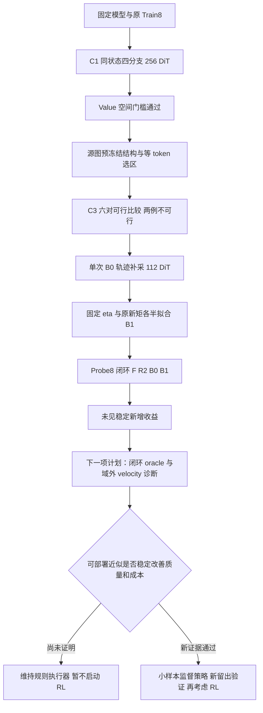

# 同状态因果诊断、结构完整扩边与单轮闭环补采研究报告

2026-10-23，Asia/Shanghai。原版 Qwen-Image-Edit + 原版对应 Lightning8 LoRA；zeta 单卡 H800。代码基点 `4222cd5955b8033842748a7d676a5d180ab4c22d`。本报告记录实际完成的 C1 → C3 → C2，实验原始文件独立保存。

## 摘要与当前决定

本轮验证了“旧上下文读取存在可修复误差”，但尚未验证“结构闭合或一次 Value 补采能够稳定改善最终编辑”。C1 的真实新鲜 V 注入使活动区域速度预测 SSE 平均下降 **83.3925%**，真实新鲜 KV 在本次检查中使活动预测误差归零；不过非活动区域仍保留旧 velocity，其误差约占原完整目标误差的 **32.6953%**。这一结果允许一次 Value 补采，不等于最终图像质量提高相同比例。

源图预冻结、严格等 token 的 CLOSE/PLAIN 对照中，6 对有 2 对 LPIPS 改善、3 对变差、1 对完全相同，数值质量合格仍为 1/6。单轮 B0 轨迹补采与固定正则 B1 拟合后，Probe8 上 B1/B0 的平均 LPIPS 为 0.085612/0.087461，只有 3/8 改善，合格数同为 4/8。两项均值收益主要受儿童一例影响，边界失败未普遍消除。

**决定：保留执行器与因果证据；停止本轮重复补采、调正则或扩大训练，不启动策略学习、RL 与 SGLang 移植。下一项应先验证闭环 oracle 的终图上限，判断是否必须同时修复域外 velocity。** 该下一项目前只是计划，尚未消耗模型调用。

本轮共 **78 个成功 pipeline 请求、864 次真实 DiT、0 推理失败**；其中 96 次 dense donor、16 次预热 DiT 已包含在总数中。另有 220 次 CPU 随机微型模型 forward，不混入真实模型计数。Train8 与 Val16 原冻结清单共 660 个文件的哈希复核通过。

## 1 研究问题与实验边界

用户提出的“将编辑区域扩展到边界更清晰、接触结构更完整的位置”具有可检验的机制基础：被编辑对象与接触对象共享遮挡、支撑、轮廓及纹理关系。但源图中结构完整的区域不必等于生成后的完整运动范围；计算域外的旧预测也可能在解码后产生矩形边界。空间完整性与时间一致性需分别验证。

本轮保持原全局上下文局部执行器：首尾两步全量，中间六步仅更新选中目标 token 的 Q/K/V 与 MLP；条件图和文本仍计算，attention 仍可读取全部目标 KV。未活动目标复用缓存 K/V 和 velocity。没有把裁剪后放回、减少扩散步数或改变底座当成算法收益。

F 是相同权重、时间表、随机 latent 的完整八步输出。LPIPS/F 是对 F 的一致性指标，不能单独衡量指令完成度。F 自身的“酱汁池”“象鼻喷水位置错误”也必须保留。

固定设置：BF16、1024×1024、batch=1、CFG=1、4096 目标 token、4096 条件 token、60 个 DiT block，seed=2026102201；原 sigma 调度、模型实际 BF16 timestep 均核对。模型与 LoRA 哈希、包版本及请求配置见 `data/environment_*.json` 和 `data/preregistration_*.json`。未量化、未 offload、未 compile；GPU 驱动名为 NVIDIA L20Y、CC9.0，物理 H800 由用户确认。

## 2 数据隔离与执行顺序

| 用途 | 独立源图数 | 范围及约束 |
|---|---:|---|
| C1 与 B0 轨迹补采 | 8 | 原 Train8；补采仍是同八图，不能写成 Train16 |
| C3/C2 Probe8 | 8 | 原冻结 Train16 排名 9–16，未参与系数拟合；训练内部机制探针，不是正式 Test |
| 原 Val16 | 16 | 本轮不重跑、不调整原结果；已看过，后续不能再称全新盲测 |
| Test64 | 64 个封存 ID | 本轮未读媒体、未生成、未用于选择方法 |

Probe8 为 101594、65261、139294、398172、175520、5142、185890、495435。仅取训练源图、指令与 mask，72 次 HTTP Range 请求均成功，451185328 字节；未请求 target 列。与 Train8、Val16、旧 demo 及 Probe 内的源图重复检查通过，未替换任何预选 ID。

C1 于 17:46:47 完成；结构区域于 **17:48:53 +08:00** 冻结，早于任何 Probe8 输出；随后 C3 完成，才启动 C2。补采于 18:05:09 完成，C2 生成于 18:09:47 完成，分析于 18:10:16 完成。各阶段原始时间见状态 JSON。目视检查均先于研究助手读取对应数值汇总，但配置标签可见，因此不是盲评。

## 3 C1：同状态因果干预

令活动目标为 A，非活动目标为 U，当前学生 latent 为 z_t，原始缓存为 C。对于每个源图的六个中间步，从相同 z_t 和完整缓存快照出发，比较四种读取：

| 分支 | U 上的 Key | U 上的 Value | U 上的 velocity |
|---|---|---|---|
| NONE | 旧缓存 | 旧缓存 | 旧预测 |
| B0 | 旧缓存 | 原冻结逐通道仿射校正 | 旧预测 |
| V_ORACLE | 旧缓存 | 同状态密集 donor 的真实新鲜 V | 旧预测 |
| KV_ORACLE | 同状态 donor 的真实新鲜 K | 同状态 donor 的真实新鲜 V | 旧预测 |

K 捕获于 QK 归一化与全局 RoPE 之后；V 为 attention 前的 raw Value。干预仅改 attention 临时拼接读取，不回写原缓存。每个中间步只执行一次密集 donor，供三个分支共用。只有 NONE 推进正式 scheduler；其余是同状态诊断。

对于图 i、分支 m，定义活动误差及相对收益：

$$
E_{i,A}^{(m)}=\sum_{t=1}^{6}\|\hat u_t^{(m)}[A]-u_t^{D}[A]\|_2^2,
\qquad g_{i,A}^{(m)}=1-\frac{E_{i,A}^{(m)}}{E_{i,A}^{(NONE)}}.
$$

汇总是八个源图的 g 等权平均，六个步不充当六个独立样本。另计算 BF16 一步 Euler 输出误差、全部目标误差与 U 的误差。预登记筛查条件为 V_ORACLE 平均活动 SSE 收益≥10%，且至少 6/8 图改善、有限值和状态检查全部通过；该条件仅决定是否投入一次补采。

| 分支 | 活动 velocity SSE 平均下降 | 活动一步 Euler SSE 下降 | 全目标 velocity SSE 下降 | 活动改善图数 |
|---|---:|---:|---:|---:|
| B0 | 78.4372% | 84.9157% | 55.2306% | 8/8 |
| V_ORACLE | 83.3925% | 89.4822% | 57.3391% | 8/8 |
| KV_ORACLE | 100.0000% | 100.0000% | 67.3047% | 8/8 |

解释：Value 读取有明确可修复空间；在真实新鲜 V 已给定时，再提供新鲜 K 可进一步消除本次活动误差。两者是条件干预，不能用两列差值宣布 Key/Value 的可加独立贡献。KV 的活动误差为零也没有修复 U 的旧 velocity，因而完整目标仍有误差。8 图 B0 在同状态上已经很强，但旧 Val16 没有稳定终图优势，说明代理指标与闭环目标存在差距。

正确性：64 步的输入、NONE 预测与 Euler 后 latent 三组哈希和旧 Train8 一致；8 张 NONE PNG 完全复现。所有层缓存、velocity、年龄、trace、输入与 RNG 的分支隔离通过；分支的非活动原始 KV 未被改写。C1 账本 512 个调用开始/结束事件，对应 256 次真实 DiT，见 [C1 详报](02_C1因果诊断结果.md)。

## 4 C3：结构闭合与等 token 普通扩张

### 4.1 选区算法和预算

从源图和指令标注编辑单元及一跳直接接触/支撑结构 H；将其栅格化到 16×16 像素的 token 网格，增加 2-token halo，与原 R2 并集：

$$
A_C=R_2\cup\operatorname{Dilate}_{\infty}(\operatorname{Raster}(H),2),
\qquad B=|R_2|+\left\lfloor\frac{N-|R_2|}{4}\right\rfloor.
$$

若 |A_C|>B，记录不可行，不截断结构，也不改预算。普通选区 A_P 按到 R2 的欧氏距离升序、同行优先索引打破并列，选取恰好 |A_C| 个 token。因此两者在每个局部步和每个层的活动目标 token 数严格相同；全局 KV 长度、文本与条件图计算相同。人工源图标注目前只是机制先验，不是已实现的自动选区方法。

评价始终使用原 R0、band1/2/4 和 far=~R2，不因为候选扩张而缩小远背景评价区。儿童接触成人/风筝、大象喷水空气走廊等标注有主观不确定性，均在标注文件保留。

| ID | R2 token | CLOSE=PLAIN token | 固定上限 B | 状态 | 两区域对称差 token |
|---|---:|---:|---:|---|---:|
| 101594 | 2744 | 3032 | 3082 | 可行 | 400 |
| 65261 | 3904 | 3983 | 3952 | 超预算，两候选均跳过 | 94 |
| 139294 | 1323 | 1408 | 2016 | 可行，相同区域控制 | 0 |
| 398172 | 456 | 899 | 1366 | 可行 | 374 |
| 175520 | 714 | 963 | 1559 | 可行 | 88 |
| 5142 | 598 | 1614 | 1472 | 超预算，两候选均跳过 | 1132 |
| 185890 | 154 | 604 | 1139 | 可行 | 618 |
| 495435 | 1700 | 1934 | 2299 | 可行 | 214 |

区域文件 SHA256：`5ae175c07a7d7cdb7c8bba04ce81c0b46afcb1efe71b8176ec01b76637c6d9d1`。真正提供不同形状比较的是 5 例；139294 两种输出 PNG 完全相同，确认索引执行一致。

### 4.2 等预算结果

下表严格取两种扩边均可行的相同六图，避免将 R2 的八图均值与候选六图均值混比。

| 配置 | 平均 LPIPS/F ↓ | 平均 band2 MAE/F ↓ | 固定数值合格 | 单次端到端中位数/s | 描述性几何平均节时 |
|---|---:|---:|---:|---:|---:|
| F | 0 | 0 | 6/6 | 6.8044 | 0 |
| R2 | 0.113511 | 0.056538 | 1/6 | 6.0890 | 10.66% |
| PLAIN | 0.105315 | 0.053501 | 1/6 | 6.0944 | 10.10% |
| CLOSE | 0.090066 | 0.058070 | 1/6 | 6.0746 | 10.17% |

| ID | CLOSE−PLAIN：LPIPS/F ↓ | CLOSE−PLAIN：band2 MAE/F ↓ | 数值合格数量变化 |
|---|---:|---:|---:|
| 101594 | −0.134752 | −0.000275 | 0 |
| 139294 | 0 | 0 | 0 |
| 398172 | +0.041029 | +0.027844 | 0 |
| 175520 | +0.001304 | +0.001416 | 0 |
| 185890 | −0.000312 | −0.001159 | 0 |
| 495435 | +0.001234 | −0.000412 | 0 |

平均 LPIPS 差为 −0.015250，但中位差为 +0.000617；排除儿童的**事后敏感性分析**为 +0.008651，方向反转。该排除不改变主结果、不用于删样本；只是揭示均值受单例驱动。平均 band2 MAE 反而上升 0.004569。故尚无稳定结构闭合收益，也没有新增质量过门案例。

PLAIN/CLOSE 每例仅测一次，另有一次旧训练源 F 预热。相同区域的两请求也出现约 0.096 秒差异，体现单次时延波动；不能宣称 CLOSE 比 PLAIN 更快。人工标注时间不在端到端内，因此此表是给定区域执行成本，不是自动结构系统成本。

目视检查中，扩边减轻儿童上方淡化带，却未消除背景竖条；大象 CLOSE 的水流方向发生变化，但水源物理关系仍错误；文字相同区域对照仍有白底亮度带。完整逐例记录见 [C3 目视检查](03_C3目视检查记录.md)。

## 5 C2：一次真实 B0 轨迹补采与 B1 拟合

### 5.1 算法与成本

C1 通过预登记门槛后，补采器实际执行 B0 读取校正，原 Train8、ROI、latent、每层 128 个非活动采样索引保持一致。每图 8 次学生前向和 6 次同状态 dense donor。x 取未改写的 raw 缓存，y 取 B0 当前学生 z_t 上的 dense raw V；补采不能只重命名旧 NONE 采集器。

对每源图的原/新原始矩 M=(E[x],E[y],E[x²],E[xy],E[y²]) 进行 1/2 混合，再对八个源图等权聚合，而不是把 16 条轨迹当成 16 个独立源图：

$$
M_i^{mix}=\tfrac12M_i^{NONE}+\tfrac12M_i^{B0},\qquad
\bar M=\tfrac18\sum_{i=1}^{8}M_i^{mix}.
$$

按 layer、current、anchor、channel 计算保持 identity 先验的闭式岭回归：

$$
\lambda=0.01\,\operatorname{MeanChannel}(\operatorname{Var}(x))+\epsilon,
\quad \alpha=\frac{\operatorname{Cov}(x,y)+\lambda}{\operatorname{Var}(x)+\lambda},
\quad\beta=E[y]-\alpha E[x],\qquad\widetilde V=\alpha\odot V_{cache}+\beta.
$$

eta 固定为原 B0 的 0.01，没有新搜索；未观测时间对回退 identity。真实覆盖仍为 360 个 layer/current/anchor 组合，首尾步不用补偿。主模型梯度更新为 0。B1 文件 50,242,347 字节，SHA256：`2b31ba98e2329db46661110effe3420c79544439987839427d289201656eb8bc`。

补采 112 次 DiT；拟合、保存及代理评估约 6.41 秒、0 次 DiT。B0 与 B1 的训练分布 raw-V 归一化 SSE 如下，均为 **in-sample 代理**：

| 分布 | B0 | B1 | 解释 |
|---|---:|---:|---|
| 原 NONE | 0.651809 | 0.651884 | 略变差 |
| 新 B0 on-policy | 0.651824 | 0.651298 | 小幅改善，约 0.081% 相对下降 |
| 1/2 混合 | 0.651810 | 0.651589 | 小幅改善，约 0.034% 相对下降 |

代理本身的增益也很小，不能解释为大幅修复了闭环分布错位。

### 5.2 Probe8 结果

本轮重新运行 F/R2/B0/B1，并让 B0/B1 表在所有配置下共同驻留；不借用 C3 的延迟。8 图的 F/R2 共 16 张输出与 C3 逐 PNG 哈希完全一致。B1 未使用 Probe8 拟合。

| 配置 | 平均 LPIPS/F ↓ | 平均 band2 MAE/F ↓ | 固定数值合格 | 单次端到端中位数/s | 描述性几何平均节时 |
|---|---:|---:|---:|---:|---:|
| F | 0 | 0 | 8/8 | 6.8493 | 0 |
| R2 | 0.098427 | 0.052241 | 2/8 | 6.0497 | 10.33% |
| B0 | 0.087461 | 0.036769 | 4/8 | 6.1948 | 9.06% |
| B1 | 0.085612 | 0.036794 | 4/8 | 6.1170 | 9.39% |

| ID | R2 LPIPS | B0 LPIPS | B1 LPIPS | B1−B0 | B0/B1 数值门槛 |
|---|---:|---:|---:|---:|---|
| 101594 | 0.269747 | 0.250671 | 0.233169 | −0.017502 | 均未过 |
| 65261 | 0.001114 | 0.000958 | 0.001041 | +0.000084 | 均通过 |
| 139294 | 0.030890 | 0.006752 | 0.006763 | +0.000011 | 均通过 |
| 398172 | 0.295599 | 0.294370 | 0.294884 | +0.000514 | 均未过 |
| 175520 | 0.039610 | 0.020200 | 0.022309 | +0.002108 | 均未过 |
| 5142 | 0.105236 | 0.102192 | 0.102299 | +0.000106 | 均未过 |
| 185890 | 0.005508 | 0.005284 | 0.005283 | −0.000000084 | 均通过 |
| 495435 | 0.039708 | 0.019258 | 0.019146 | −0.000112 | 均通过 |

B0 在本 Probe8 上相对 R2 的 LPIPS 全部下降，文字和蛋糕新增数值过门，这是训练内部探针的局部正结果；本矩阵没有 PRIOR，不能据此改写原 Val16 中“学习未可靠优于先验”的结论。

B1 相对 B0 的平均 LPIPS 仅下降 0.001849，逐例 3 改善、5 变差；其中背景人物的下降仅约 8.4e−8，不具备实际可见收益证据。中位差为 +0.000047，排除儿童的事后均值差为 +0.000387。band2 均值略变差，过门例数不增。儿童接缝、大象喷水连接、猫的外观偏移均仍在，见 [C2 目视记录](05_C2目视检查记录.md)。

每配置只有一次正式耗时，B0/B1 的毫秒级或百分比差不作显著加速结论。当前表不能证明 B1 达到稳定 10% 净节时或质量非劣性；大面积蒸笼案例的局部路径甚至略慢于 F。

## 6 调用账本与复现审计

| 阶段 | Pipeline 请求 | 真实 DiT | 其中 dense donor | 其中预热 DiT | 状态 |
|---|---:|---:|---:|---:|---|
| C1 | 8 | 256 | 48 | 0 | 完成；144 次探针分支已含在总数 |
| C3 | 29 | 232 | 0 | 8 | 28 主请求，1 旧源预热；2 超预算候选对跳过 |
| C2 补采 | 8 | 112 | 48 | 0 | 64 学生 + 48 donor |
| C2 Probe | 33 | 264 | 0 | 8 | 32 主请求，1 旧源预热 |
| 合计 | **78** | **864** | **96** | **16** | **0 推理失败** |

另计 C1 两版随机微型检查 160 次、补采器检查 60 次，共 220 次 CPU tiny forward。此前规则预算末 419/4008，加 Train8 工程及采集 9/126、旧 Val16 320/2560、本轮 78/864，历史累计 **826 个 pipeline 请求、7558 次真实 DiT**。不同阶段重复输出、诊断与预热不能当作独立质量样本。

独立验收 `scripts/audit_stage.py` 已通过：输出/面板/矩统计/系数哈希，C1 调用账，Probe 相同 latent 和 F/R2 跨阶段确定性，等区域控制，原始区域冻结时间，补采采样索引与当前学生状态，原 Train8 201 文件及 Val16 459 文件均与冻结清单一致。拟合与指标分析未新增生成调用。H800 实验进程已退出。

实验过程中仅出现本地准备问题：首次选区脚本尝试导入本地缺失的 SciPy，在任何区域写入前停止，改用 NumPy 距离计算后冻结；文档辅助 heredoc 编码错误未执行模型。两者都未改变预选样本、标签或真实 DiT 账本。没有模型请求失败或失败后删样本。

关键文件：`data/summary_c1.json`、`data/summary_probe_c3.json`、`data/fit_b1_summary.json`、`data/summary_probe_c2.json`、两份 `quality_probe_*.csv`、四份 `runs_*.jsonl`、`data/final_audit.json`。完整数据与大二进制文件保存在本地及 zeta，本轮未自动提交或推送 Git。

## 7 已完成进度与后续门槛

| 项目 | 状态 | 当前验收结论 |
|---|---|---|
| C1 代码、微型检查、真实 256 DiT | 已完成 | 支持 Value 因果空间；不等于图像质量证明 |
| Probe8 源图 QC、源图结构标注冻结 | 已完成 | 8 例保留；6 可行、2 超预算 |
| C3 等预算闭环比较 | 已完成 | 结构闭合优势不稳定；不进入自动结构学习 |
| 一次 B0 补采与 B1 拟合 | 已完成 | 固定 eta=.01，无新增源图、无主模型训练 |
| C2 Probe8、图像与数据审计 | 已完成 | 无稳定 B1 增量；停止本轮迭代补采 |
| 重复计时、多种子、新独立验证 | 未执行 | 先有可部署机制改善再投入 |
| 策略学习、RL、SGLang | 未启动 | 不满足进入条件 |

### 7.1 下一项最小诊断：C4（计划，未执行）

优先判断“即使缓存上下文精确，旧域外 velocity 是否仍限制终图”。预选原 Train8 顺序前四图，保留全部，不按本轮失败筛选。固定原 R2、seed 和八步，比较 F、NONE、闭环 V_ORACLE、闭环 KV_ORACLE、闭环 KV_ORACLE+新鲜域外 velocity。后三者各自用自己的当前 z_t 查询 donor，各自推进 scheduler，不能复用另一分支的 donor。

计划成本为每图 8+8+14+14+14=58 次 DiT，四图 **232 次 DiT**，其中 72 次 donor；诊断不测部署延迟，不增加预热。KV+velocity 作为完整预测与 F 对齐控制。若上下文 oracle 仍留严重边界失败，而加入域外 velocity 才恢复，优先修复背景演化/刷新一致性；若 V 闭环明显改善，再考虑条件化校正表示；若 V 与 KV 均无可用终图优势，则停止只修读取的主线。该实验的真正可部署近似另行记成本，oracle 不能当加速方案。

### 7.2 接下来十个工作日（条件计划）

日期为资源暂排，均未执行；不因排期到了而跳过证据门槛。

| 日期 | 任务 | 预算/验收与停止条件 |
|---|---|---|
| 10-26 | 固定 C4 分支、232 次预算和质量评价；补齐闭环 oracle 正确性 | 先确认所有 donor 使用本分支当前状态；实现检查不增加真实模型试跑 |
| 10-27 | 执行 C4 与终图诊断 | 四个预选训练源，全部保留；不把 oracle 时延当部署加速 |
| 10-28 | 判断读取误差与旧域外 velocity 的闭环影响 | 没有终图上限改善则收缩 Value 主线；不盲目增大 B1 样本量 |
| 10-29 | 若存在上限，设计一种最小可部署近似 | 条件校正或少量刷新二择一；预算与固定基线先登记，prefix 上游成本必须计入 |
| 10-30 | 有条件的训练侧小规模筛查 | 同八源、限定一个版本；代理和终图不一致就停止该分支 |
| 11-02 | 有质量信号才做同期重复计时 | F/R2/PRIOR/B0/冻结新候选；给定相同模型/表/自动选区成本口径 |
| 11-03 | 只有前项通过才登记新留出集 | 已看过的 Probe8/Val16 不重新标成盲测；Test64 继续封存 |
| 11-04 | 新留出闭环、多种子及编辑/边界盲评 | 源图为统计单位，语义失败单列；不以 LPIPS 单指标宣布无损 |
| 11-05 | 基线和贡献复核 | 检查收益是否超过 PRIOR、普通扩张或额外刷新，而非只来自更多计算 |
| 11-06 | M1 继续/修订/停止决策 | 仍无稳定质量—时间收益则保留负结果并调整方法范围；不进入 RL |

### 7.3 八个月计划的调整

仍沿用 2026-10-22—2027-06-21。M1 的 Train8 拟合、Val16、C1/C3/C2 已提前完成，剩余重点是闭环上限与可部署误差修复，不重复做已失败的单轮补采。M2 保留公平复现 RegionE/SpotEdit/LinCa；M3 的学习曲线以可部署方案通过为前提；M4 做结构/刷新消融。M5–M6 的 SGLang 迁移与 M7 的 RL 均依赖 Diffusers 质量和净延迟先过门；条件不满足就删除相应模块，将时间用于失效分析、基线与论文。M7 封存方法后才做 Test，M8 完成复现和论文归档。

RL 目前既缺稳定的基础校正器，也缺能预测真实闭环收益的动作标签。后续若启动，必须有同预算规则、监督学习和等教师查询的增量监督对照；不能通过增加区域或教师调用获得收益后归因于 RL。

## 8 结论边界

目前最有价值的新证据是：活动分支对旧 KV 有明确敏感性，真实新鲜 KV 可以恢复当前状态的活动预测，但域外旧 velocity 和闭环传播仍未解决。当前人工结构闭合与固定逐通道 Value 仿射模型的单轮补采，都不足以支撑“稳定无损局部加速”的论文结论。

方向仍可继续做机制研究；近期主任务应从扩大训练和策略复杂度收缩为**建立闭环可修复上限，并找到能在真实计算预算下逼近它的最小方案**。
