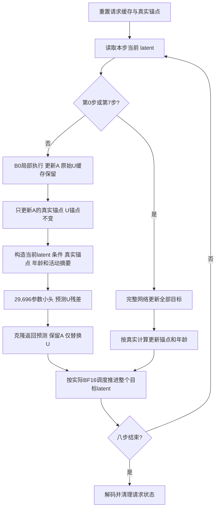

# 局部图像编辑中的域外速度误差：闭环因果诊断与小样本残差学习

2026-10-23 · Qwen-Image-Edit + Lightning8 · zeta 单卡 H800

**本稿状态：**C4b、Train8同状态采集、一次固定小头训练及六配置Probe8已完成。训练误差下降，但闭环质量门未通过，预留192次重复计时按规则跳过，RL未启动。最终结论：保留域外velocity机制假设，停止当前固定B0标签U-only头的扩展，下一轮先登记误差来源诊断。

## 摘要

前阶段 C4 表明，真实新鲜 Key/Value 可以恢复局部活动目标的同状态预测，但不能独自消除完整八步轨迹的偏差。为辨别域外旧 velocity 的独立作用，本阶段对原 Train8 前四源图追加“旧 KV + 新鲜域外 velocity”的独立闭环对照 C4b，共完成 **4 个请求、56 次真实 DiT，其中 24 次同状态教师前向，零推理失败**。相对原 NONE，四源 LPIPS/F 均下降，均值由 0.168465 降至 0.071990，逐源比值的几何均值为 0.549571；公共 band2 MAE 的配对差中位数为 −0.002103。C4b 通过预登记的探索筛查，但仍为 **0/4 严格数值合格**，且局部布局、字形和水纹错误保留。

域外速度修复有可进一步研究的空间，但“速度单头足够”尚不成立：与 KV_ORACLE 相比，VEL_ORACLE 虽有较低的全图 LPIPS 算术均值，却仅一源改善、三源变差，配对差中位数为 +0.020647，band2 误差四源均更大。源图中的局部上下文与域外演化需要同时考虑，不能用一个均值宣布 KV 已不重要。

按预先登记的分支规则，本轮冻结一个以 B0 为执行基底、仅修正非活动目标 velocity 的 29,696 参数残差头。其训练标签来自八个原训练源、每源六个 B0 当前状态，共 48 条状态记录。底座冻结，只离线训练小头；选择固定最终检查点，最多 2000 次更新或 3600 秒优化窗口。实测优化49.503秒完成2000更新，训练内域外速度MSE下降32.97%。但Probe8相对B0仅1好7坏，LPIPS均值0.087461升至0.092324，数值合格4/8降至3/8，边界误差增加。故按冻结门停止条件计时；训练收益没有转化为可靠闭环编辑收益。

## 1 研究问题与证据边界

设局部执行区域为 A，非活动目标集合为 U。当前执行器在首尾两步更新全部目标，中间六步仅重新计算 A 的目标特征；文本与条件图仍更新，attention 仍读取全局目标 KV。U 使用旧 KV 和旧 velocity。旧上下文会影响活动区预测，旧 velocity 则直接影响域外 latent 的后续演化。

C1 采用同一 NONE 状态分支，C4 改为不同干预各自闭环。本轮 C4b 补齐其中缺少的 velocity-only 对照，而不是重复原实验。完整八步输出 F 是同一 Lightning8 模型的参照，不是真实编辑标注或原始 50 步模型。逼近 F 的数值保真不等于遵循指令更好；教师本身的过度编辑和错误也可能被继承。

本文只使用内部实验数据，不新增外部文献检索。前序机制和限制以 [C4 报告](../闭环Oracle与域外速度诊断_20261023/02_闭环诊断结果与训练决策.md) 及 [C1/C3/C2 报告](../因果诊断与结构扩边_20261023/04_阶段总结与后续计划.md) 为依据。

## 2 C4b：保持旧 KV 的域外速度干预

### 2.1 数据与执行合同

固定原 Train8 顺序前四源：405994（球棒文字）、301232（红酒）、544811（右侧黑鸟）、253960（披萨换蛋糕）。不按失败程度重新选图，不扩区域。模型、源图、指令、原 R2、初始 latent、seed=2026102201、CFG=1、1024×1024 和八步时间表与 C4 一致。目标与条件图各有 4096 个 token。

四源均已用于前期机制研究和拟合，属于**四个已见训练源**。同源八个步骤、多个 token 或多个配置都不是新增独立图像样本。本轮没有读取 Test 媒体，也未使用 Val 拟合。继承 C4 的 20 张输出仅用于质量参照，不能与本轮四张输出一起记为 24 次新请求，也不能把继承耗时当作同期部署计时。

令本分支当前状态为 \(z_k^S\)，教师为冻结完整模型 D：

$$
u_k^D=D(z_k^S,\sigma_k,c),\qquad
u_k^L=\operatorname{Local}(z_k^S,\sigma_k,c;K_a,V_a).
$$

C4b 返回的目标预测为：

$$
\widehat u_k[i]=
\begin{cases}
u_k^L[i],&i\in A,\\
u_k^D[i],&i\in U.
\end{cases}
$$

上述干预只在六个中间步生效。执行器先在同一当前状态获取 dense donor，核验其未污染原缓存后，再计算真正使用旧 KV 的局部结果，克隆返回张量并仅替换 U；不注入教师 K/V，不安装 attention hook，不回写真实 KV、velocity 缓存或年龄。每一步 donor 使用本分支当时的输入，不能复用 C4 的同名时间步 donor。缓存和输入、RNG 的前后快照均参与正确性检查。

实际调度严格沿用原实现，并用回调逐步比对，不把不同精度的代数写法当成相同计算：

```python
expected = (hidden[:, :n].float() + sigma_delta * returned_prediction[:, :n]).to(returned_prediction.dtype)
assert torch.equal(actual_scheduler_latent, expected)
```

首尾步骤全量；每源 8 次学生前向、6 次教师前向，新增预算为 \(4(8+6)=56\) 次 DiT，无预热。输出、输入和 Euler 后 latent 均记录 SHA；第一步精确复现旧 NONE。诊断时间包含 donor、快照、哈希和断言，不是可部署成本。

### 2.2 评价区域与两个不同门槛

所有配置共用原始 core、band1/2/4 和固定 \(\sim R2\) 的远背景。严格数值门槛保持为：

$$
\operatorname{LPIPS}(I_m,I_F)\le0.02,
\quad
\operatorname{MAE}_{\sim R2}(I_m,I_{src})-
\operatorname{MAE}_{\sim R2}(I_F,I_{src})\le1/255.
$$

它是相对 F 的数值代理，不能代替语义成功。额外背景误差为负只说明比 F 更接近源图，不等于相对 F 更精确。

另有在 C4b 输出前冻结的**探索门**，只决定是否投入一个小头：至少 3/4 源的 LPIPS 低于 NONE；逐源 LPIPS 比值几何均值≤0.8；公共 band2 MAE 配对差中位数≤0；任何一源 LPIPS 恶化不超过0.01；结构化目视筛查未发现超出可见 F/NONE 的新增明显语义失败。所有条件同时满足，仍不是统计非劣性或部署 Go。

## 3 C4b 实测结果与局部 KV 的剩余作用

### 3.1 配对数值结果

| 源图 | NONE LPIPS/F | VEL_ORACLE LPIPS/F | 配对差 | 比值 | VEL band2 MAE | VEL extraBG | 严格数值合格 |
|---|---:|---:|---:|---:|---:|---:|---|
| 405994 | 0.407612 | 0.091219 | −0.316392 | 0.223790 | 0.131474 | +0.000620 | 否 |
| 301232 | 0.045560 | 0.034746 | −0.010814 | 0.762649 | 0.115936 | +0.000937 | 否 |
| 544811 | 0.103603 | 0.072211 | −0.031392 | 0.696995 | 0.229463 | +0.000923 | 否 |
| 253960 | 0.117086 | 0.089786 | −0.027301 | 0.766833 | 0.007842 | +0.001343 | 否 |

VEL_ORACLE 全图 LPIPS 平均下降 0.096475，配对差中位数为 −0.029346。四源的 extraBG 都通过门槛，但 LPIPS 均超过0.02，因此仍为0/4严格数值合格。band2 配对差分别为 −0.001757、−0.002449、−0.000033、−0.005877；鸟例几乎不改善。

| 配置 | 全图 LPIPS/F 均值 | band2 MAE 均值 | 严格数值合格 | 数据来源 |
|---|---:|---:|---:|---|
| NONE | 0.168465 | 0.123708 | 0/4 | 继承 C4 |
| V_ORACLE | 0.144133 | 0.040653 | 0/4 | 继承 C4 |
| KV_ORACLE | 0.119628 | 0.032023 | 0/4 | 继承 C4 |
| VEL_ORACLE | 0.071990 | 0.121179 | 0/4 | 本轮新增 |
| KV_VEL_ORACLE | 0 | 0 | 4/4 | 继承 C4；与 F 精确对齐控制 |

VEL_ORACLE 相对 KV_ORACLE 的 LPIPS 仅文字源改善，另外三源变差；配对差中位数为 +0.020647，几何均值比为1.152719。VEL 的平均 LPIPS 更低主要受到文字源大幅下降影响，不能据此认定它整体优于 KV。VEL 的 band2 误差在四源均高于 KV；鸟例为0.229463，而 KV 为0.019628。局部上下文修复对边界及编辑区域仍有重要影响。

这些是不同闭环轨迹的配对终图结果，不是可相加的同状态误差分解。KV+VEL 精确恢复 F 是组合干预的正确性控制；它不意味着一个低成本学习器已经能够同时恢复两个分量。

### 3.2 目视失败及教师错误继承

下述内容转述已归档的八幅全图/裁剪面板审阅，配置标签可见，由研究助手完成，不是独立人工盲评。详见 [结构化语义记录](data/semantic_review_c4b.json)。

| 源图 | 已观察现象 | 对结论的限制 |
|---|---|---|
| 文字 405994 | VEL 保留 NONE 的局部 BAT 和异常字形，并增加顶部 BAT、背景重绘；这些变化在 F 中已有 | 相对 NONE 的背景保持变差；全图 LPIPS 下降不能等同文字编辑更正确 |
| 酒杯 301232 | VEL 保留 NONE 较大的酒杯排列，未恢复 F 的大小、位置 | 未新增明显物体类别错误，但局部布局尚未修复 |
| 鸟 544811 | VEL 保留右鸟位置/姿态差异及局部水纹重绘；左鸟也变黑 | 左鸟改变在 F/NONE 中已存在，属于继承错误；接近 F 不保证只编辑右鸟 |
| 蛋糕 253960 | VEL 保留 NONE 的三角蛋糕，背景更接近 F，纹理与形状仍不同 | 未新增明显类别错误；仍不能通过严格保真门槛 |


探索门的语义条件被记录为通过，含义仅是“相对可见 F/NONE 未发现新增明显失败类别”。它不清除既有错误，不表示四源都符合原指令，也不把继承 F 的过度编辑视为新的优点。

### 3.3 探索决策

| 探索条件 | 预登记阈值 | 实测 | 判定 |
|---|---:|---:|---|
| 相对 NONE 的 LPIPS 改善源数 | ≥3/4 | 4/4 | 通过 |
| 源级 LPIPS 比值几何均值 | ≤0.8 | 0.549571 | 通过 |
| 公共 band2 MAE 配对差中位数 | ≤0 | −0.002103 | 通过 |
| 最大逐源 LPIPS 恶化 | ≤0.01 | −0.010814，即全部改善 | 通过 |
| 新增明显语义失败类别 | 0 | 结构化审阅记为0 | 探索筛查通过 |

[decision_c4b.json](data/decision_c4b.json) 在2026-10-23 20:54:41 +08:00 将下一候选冻结为 `scope=inactive`。数值汇总是在目视记录合并前生成，故 [summary_c4b.json](data/summary_c4b.json) 内仍保留语义待审的中间状态；最终探索决定以独立 decision 文件及其引用的语义记录为准，不能把中间字段覆盖成事前已知。

## 4 冻结候选：B0 基底的域外 velocity 残差头

### 4.1 选择 B0 的依据及限制

本轮 C4b 基底是 NONE，并未测量 B0+fresh-U-velocity 的上限。选择 B0 是沿用 C1 中已观察到的活动预测误差修复能力，希望在保留该修复的同时训练域外更新；它属于预登记的工程选择，不是 C4b 已验证 B0 组合更优。旧 Val16 中 B0 未可靠优于先验的结论保持不变。

只实现并训练一个 inactive 候选，不扫描多个模型后取最好者。若 C4b 未通过，原协议允许的全目标候选并未在本轮被选用；即使源码支持 `scope=all`，也不能记为另一项已执行训练。

### 4.2 状态、锚点与部署可观测特征

设 \(a_i\) 为目标 token i 最近一次真实局部网络更新的步数；真实锚点为 \(z_{a_i,i}\) 和 \(u_{a_i,i}\)。每个中间步先执行 B0 局部网络，得到 \(u_k^S\)。真实更新的 A 将锚点更新为当前 latent 与当前 B0 输出；U 的锚点保持不变。因此年龄为 \(k-a_i\)，A 为0，当前固定 R2 设置下 U 的锚点来自第0步。

输入特征为六组64维向量和四个标量：

$$
\phi_{k,i}=\left[
z_{k,i},z_{a_i,i},z_{k,i}-z_{a_i,i},u_{a_i,i},c_i,
\overline u_{k,A}^S,
\sigma_k,(k-a_i)/7,\mathbf1_{i\in A},\operatorname{clip}(d_i,-32,32)/32
\right],
$$

$$
\overline u_{k,A}^S=|A|^{-1}\sum_{j\in A}u_{k,j}^S.
$$

其中 \(c_i\) 为已存在的条件图 latent，\(d_i\) 为固定 A 的有符号距离，A 内负、U 内正；活动速度摘要在本步 B0 局部前向后计算。输入不包含教师速度、教师图像或域外当前深层 hidden state。每个目标 token 为64通道，排列在64×64的 packed latent token 网格上，邻域操作不是直接在 RGB 像素上执行。

### 4.3 模型与输出

$$
r_\theta=\operatorname{Conv}_{1\times1}^{64\to64}\left(
\operatorname{SiLU}\left(
\operatorname{DWConv}_{3\times3}^{64}\left(
\operatorname{SiLU}\left(\operatorname{Conv}_{1\times1}^{388\to64}(\phi)\right)
\right)\right)\right).
$$

含 bias 的参数量为24,896+640+4,160=**29,696**。网络以 FP32 计算，最后输出层权重和 bias 置零，其余层随机初始化；初始输出因此严格复现 B0 的目标预测，不把所有层同时置零而阻断学习。

$$
\widetilde u_{k,i}=
\begin{cases}
u_{k,i}^S,&i\in A,\\
u_{a_i,i}+r_\theta(\phi_k)_i,&i\in U.
\end{cases}
$$

正式返回前转换为原学生 velocity 的 dtype。整个返回张量先 clone，条件图预测保持原值；模型预测的残差不写入真实 velocity 缓存，不更新真实年龄，也不写入 K/V。下一步仍以最近真实计算的锚点为基底，避免将一次预测再当成真实观测累加。首尾全量步不调用小头，中间六步各调用一次。

## 5 同状态教师采集与实际训练损失

### 5.1 八源、四十八状态，不是四十八独立样本

冻结训练源为405994、301232、544811、253960、315467、355272、257102、271359。每源运行一条 B0 八步轨迹，在六个中间步查询一次当前学生状态的完整教师：

$$
u_{k,i}^D=D(z_k^{B0},\sigma_k,c)_i.
$$

学生仅按自己的 B0 输出推进，教师用于标注，不参与采集轨迹。计划8×(8+6)=**112次真实 DiT**，保存8份数据、48条状态记录。每条记录包含完整低维目标网格、学生/教师速度、真实锚点、mask、年龄与距离；不沿用只含逐通道矩的旧 B1 文件作为动态头样本。

八个源图才是独立来源。六步及4096个 token 强相关，不能将其当成48幅图或数十万个独立训练样本。采集要求逐步输入、B0 预测、Euler 后 latent 和最终 PNG 精确复现上阶段 B0 on-policy 记录。采集已全部通过，实测验收见第8.1节。

### 5.2 已实现的 U-only 损失

令 \(\langle\cdot\rangle_U\) 表示在 U 的 token 与通道上求均值，\(\Delta\sigma_k<0\)。每条状态的速度项与理想一步项为：

$$
E_U=\left\langle(\widetilde u-u^D)^2\right\rangle_U,
\quad
s_U=\operatorname{stopgrad}\max\left(\left\langle(u^D)^2\right\rangle_U,10^{-6}\right),
$$

$$
\mathcal L_{vel}=E_U/s_U,
\qquad
\mathcal L_{step}=(\Delta\sigma_k)^2E_U.
$$

一步项不再用含 \((\Delta\sigma_k)^2\) 的分母抵消时间权重。当前 inactive 范围仅优化 U；不能将其描述为已经通过反向传播优化了 A 的网络预测。

令 \(\partial A\) 为 packed token 网格中水平/垂直跨越 A/U 的相邻对。用 FP32 构造训练代理 \(z'_S=z+\Delta\sigma_k\widetilde u\)、\(z'_D=z+\Delta\sigma_ku^D\)，定义：

$$
E_{edge}=\operatorname{Mean}_{(i,j)\in\partial A,\,channel}
\left|[(z'_{S,i}-z'_{S,j})-(z'_{D,i}-z'_{D,j})]\right|,
$$

$$
s_{edge}=\operatorname{stopgrad}\max\left(
\operatorname{Mean}_{(i,j)\in\partial A,\,channel}|z'_{D,i}-z'_{D,j}|,10^{-3}\right),
$$

$$
\boxed{\mathcal L=\mathcal L_{vel}+\mathcal L_{step}+0.1\,E_{edge}/s_{edge}}.
$$

边界项匹配教师的一步跨界梯度，不要求边界差为零，也不强制域外等于源图。真实边缘、阴影或接触变化可以保留。所有缩放项停止梯度；训练 FP32 一步项是可微代理，正式验收仍使用实际 BF16 scheduler，不宣称两者舍入完全一致。

固定源 i 的六条记录等权，完整目标为 \(\frac18\sum_i\frac16\sum_{k=1}^{6}\mathcal L_{i,k}\)。实现每更新选择一个源，对其六状态累计平均梯度；每八更新将八源各访问一次并重新打乱。状态内像素多不提高该源的权重。底座不参与反向传播，不加载教师进行优化，也没有八步端到端梯度展开。

### 5.3 冻结训练合同与停止规则

[training_contract.json](data/training_contract.json) 冻结于2026-10-23 20:54:41 +08:00：

| 项目 | 冻结值 |
|---|---|
| 执行基底 / 预测范围 | B0 / inactive，仅 U |
| 候选数 / 参数量 | 1 / 29,696 |
| 训练随机种子 | 2026102309 |
| 优化器 | AdamW，lr=0.001，weight_decay=0.0001，不做梯度裁剪 |
| 最大优化更新 | 2000 |
| 优化窗口预算 | 3600秒；每更新前检查已耗时间及上一更新耗时，不启动预计越界的下一更新 |
| 检查点 | 初始、固定中点、最终；中点为首次到1000更新或1800优化秒；若提前结束，按实现保存停止点中间快照 |
| 用于 Probe 的模型 | 固定最终检查点，不按 Probe 选择最佳检查点 |
| 完整模型查询 / 反向传播 | 离线拟合阶段0次 DiT；只训练小头 |
| 数据约束 | 8源、48记录，Test不参与，Probe不用于拟合或挑检查点 |

3600秒是优化窗口，不是含数据读取、初始/中点/最终损失快照与保存的总作业耗时；实际完成更新、窗口时间、快照时间和总墙钟时间都必须分别报告。按2000更新的上限，训练小头前向/反向各最多12,000次，三次全数据快照各48次、共144次小头前向；这些都不计为真实 DiT。

拟合前核验合同 FROZEN、CLI scope、2000/3600和损失权重一致；八份 `.pt` 的 SHA 与采集账本一致，payload 的合同、collector、校准 SHA 与文件一致。协议、每个检查点和最终总结均记录合同 SHA 与 scope；结束时再次检查冻结文件未改变。

## 6 八步部署流程与工程正确性



部署路径不使用 dense donor。教师只用于离线采集和诊断；把56次 C4b 的 oracle 耗时拿来说明小头速度没有意义。小头引入的特征转换、活动摘要、卷积、dtype转换、clone、索引、锚点维护及距离计算都须纳入计时。参数少不代表没有额外成本，尤其当前局部执行的节时余量并不大。

已归档两个集成正确性检查：C4b执行器76次CPU tiny forward，以及velocity runtime76次CPU tiny forward；它们均为随机微型Qwen，不是真实20B模型计算。后者检验 FP32/BF16、非连续且非排序选区、非连续文本mask，以及inactive/all零头八步精确复现无头局部输出与调度。collector同状态教师不污染自身轨迹、真实锚点、缓存或保存记录。零头正确不等于训练后的质量有效；真实 B0 表已通过八源、64步旧轨迹与8张PNG精确复现检查。

## 7 后续筛查和停止条件

冻结 Probe8 为101594、65261、139294、398172、175520、5142、185890、495435。它们未进入本轮拟合，但已被前期研究看过，因此是开发筛查，不重新称为盲测。

固定比较 F/R2/PRIOR/B0/HEAD/B250 六配置，共8×6×8=384次 DiT，另一次旧训练源 F 预热8次。相对同期 B0，训练合同要求：至少6/8源的 LPIPS 降低达到0.0001；源级LPIPS差中位数<0；严格数值通过数至少新增1；公共band2 MAE平均差≤0；无新增明确语义失败。固定最终检查点只评一次筛查矩阵，不扫描检查点、宽度或损失权重。

仅质量门通过后执行成本筛查：固定旧训练源405994，六配置各一次预热、三次交错重复，最多192次 DiT。B250是冻结规则刷新，不是等秒预算；报告实际token和质量—时间观测点，不用它冒充严格等成本。净节时目标为相对 F 至少10%，单源结果仍不足以宣布部署 Go；需要后续另行登记多源、多seed和新留出。

| 环节 | 真实 DiT预算 | 本稿可确认状态 |
|---|---:|---|
| C4b | 56 | 已完成，4请求，0推理失败 |
| B0标签补采 | 112 | 已完成8请求，0失败 |
| 离线小头拟合 | 0 | 已完成2000更新；底座不反传 |
| Probe8六配置 | 384 | 已完成48正式请求，0失败 |
| Probe统一预热 | 8 | 已完成1请求 |
| 条件成本筛查 | 192 | 质量门失败，未执行，实际0 |
| 条件上限 | **752** | 实际560，未使用192；61请求/零推理失败 |

若质量门失败，停止该候选的计时和策略扩展，保留失败数据；不因预算尚有余量而自动追加训练。RL仍未进入：先建立稳定闭环质量和重复、多源净延迟证据，再讨论刷新/扩边/回退策略。当前监督标签已经存在，不用RL代替直接回归这一首轮问题。

## 8 实测结果

### 8.1 B0标签采集与完整审计

采集完成8个请求、112次真实DiT（64次学生、48次教师），失败0。八源64步输入、预测及更新后latent，以及八张PNG全部精确复现旧B0。得到48条同状态监督记录，来源仍是8张图。独立审计至fit阶段已通过：历史978文件未变，所有数据与冻结合同匹配。

审计期间发现并修复了一个验证程序问题：CPU直接用Python float乘BF16，不能复现调度器用零维FP32张量相乘时的舍入。保留原错误审计记录后，将delta恢复为零维FP32 Tensor，48/48更新后SHA和40/40相邻状态均精确匹配，未引入容差、未改标签、未重跑完整模型。此前本地另有缺少远端status文件的同步前失败回执；两者都不是模型推理失败。最终核验和历史失败日志分别归档。

### 8.2 实际拟合结果

唯一候选为B0上的inactive头，29,696参数。完成2000次AdamW更新，每来源250次，每次均衡平均该来源六个状态；共12,000次小头前向和反向，另144次固定快照前向。优化49.503秒，快照/检查点0.635秒，读取校验0.273秒，完整fit函数墙钟52.213秒。训练过程不加载20B底座、无教师查询和完整DiT；标签采集112次DiT成本单独记账，不能把52秒说成从模型下载到全部实验的总耗时。

| 检查点 | 更新数 | U归一化速度损失 | 一步损失 | 归一化边界损失 | 合计损失 |
|---|---:|---:|---:|---:|---:|
| 初始 | 0 | 0.00647634 | 0.00013623 | 0.02350961 | 0.00896353 |
| 固定中点 | 1000 | 0.00473252 | 0.00010550 | 0.01732621 | 0.00657064 |
| 最终 | 2000 | 0.00438676 | 0.00009951 | 0.01644122 | 0.00613039 |

八源等权的原始U velocity MSE从0.00818867降至0.00548854（−32.97%），原始一步误差下降26.96%，原始跨边界梯度L1从0.01206303降至0.00855178（−29.11%）。A原始速度MSE保持0.02078151，符合本轮不训练A的设计。上述都是**固定B0标签上的训练内拟合**，不证明新闭环状态下仍有相同收益，也不能证明三个损失项各自的增量作用；本轮未做损失消融。

最终权重SHA：`9758bde7df187fc135a5b42738902718035faf73bc69e20f756024ec1b33d1d1`。只使用预定最终权重，不用Probe挑中间检查点。

### 8.3 Probe8闭环与失败案例

49请求全部完成：一次旧训练源F预热加48正式请求，共392真实DiT、0教师调用、0失败。24个F/R2/B0输出逐PNG精确复现旧Probe，静态B0表亦匹配。HEAD共调用48次小头（每请求6次），所有配置共享驻留权重和表，缓存按请求清理。评价源图和mask保持不变。

| 配置 | 平均LPIPS/F | 中位LPIPS/F | 公共band2 MAE均值 | extraBG均值 | 严格数值合格 |
|---|---:|---:|---:|---:|---:|
| F | 0.000000 | 0.000000 | 0.000000 | +0.000000 | 8/8 |
| R2 | 0.098427 | 0.039659 | 0.052241 | +0.012158 | 2/8 |
| PRIOR | 0.099853 | 0.053531 | 0.036534 | +0.011294 | 3/8 |
| B0 | 0.087461 | 0.019729 | 0.036769 | +0.011304 | 4/8 |
| HEAD | 0.092324 | 0.030498 | 0.040188 | +0.012909 | 3/8 |
| B250 | 0.077496 | 0.025259 | 0.035069 | +0.002487 | 3/8 |

F的8/8仅为自比较恒等，不能当作语义正确率。HEAD对R2有6/8下降，但其中包含B0已有贡献；相对真正的增量参照B0只有1/8下降，不能用较弱基线宣布训练成功。B250全图平均距离更低但数值合格仍3/8，也未解决全部难例。

| 来源/编辑 | B0 LPIPS | HEAD LPIPS | HEAD−B0 | B0→HEAD数值门 |
|---|---:|---:|---:|---|
| 101594 / 儿童玩沙 | 0.250671 | 0.251302 | +0.000631 | 未过→未过 |
| 65261 / 饺子加酱 | 0.000958 | 0.000978 | +0.000020 | 过→过 |
| 139294 / Welcome文字 | 0.006752 | 0.007423 | +0.000671 | 过→过 |
| 398172 / 大象喷水 | 0.294370 | 0.297619 | +0.003249 | 未过→未过 |
| 175520 / 冰箱贴纸 | 0.020200 | 0.020820 | +0.000619 | 未过→未过 |
| 5142 / 猫表情 | 0.102192 | 0.102590 | +0.000398 | 未过→未过 |
| 185890 / 移除背景人物 | 0.005284 | 0.040176 | +0.034892 | 过→未过 |
| 495435 / 盘中蛋糕 | 0.019258 | 0.017684 | -0.001574 | 过→过 |

相对B0的中位LPIPS差为+0.000625，平均差+0.004863，平均band2差+0.003419；五个数值谓词全部false。最大退化在185890：人物移除动作仍完成，但HEAD出现更明显的整体色调/亮度漂移，LPIPS从0.005283升至0.040176，额外背景误差较B0增加0.021381，丢失一个数值合格案例。其余多为小幅退化，不能把7个正差都解释成明显语义失败。

全例完整图与裁剪图均保留。儿童案例中B0/HEAD仍有大范围矩形接缝和背景重复；大象案例沿用鼻部/象牙喷水起点不合理、体形重绘；猫例仍比F更卡通化。Welcome拼写与蛋糕类别完成。加酱主要表现为笼屉底部及包子之间积聚，是否充分符合“on the dumplings”存在F/B0共有疑点；冰箱已出现贴纸/磁贴，但flags未清楚辨识。大象F本身也未明确从下垂鼻尖喷水，不能只因HEAD不同于F就归为新增失败。F不是人工真值：它的重绘及过度编辑也需要单列。

语义审核覆盖8张全图和8张裁剪图，记录1例明确新增视觉退化、0例新增物体/动作错误类别；后者不等于没有画质退化。去人案例里其他背景人物也被F/B0/HEAD共同去除，另记为共有的过度编辑风险。审核为assistant可见配置的非盲定性检查，不充当盲评成功率。


### 8.4 净延迟与最终去留决定

**质量门未通过，192次重复计时按预定规则跳过，实际0次；不启动RL。** Probe每源每配置只有一次计时，HEAD中位6.196秒、B0中位6.109秒、F中位6.848秒；源级配对几何节时描述值分别约9.11%/9.37%，没有单独充分预热和重复精度证据。这些秒数仅记录运行成本，不能用来确认稳定净节时、比较小幅头开销，或使未通过质量门的候选变成Go。

本阶段实际61请求/560真实DiT（学生488、教师72），加此前846/7790后，历史累计907请求/8350DiT，其中dense教师366次。152次CPU随机微型模型前向、纯小头训练与数值回放另列，不混入真实DiT。最终独立审计通过，历史978文件均保持不变。本阶段没有额外模型重试、正式Test、新来源训练或部署RL。

决策为**停止当前候选的扩展，修订研究假设**。保留唯一最终权重和负结果；不追加epoch、不以Probe选择别的checkpoint、也不移动6/8或质量门。后续先在Train内登记有限HEAD自身轨迹诊断，区分新状态分布偏移、未观测全局信息/头容量不足和活动区KV残差。当前数据尚不能区分这些原因，不能直接断言再多训练必然有效。

## 9 当前可支持的结论

C4b补足了旧KV条件下域外速度的闭环干预证据：四个已见源相对NONE的全图LPIPS均改善，支持投入一个有界的小头筛查。同时，严格质量通过数仍为0/4，局部边界和语义问题保留，且KV-only在三源LPIPS和四源band2上优于velocity-only。当前更合理的工作假设是：保留已有活动区读取修复，尝试学习低维域外更新，而不是宣布只修速度已经足够。

实际完成的B0+U残差头降低了固定标签误差，却在开发Probe8相对B0表现为1好7坏，现有证据不支持该候选改善质量—时间关系。域外速度的重要性与该小头的可学习性是两个不同命题。下一轮优先做有界误差诊断；新留出、较大样本学习、系统移植和RL均继续以稳定闭环收益为前置。

## 数据与实现索引

- [C4b数值汇总](data/summary_c4b.json)、[逐例CSV](data/quality_c4b.csv)、[探索决策](data/decision_c4b.json)、[语义记录](data/semantic_review_c4b.json)。
- [冻结训练合同](data/training_contract.json)、[原始C4b预登记](data/preregistration_c4b.json)、[C4b请求账本](data/runs_c4b.jsonl)。
- [小头及实际损失](scripts/velocity_head.py)、[运行时与锚点维护](scripts/velocity_runtime.py)、[B0采集](scripts/collect_velocity.py)、[拟合与合同校验](scripts/fit_velocity_head.py)。
- [C4b正确性回执](data/check_velocity_oracle.json)、[runtime集成检查回执](data/check_velocity_runtime.json)。
- [Probe完整指标](data/quality_head_probe.csv)、[Probe汇总](data/summary_head_probe.json)、[Probe语义审核](data/semantic_review_probe.json)、[最终判停决策](data/probe_decision.json)。
- [训练汇总](training/fit_summary.json)、[最终小头权重](training/final.pt)、[最终独立审计](data/independent_audit_probe.json)、[Euler精度问题复核](data/check_euler_replay.json)、[八个月进度](03_完成进度与后续计划.md)。
