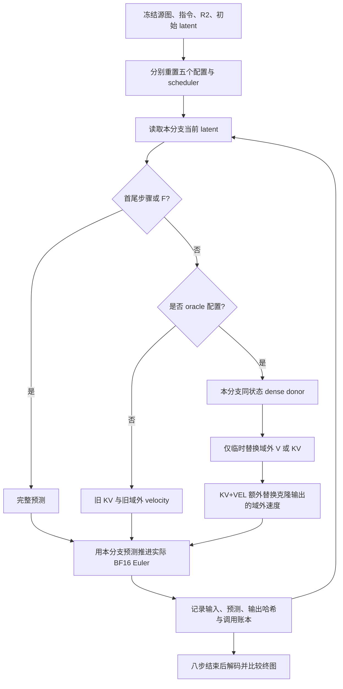

# 闭环新鲜缓存与域外速度的因果诊断

2026-10-23 · Qwen-Image-Edit + Lightning8 · zeta 单卡 H800 · C4 阶段报告

## 摘要

本轮完成四个固定训练源、五种配置的独立八步闭环，共 **20 请求、232 次真实 DiT、72 次同状态 dense donor，零推理失败**。真实新鲜 V 将平均 LPIPS/F 从 0.168465 降至 0.144133；联合新鲜 KV 进一步降至 0.119628，但三种局部配置均为 **0/4 数值合格**。KV 的活动目标预测在每个中间步精确等于其自身当前状态的完整预测，最终图像仍与完整执行不同。加入真实新鲜域外 velocity 后，四例全部八步轨迹及 PNG 精确复现 F。

结果支持：缓存读取误差确实影响闭环，然而只修读取不足以恢复本组完整执行结果；域外旧速度留下了实际误差通路。它**不证明 velocity 单头足够，也不证明小样本训练可达到 oracle**。下一步优先补齐 velocity-only 对照，再检验一种廉价可学习近似。继续扩大静态 V 拟合、直接启动 RL，均缺少当前证据支持。

## 1 研究问题与实验合同

前一阶段 C1 仅推进 NONE，在相同学生状态上插入校正分支，证明新鲜 V/KV 可降低活动预测误差。C2 单轮 B1 补采没有稳定终图收益。本轮改为各配置独立闭环：源图、指令、原 R2、初始 latent、seed=2026102201 相同，但每个分支仅使用自己当前 latent 查询教师并推进 scheduler。

模型为原版 Qwen-Image-Edit，revision `ac7f9318f633fc4b5778c59367c8128225f1e3de`；LoRA 为原版 Edit Lightning8 V1.0 BF16，SHA256 `36ee4ff860856559b9c581eaa69414900488f3de8be2f2448586daec77e201b9`。LoRA fuse 后卸载 adapter，原生 SDPA，BF16、CFG=1、八步、1024²，4096 个目标与4096个条件图像 token。首尾全量，六个中间步按冻结 R2 局部执行。

| 源图 | 指令概要 | 活动目标 token /4096 | 来源 |
|---|---|---:|---|
| 405994 | 球棒上写 BAT | 528 | 原 Train8 第1源 |
| 301232 | 杯中装红酒 | 266 | 原 Train8 第2源 |
| 544811 | 右侧白鸟换黑鸟 | 360 | 原 Train8 第3源 |
| 253960 | 披萨换蛋糕 | 1536 | 原 Train8 第4源 |

四源均为已知训练源，不能称独立验证。只改变干预，不重新选区、训练、调参或读取 Test。F 为相同八步完整执行，不是真实编辑标注或50步模型。

## 2 方法与算法

### 2.1 读取误差与更新误差

令 A 为活动目标集合、U 为其补集，a_i 为 token 最近真实更新时间。局部执行器读取缓存 K/V，并只更新 A 的当前 velocity；U 沿用 u_{a_i}。本轮比较：

$$
\begin{aligned}
\text{NONE}:&\quad (K_U,V_U)=(K_{a},V_{a}),\quad\widehat u_U=u_a;\\
\text{V}:&\quad (K_U,V_U)=(K_{a},V^D_t),\quad\widehat u_U=u_a;\\
\text{KV}:&\quad (K_U,V_U)=(K^D_t,V^D_t),\quad\widehat u_U=u_a;\\
\text{KV+VEL}:&\quad (K_U,V_U)=(K^D_t,V^D_t),\quad\widehat u_U=u^D_t.
\end{aligned}
$$

每层 K 是 QK normalization 和全局 RoPE 之后的向量；V 是 attention 前 raw Value。只有 U 的目标读取被替换，文本与条件图像不替换。近似/教师读取不回写真实 KV，不改变缓存年龄。KV+VEL 先克隆返回预测，再改 U，避免通过共享存储污染内部旧 velocity。

对每个配置 m：

$$
(K_t^D,V_t^D,u_t^D)=D(z_t^{(m)},t,c),\qquad
z_{t+1}^{(m)}=\mathcal E_{\rm actual}(z_t^{(m)},\widehat u_t^{(m)},\Delta\sigma_t).
$$

教师必须在同一个学生状态上计算；沿另一条轨迹的“同一步标签”不满足该条件。KV 能使活动预测精确对齐当前状态的教师，但该状态仍可能因过去域外误差而偏离 F 的轨迹。

这里实际Euler算子严格对应 `(z.float() + delta * prediction).to(prediction.dtype)`，而非先将velocity转换为FP32后相乘。当前PyTorch中零维FP32的delta与BF16预测相乘保留BF16乘积，再与FP32的z相加，最后转回BF16；舍入位置影响逐步精确性。主实验验收一直采用实际表达式，最终文档审阅纠正了初稿公式的显式FP32乘法写法，没有更改或重跑模型。[纯CPU类型检查记录](data/euler_dtype_check.json)不含任何模型forward。

上述循环八步终止。NONE 不产生 donor；V/KV/KV+VEL 每图各六次 donor。实际预算为：

$$4\times(8+8+14+14+14)=232.$$

### 2.2 数值评价

所有配置共享原始 R0 的 core、band1/2/4，以及固定 ~R2 的远背景，不随干预重新定义。报告全图 LPIPS/F、band2 MAE 和额外远背景误差：

$$\mathrm{extraBG}=\mathrm{MAE}_{\sim R2}(I_m,I_{src})-\mathrm{MAE}_{\sim R2}(I_F,I_{src}).$$

数值合格仍要求 LPIPS≤0.02 且 extraBG≤1/255。extraBG 为负只表示比 F 更接近源图，不能解释为相对 F 更精确，也不能替代编辑语义成功。完整质量、SSIM、PSNR、各带指标见 [CSV](data/quality_c4.csv) 与 [JSON](data/summary_c4.json)。

## 3 实测结果

### 3.1 四源等权汇总

| 配置 | LPIPS/F 均值 | LPIPS/F 中位数 | band2 MAE 均值 | extraBG 均值 | 数值合格 |
|---|---:|---:|---:|---:|---:|
| F | 0 | 0 | 0 | 0 | 4/4，参考自比较 |
| NONE | 0.168465 | 0.110345 | 0.123708 | -0.010926 | 0/4 |
| V_ORACLE | 0.144133 | 0.078985 | 0.040653 | -0.011581 | 0/4 |
| KV_ORACLE | 0.119628 | 0.033922 | 0.032023 | -0.011718 | 0/4 |
| KV_VEL_ORACLE | 0 | 0 | 0 | 0 | 4/4，逐步精确控制 |

### 3.2 逐源结果

| 源图 | 配置 | LPIPS/F | band2 MAE | extraBG | 数值合格 |
|---|---|---:|---:|---:|---|
| 405994 | NONE | 0.407612 | 0.133230 | -0.060167 | 否 |
| 405994 | V | 0.389680 | 0.097461 | -0.059549 | 否 |
| 405994 | KV | 0.383767 | 0.069274 | -0.059583 | 否 |
| 301232 | NONE | 0.045560 | 0.118385 | +0.003934 | 否 |
| 301232 | V | 0.028883 | 0.032742 | +0.003351 | 否 |
| 301232 | KV | 0.026903 | 0.031863 | +0.003494 | 否 |
| 544811 | NONE | 0.103603 | 0.229496 | +0.006958 | 否 |
| 544811 | V | 0.037909 | 0.019774 | +0.005319 | 否 |
| 544811 | KV | 0.038759 | 0.019628 | +0.005179 | 否 |
| 253960 | NONE | 0.117086 | 0.013719 | +0.005571 | 否 |
| 253960 | V | 0.120062 | 0.012634 | +0.004556 | 否 |
| 253960 | KV | 0.029085 | 0.007326 | +0.004039 | 否 |

每源 F/KV+VEL 都为零距离；其余指标不因显示舍入而改变门槛。四个 V 相对 NONE 的 LPIPS 差为 −0.017932、−0.016677、−0.065694、+0.002975，**3好1坏**；KV 相对 V 为 −0.005913、−0.001980、+0.000850、−0.090977，也是 **3好1坏**。均值分别改善0.024332与0.024505，但不能解释成两个误差来源可相加的贡献。

图中每个柱是一个源图的一次确定性配置，不能当成重复实验。事后逐一剔除任一源图，V−NONE与KV−V的平均LPIPS差仍为改善方向；但去掉蛋糕253960后，KV−V均值差从−0.024505缩至−0.002348；去掉文字405994后，KV+VEL−KV从−0.119628缩至−0.031582。该敏感性描述说明增益幅度受样例影响，不删除样本、不调整门槛。V−NONE及KV−V的band2 MAE各4/4改善，仍不能替代终图与语义验收。

### 3.3 局部预测精确仍不等于闭环精确

KV 每源六个中间步的活动预测 SSE 均为零，而域外 SSE 累积分别为 38265.443487、13451.630719、13018.400175、7935.301961。它们与每个分支自己的同状态 donor 比较，是同轨迹内部的描述性残差；分支状态不同，不能与其他配置做同状态百分比归因。NONE 没有 donor，本轮不报告其未测量的同状态 SSE。

这说明“每步活动区已算准”不足以恢复完整轨迹。KV+VEL 将完整目标预测与轨迹复原，是实现正确性控制，也是对域外更新通路的条件干预；它不是一个已学到的加速算法。

## 4 图像与失败案例

以下为研究助手对已标注配置的全图与裁剪进行的非盲视觉核查，不是独立人工盲评，也未给出人的偏好分数。

**文字 405994。** F 有可辨认 BAT，同时显著重绘了球棒及周围。NONE/V/KV 均保留不同程度的局部贴片、文字布局和上下接缝；V 有重复 BAT，KV 上部可见 BA、下部字符畸变。KV 活动数值精确未使最终文字与 F 一致。源图外观保留更多也不能自动判定编辑质量优于 F。

**酒杯 301232。** 多种配置均生成红酒，但杯身大小、位置、液面、脚部及遮挡关系不同。V/KV 比 NONE 更接近 F 的部分形状，仍未达到保真门槛。它属于相对 F 的布局差异，不能把所有差异笼统称为语义失败。

**鸟 544811。** NONE 在右侧有明显的矩形水面纹理改变及鸟形变化；V/KV 大幅减弱了这类局部不协调，但相对 F 仍有残差。F 本身将左侧鸟也明显变黑，存在超出“右侧鸟”指令的改变；因此 KV+VEL 精确复制 F 并不等于该例语义完全成功。教师自身的失败必须单列。

**蛋糕 253960。** 各配置都把披萨改成蛋糕；V 产生不同的圆形/层次外观，相对 F 的 LPIPS 比 NONE 略差。KV 更接近 F 的切片形状，但 extraBG 约0.004039，仍高于1/255，LPIPS亦超门。这是“新鲜 V 更准确，但终图不必单调接近 F”的直接样例，不意味着圆蛋糕本身不符合指令。

## 5 实验过程、成本与复现审计

预登记写入时间为2026-10-23 18:54:20 +08:00，主实验完成于18:57:23。20请求的诊断计时之和158.041秒，剩余包含加载及请求间管理；不是完整研究工作耗时。单请求峰值 PyTorch allocated 显存最高62.852 GiB，不能等同驱动总占用。

F 诊断请求为6.883–7.598秒，NONE为5.857–6.152秒，oracle为8.734–9.007秒。本轮固定顺序、无真实模型预热，且含全量 donor 与断言；**不由此计算或宣称部署节时**。此前 Val16 的重复时延结论保持其原口径，不与本轮拼接成新方法速度。

| 核验 | 结果 |
|---|---|
| 主执行/donor/真实 DiT | 160 /72 /232，全部 invoked=completed |
| 请求/步骤/调用事件 | 20 /160 /464 |
| CPU 微型正确性测试 | 132 forward，FP32/BF16，零真实 DiT |
| NONE 旧轨迹与 PNG | 4源×8步输入/预测/后 latent 精确一致，4 PNG 一致 |
| KV 活动预测 | KV 与 KV+VEL 共48中间步精确对齐自己的 donor |
| KV+VEL 与 F | 32步完整轨迹、4 PNG 精确一致 |
| donor 与注入隔离 | 72步状态、输入、RNG、缓存及年龄检查通过 |
| 旧 Train8/Val16/C1-C3-C2 | 912个冻结文件全部 SHA256 一致 |
| 训练/新数据/Test | 0梯度步、0新增源图、0 Test媒体 |

独立审计见 [final_audit.json](data/final_audit.json)，模型和 LPIPS 权重/版本见 [environment](data/environment_c4.json) 与 [metric environment](data/metric_environment_c4.json)。初次 setup 命令的源码路径问题及修正见[协议](01_实验协议与计划进度.md)，没有新增模型失败调用。

本阶段新增20请求/232 DiT，历史累计从826/7558变为 **846请求/7790真实DiT**，累计包含294次 dense donor。累计数表示工作量，不表示独立图像数量或统计样本量。

## 6 可以通过训练消除误差吗

**可以把训练作为进一步减小误差的手段；目前不能承诺完全消除。** 本轮甚至真实新鲜 V/KV 都不能单独恢复 F，继续只用 raw Value 回归损失训练更久，不会直接解决未更新域的速度通路。

下一种候选应使用部署时已存在的特征，预测域外速度残差，必要时再加低秩 K/V 读取修复：

$$\widetilde u_{t,i}=u_{a_i,i}+g_\theta(z_{t,i},z_{a_i,i},u_{a_i,i},c_i,t,a_i,d_i,s_A),\quad i\in U.$$

教师标签来自同一学生状态；底座冻结。第一轮可离线训练低维小头，监督域外 velocity、实际时间步加权的一步误差以及教师跨界梯度：

$$\mathcal L=\lambda_U\|\widetilde u_U-u_U^D\|^2+\lambda_s\|\Delta\sigma_t(\widehat u-u^D)\|^2+\lambda_e\!\sum_{(i,j)\in\partial A}\!\big|[(z'_{S,i}-z'_{S,j})-(z'_{D,i}-z'_{D,j})]\big|.$$

该式说明目标，不代表所有项已经实现或经过超参选择。固定活动观测的离线损失只能直接训练速度头；要通过 K/V 优化活动预测需额外可微前向，冻结20B权重仍有激活显存成本。边界损失匹配教师梯度，不能强迫所有边界平滑，也不能强迫域外完全保持源图不变。

本轮缺少 `NONE+fresh-U-velocity`，因此先建议 **C4b 四源独立闭环、56 DiT**，检验只修速度的上限；它尚未执行。只有该证据支持且工程成本允许，才冻结一种小头，执行有界补采/训练/闭环筛查。完整损失、Key空间、初始化、预算及RL条件见[训练方案](训练方案草案.md)；近期与八个月计划见[进度表](03_完成进度与后续计划.md)。

## 7 当前决定与局限

当前为 **Revise**：停止扩展相同的静态 V 拟合，把可学习目标扩展到实际更新误差；先补齐速度单独对照，保持一种候选和明确查询上限。RL继续后置，适合在校正器有效之后学习刷新/扩边/回退决策，不替代现有同状态标签可直接监督的问题。

局限包括四个已知训练源、单seed、单模型与固定R2；没有 velocity-only 分支；F自身存在编辑失败；oracle调用完整模型；尚无可部署近似、泛化、无损或新的速度证据。区域扩边的负面/混合结果仍保留，不因本轮更换诊断而改写。只有新候选在独立留出、多seed、同期时延及语义检查中通过，才进入策略学习和SGLang实现。
