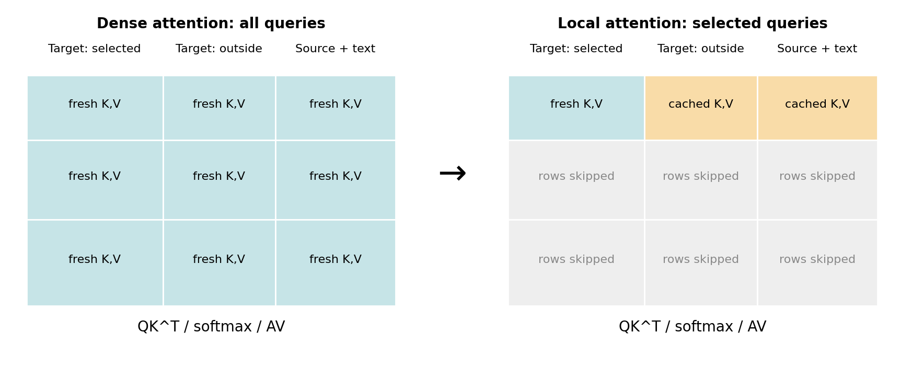
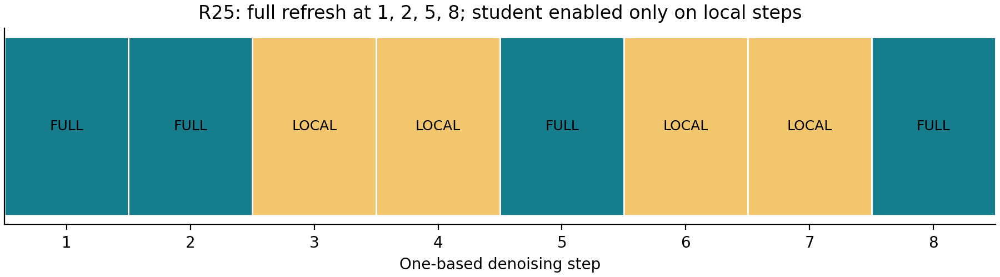
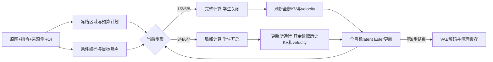
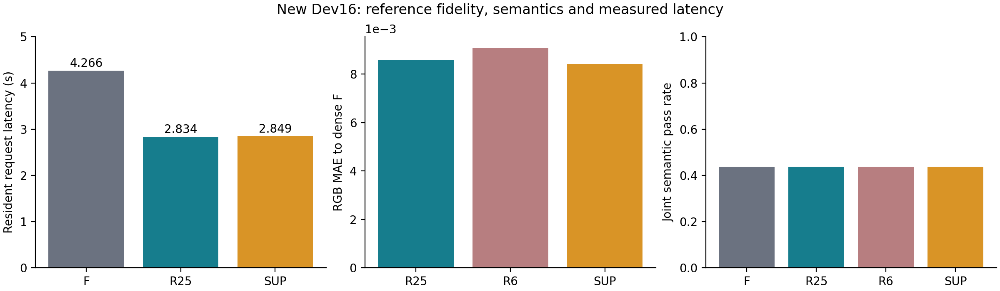
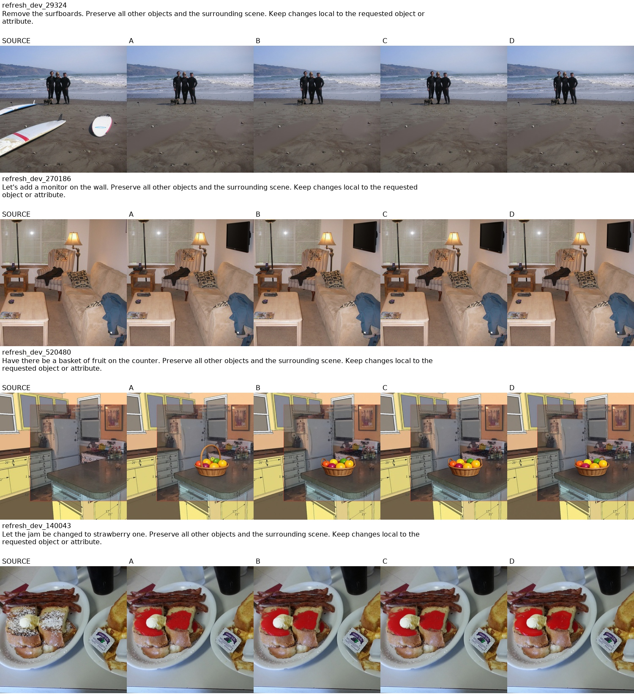
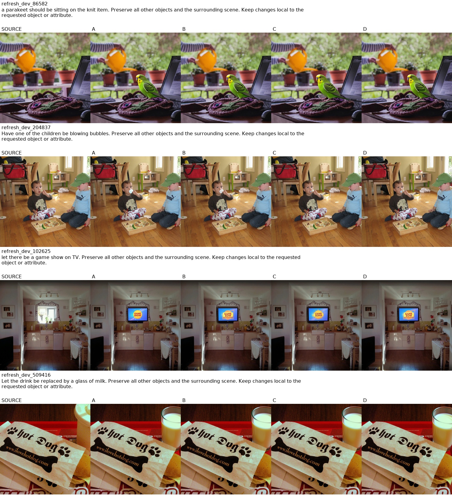
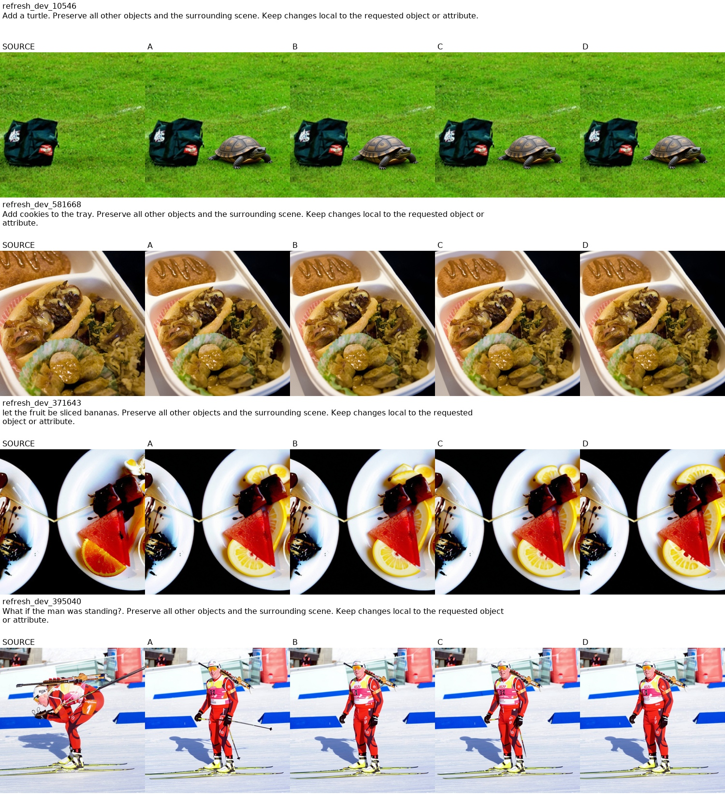
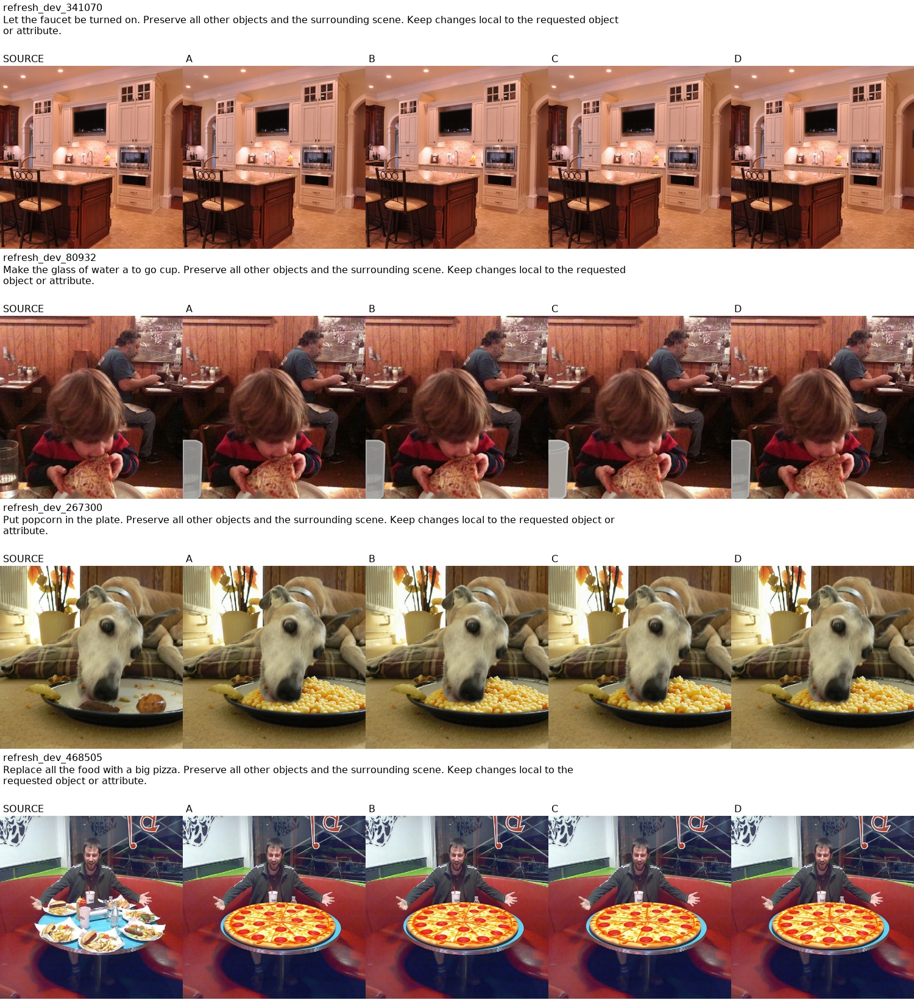

# 面向少步图像编辑的缓存感知低秩校准与区域预算刷新方法

**研究论文完整工作稿（截至 2026 年 10 月 30 日）**
作者、学号、导师、学院：待填写。适用用途：毕业设计阶段论文、实验归档及后续定稿依据。本文按问题、相关工作、方法、实验、讨论与结论组织，尚未套用学校最终学位论文排版。原始证据不足处明确标注；未执行的工作不会填成已完成结果。

## 摘要

扩散 Transformer 图像编辑模型在少步蒸馏后仍具有较高的单步计算成本。局部编辑为减少目标区域之外的重复计算提供了机会，但直接冻结域外计算会引入历史注意力上下文和速度场误差；过强的硬掩码约束还可能阻碍对象尺寸变化和接触边界的自然生成。本文以原版 Qwen-Image-Edit 及其公开 8 步 Lightning 适配器为基础，研究无输出硬掩码条件下的局部执行。方法以原图、文本指令及来源侧对象框为输入，将对象框外扩并映射到 token 网格，在固定预算内保留核心、邻近区域和确定性探针；局部步骤仅更新所选目标 token 的 Transformer 计算，复用其余目标、原图条件和文本的历史 KV，并使用上次计算的域外 velocity 推进整个目标 latent。为减轻缓存近似误差，本文采用同状态稠密教师监督训练 rank-8 低秩适配器，并在完整步骤关闭新增适配器，在局部步骤开启。最终采用第 1、2、5、8 步完整刷新的 R25 调度。

研究累计使用 140 个拟合来源、153 次低秩优化器更新，得到包含 4,423,680 个可训练参数的 LOCAL128 学生。在新 32 来源开发集上，R25 相对同一学生的低预算 B 配置降低 RGB 参考误差 31.41%，严格语义联合通过为 22/32，与完整执行 F 的总数相同，但存在逐例一退一进。新 16 来源上，R25 与 F 的联合通过均为 7/16，基座对象绑定和编辑正确性仍是共同瓶颈。在其中预定 8 来源的配对三次计时中，完整模型驻留请求由 4.2659 秒降至 2.8344 秒，获得 1.5050 倍加速、33.56% 节时。18 参数监督刷新头取得小幅但不显著的额外数值收益；128 次真实 contextual bandit 交互未证明强化学习优于监督策略。结果支持“缓存感知小规模适配＋保守完整刷新”作为少步局部编辑加速的可行路线，尚不支持绝对无损、显著策略学习增益或可部署高成功率的结论。最终测试集与原生 SGLang 执行尚未完成。

**关键词：** 图像编辑；扩散 Transformer；局部计算；KV 缓存；低秩适配；同状态蒸馏；预算刷新；强化学习

## Abstract

This work studies regional execution for eight-step image editing without a hard output mask. Starting from Qwen-Image-Edit and its public Lightning adapter, we combine source-side region planning, cached context, stale-velocity propagation, and cache-aware low-rank adaptation. The final LOCAL128 student contains 4.42 million trainable parameters and is enabled only on local steps. The R25 schedule performs full refreshes at steps 1, 2, 5, and 8. On a fresh 16-source development batch, all compared methods achieve 7/16 joint semantic passes, exposing shared base-model failures. Paired repeated timing on eight prespecified sources reduces model-resident request latency from 4.266 to 2.834 seconds, a 1.505× speedup. A supervised timing head shows a small statistically inconclusive improvement, while a real contextual-bandit experiment does not outperform supervision. These results establish a practical research prototype rather than lossless editing or a final benchmark claim.

## 1 引言

### 1.1 问题背景

图像编辑通常要求改变局部对象、属性或动作，同时保持周围内容。全图扩散 Transformer 在每个去噪步骤计算大量未直接编辑位置的表示，因而存在空间和时间冗余。然而，“最终像素变化小”不等于“该位置的内部表示不需要计算”。在联合注意力中，域外目标 token、源图条件 token 和文本 token 仍参与信息传播。省去这些计算会改变活动区域读取的 K、V，且域外速度场自身也可能随时间变化。

另一方面，原始对象轮廓并不一定包含编辑后的全部影响区域。例如猫换成长颈鹿可能超出猫的原框；对象的阴影、接触面和遮挡关系也可能影响周围像素。若将原框直接作为硬输出掩码，会把计算范围和允许变化的范围绑定在一起。本文将二者分开：ROI 是计算预算的定位提示，输出没有必须逐像素保持源图的硬约束。

用户最初提出“小样本训练是否能弥补训练免费方法的误差”。本研究从单头误差校准、结构扩边、固定比例预算、闭环蒸馏和刷新策略逐步检验该问题，最终形成较稳定的约 1.5 倍端到端收益。本文保留失败路线，说明最后的算法由哪些证据支持。

### 1.2 研究目标与边界

研究目标是在一个已具备 8 步生成能力的编辑模型上，以有限新增训练改善局部执行的质量与时间权衡。本文没有自行完成 50 步至 8 步的蒸馏；公开 Lightning 是共同基座。原版 50 步和 8 步 Lightning 的速度差异不能记为本文贡献。

当前约束为单卡、BF16、单请求、1024×1024 输出、8 步、CFG=1；已验证入口限定正方形源图。任务侧聚焦不要求全局重照明、整体风格转换或大范围背景重构的对象编辑。此限制并不保证局部操作没有远距离影响，失败样本仍全部计入。部署输入是原图、prompt、ROI；ROI 需要人工或来源侧标注，不声称完成自动语义框选。

### 1.3 本文的实证贡献

1. 明确局部执行中“活动区域上下文陈旧”和“域外 velocity 陈旧”同时存在，并通过新鲜 V、KV、域外 velocity 的同状态及闭环对照排除单一误差头足以解决问题的假设。
2. 实现不使用输出硬掩码的联合注意力局部执行器，将目标、源图条件和文本的计算开销统一纳入分析。
3. 在少步模型上实现同状态教师监督的低秩校准，以局部步启用、完整步关闭的方式避免稠密轨迹漂移；配合预算内中途完整刷新获得可测端到端收益。
4. 完成监督刷新头与真实 bandit 训练，报告其相对固定调度的有限收益及失败，给出可恢复权重、协议、代码与证据缺口。

这些贡献属于当前特定任务与实现的实证结果，尚无同协议的 RegionE、SpotEdit、LinCa 完整复现实验，不能据此宣称优于这些方法。

## 2 相关工作与创新边界

### 2.1 基座与区域计算

[Qwen-Image-Edit 模型卡](https://huggingface.co/Qwen/Qwen-Image-Edit)描述了图像条件与文本指令结合的编辑能力；[Lightning 项目](https://huggingface.co/lightx2v/Qwen-Image-Lightning)提供对应的少步适配器。本文冻结它们，把问题集中在少步之内的计算压缩。

[RegionE](https://arxiv.org/html/2510.25590v1)利用区域间的编辑差异减少重复计算，涉及区域状态预测、KV 复用和速度处理；[SpotEdit](https://arxiv.org/html/2512.22323v1)研究选择性区域执行和 KV 融合。它们已经覆盖局部查询、条件缓存及区域选择等重要思想，因此“局部只计算 Q”“域外保留 KV”本身不是本文独占创新。

[LinCa](https://arxiv.org/html/2608.17973v1)通过可学习的可逆分解及不同时间阶数处理缓存近似。可逆映射不意味着整个生成预测无误差，其训练校准也意味着本文不能把“首次用少量训练改善缓存”作为创新主张。

|维度|RegionE / SpotEdit 所代表的区域路线|LinCa|本文最终实现|
|---|---|---|---|
|主要可学习部件|主要依赖区域执行与缓存规则，具体以论文实现为准|学习变换/分解以改善缓存预测|72 处低秩适配，另有可选 18 参数时机头|
|选区依据|模型信号或选择机制|侧重表示与时间冗余|来源侧 ROI＋固定扩边＋预算 tile＋探针|
|误差校正位置|区域状态、KV、速度等规则|变换后的缓存近似|Transformer 输出投影内部适配，完整步禁用|
|训练状态|本文未复现其训练/执行协议|其特定学习协议|教师读取学生自身闭环状态；短窗口训练|
|刷新预算|已有刷新机制，不能声称首次提出|缓存时间建模|在 8 步固定预算中实测中途完整刷新|
|本文的实验证据|只有文献比较，无共同数据上的胜负|只有文献比较，无共同数据上的胜负|140 拟合来源，开发验证，约 1.5× 完整请求加速|

### 2.2 新近工作与需要补充的对照

[CacheEdit](https://proceedings.mlr.press/v306/yu26e.html)研究图像编辑中的自适应激活缓存。[FreezePlan](https://arxiv.org/abs/2610.34177)在不同基座上讨论区域冻结与预算分配，进一步说明调度本身可能比更复杂的选择器更重要。本文的固定刷新结果与这一方向相关，但基座、步数、数据和执行实现不同，不能比较各自论文中的加速数字。正式定稿应至少加入同一环境、同一输入与计时边界下的公开缓存/区域基线。

因此，最稳妥的论文定位是：**面向 8 步局部编辑的缓存感知低秩适配及完整刷新组合，并用系统与闭环实验证明其收益边界。** 自动框选、结构边界学习及强化学习属于研究过但尚未成为可靠主贡献的部分。

## 3 任务形式与计算语义

### 3.1 输入、状态与编辑范围

设源图为 \(I_s\)，指令为 \(p\)，来源侧框为 \(b=(x_0,y_0,x_1,y_1)\)。VAE 编码及打包后得到源条件 \(c\in\mathbb R^{N_c\times d}\)，目标噪声状态为 \(z_t\in\mathbb R^{N\times d}\)。当前分辨率下 \(N=N_c=4096\)、\(d=64\)，Transformer 隐层宽度为 3072。文本长度为 \(L\)，依实际编码确定。

源条件 latent 代表输入图像，目标 latent 从噪声开始逐步形成结果。最终方法没有把 ROI 内的源图内容抹掉，没有额外黑白 mask 图条件，也没有把域外源像素粘贴到结果中。因此域外像素不保证与原图一致，扩大 ROI 也不是扩大“准许画图”的边界，而是扩大精确重算范围。

### 3.2 完整联合注意力

为解释计算，将某层联合 token 写成 \(H=[H_T,H_C,H_P]\)，分别表示目标、源条件、文本。模型在不同流上有对应投影、归一化及位置编码，随后形成联合注意力。简写为

\[
Q=\begin{bmatrix}Q_T\\Q_C\\Q_P\end{bmatrix},\quad
K=\begin{bmatrix}K_T\\K_C\\K_P\end{bmatrix},\quad
V=\begin{bmatrix}V_T\\V_C\\V_P\end{bmatrix},\qquad
O=\operatorname{softmax}(QK^\top/\sqrt{d_h})V.
\]

此表达用于说明矩阵形状，并不把 Qwen 实现误写成每路完全独立的 self-attention 再外接一层 cross-attention。完整步的注意力分数矩阵大小为 \((N+N_c+L)\times(N+N_c+L)\)。

### 3.3 局部执行节省什么

令 \(S_t\subseteq\{1,\ldots,N\}\) 为活动目标 token，\(U_t\) 为其补集。局部步计算新鲜 \(Q_{S_t},K_{S_t},V_{S_t}\)，其余键值从上一次实际计算的层级缓存读取：

\[
\widetilde K_t=\operatorname{scatter}(K_{S_t}^{new},K_{U_t}^{cache},K_C^{cache},K_P^{cache}),
\]
\[
\widetilde V_t=\operatorname{scatter}(V_{S_t}^{new},V_{U_t}^{cache},V_C^{cache},V_P^{cache}),\quad
O_{S_t}=\operatorname{softmax}(Q_{S_t}\widetilde K_t^\top/\sqrt{d_h})\widetilde V_t.
\]

只保留分数矩阵的 \(|S_t|\) 个查询行，仍读取全部键值列。活动目标 token 的各层 MLP、归一化及投影继续计算；局部步跳过域外目标、源条件、文本对应的重复查询和 MLP。完整步重新计算全部流并刷新缓存。



图 1：矩阵示意中的比例不对应真实 token 数。灰色查询行被省略，黄色列对应复用的历史 KV。局部计算仍能读取域外信息，只是该信息具有缓存年龄。

注意力主项的理论复杂度由 \(O((N+N_c+L)^2d_h)\) 降为 \(O(|S_t|(N+N_c+L)d_h)\)。实际速度还受线性层、索引、scatter、缓存内存、VAE、文本编码和内核效率影响，不能用此比值代替端到端实测。

### 3.4 域外 latent 仍然变化

域外 velocity 使用最近一次计算值：

\[
\widehat v_{t,i}=\begin{cases}v^{local}_{t,i},&i\in S_t,\\v_{\tau(i),i},&i\notin S_t,\end{cases}
\quad
z_{t+1}=z_t+(\sigma_{t+1}-\sigma_t)\widehat v_t.
\]

这里的 \(\tau(i)\) 是该位置最近一次实际计算 velocity 的步骤，可能来自完整步或此前局部选择。Euler 更新覆盖所有目标 token，域外并非冻结图像，也不是每步复制原图。实际代码保持 BF16 乘法、FP32 加法、最终 BF16 转换的次序；改变强制转换顺序可能改变轨迹。

## 4 方法：LOCAL128＋R25

### 4.1 预算受控的区域规划

先在源像素坐标中把框四边扩张 32 像素并裁到图内，再映射至 64×64 目标网格。32 是源像素尺度，并非固定 32 个输出像素。将网格分为 2×2 token tile；所有与核心相交的 tile 强制纳入。设强制 tile 数为 \(m\)，从 \(\{0.25,0.5,0.75,1\}\) 选择能够容纳核心且不低于当前档位的最小比例 \(\rho\)：

\[
\rho=\min\{r:r\in\{1/4,1/2,3/4,1\},\ r\ge r_{min},\ rN\ge4m\}.
\]

额外 tile 中约 7/8 按到核心的空间距离选择，约 1/8 作为确定性轮转探针。探针由 case/request key 的 SHA 排序决定，保证预算不变、重复运行可复现。若核心过大，则自动升档；这会降低加速潜力，但不截断核心。规划在生成前冻结，不利用候选终图调整区域。

### 4.2 为什么保留完整刷新

早期 B 配置仅第 1、2、8 步完整计算，其余步局部执行。增加局部比例不总是改善质量；同等或相近预算下，中途一次完整刷新对清除累积误差更有效。最终 R25 设置

\[
\mathcal F=\{1,2,5,8\},\quad S_t=\{1,\ldots,N\}\ (t\in\mathcal F).
\]

对同一来源，目标 token 更新总量为

\[
B_i=4N+4\rho_iN,\qquad B_i/(8N)=(1+\rho_i)/2.
\]

最低 25% 局部档的更新比例为 62.5%；新 Dev16 的来源平均为 71.09375%，因为部分来源升档。它只计目标 token 更新次数，不包括条件/文本、注意力列、缓存操作与 VAE，不能称为总 FLOPs 比例。



图 2：R25 的 4 个完整步和 4 个局部步。R4、R6 分别把中途完整步移到第 4、6 步，总目标预算保持相同。

### 4.3 缓存感知低秩适配器

冻结主干与已融合的 Lightning，给全部 60 个 attention 输出投影及每 5 层一个 MLP 输出投影增加 rank-8 适配，共 72 处。对输入 \(h\)，实现为

\[
f_\theta(h)=Wh+\operatorname{cast}_{BF16}\{B_\theta(A_\theta\operatorname{float}(h))\}.
\]

\(A,B\) 保持 FP32；此实现没有额外的 \(\alpha/r\) 缩放项。总参数为 4,423,680，约占 20,430,401,088 参数 DiT 的 0.022%。最终取消试验中的空间 velocity 小头，仅保留这组低秩参数。

关键开关是：**局部步启用新增学生，完整步关闭；Lightning 始终启用。** 在全部 8 步均开启相同适配器会改变稠密锚点，实测域外误差增加。BF16 永久合并也不能直接代替未合并执行：其舍入位置改变，且不便在完整步恢复无学生状态，合并实验未被采纳。

### 4.4 同状态教师与短闭环损失

学生先用自身执行器推进到训练步 \(t\)，得到 \(z_t^S\) 和缓存。稠密教师读取相同 \(z_t^S\)、条件、时间步，但不改写学生缓存，也不推动学生路径：

\[
v_t^T=f_{dense}(z_t^S,c,p,t),\qquad
v_t^S=f_{local,\theta}(z_t^S,c,p,t;\mathcal C_t,S_t).
\]

把活动掩码经 3×3 膨胀和腐蚀得到边界环，形成内部、边界、外部三个组 \(G_1,G_2,G_3\)。尺度 \(s_g\) 仅由训练来源统计。velocity 损失为

\[
\mathcal L_v=\sum_{g=1}^{3}w_g\operatorname{mean}_{i\in G_g}
\operatorname{SmoothL1}\left((v^S_{t,i}-v^T_{t,i})/s_g\right),\quad (w_1,w_2,w_3)=(1,2,1).
\]

空组不参与均值。晚期 \(\sigma_t\le0.75\) 时，对隐含干净状态误差 \(e_t=-\sigma_t(v_t^S-v_t^T)\) 加边界差分：

\[
\mathcal L_{edge}=\sum_{a\in\{x,y\}}
\operatorname{mean}_{(i,j)\in\partial G,a}\frac{|e_{t,i}-e_{t,j}|}{s_2}.
\]

75% 微批采用一步监督，25% 采用两步短闭环。两步教师分支的第二步运行在教师第一步推进的状态，不能称为第二步也与学生同状态。端点损失为

\[
\mathcal L_{roll}=\frac{3\|z^S_{t+2}-z^T_{t+2}\|_1}{s_1+s_2+s_3},\qquad
\mathcal L=\mathcal L_v+0.1\mathcal L_{edge}+0.5\mathcal L_{roll}.
\]

其中 \(\|\cdot\|_1\) 在实现中指元素绝对值均值，单步窗口不加 roll 项。每 8 个微批安排一次完整锚点窗口，基础蒸馏项乘 0.1；代码保留实际加权次序。缓存梯度截断，短窗口 latent 的梯度保留，配合 checkpointing 控制显存。

这里的 roll 是实际舍入后的状态误差；晚期边界项是 latent 速度诱导的梯度误差，不是直接监督最终 RGB 接缝。不能把它表述为已完成感知或语义损失训练。

### 4.5 完整推理算法

```text
算法 1：LOCAL128 + R25
输入：源图 I、文本 p、来源框 b、请求 key、初始噪声 z0
参数：冻结主干和 Lightning；训练学生 θ；完整步 {1,2,5,8}
1. 编码 I 和 p；根据 b、32 像素扩张、tile 和预算构建八步 S_t
2. 初始化请求内 KV 缓存、各位置最近 velocity；禁止跨请求复用
3. 对 t=1,...,8：
   a. 若 t 为完整步：关闭 θ；计算目标、源条件、文本全流；刷新各层 KV 和全部 velocity
   b. 否则：开启 θ；只运行 S_t 对应目标行，读取完整缓存 KV
      更新 S_t 的 KV 与 velocity；其余位置保留最近 velocity
   c. 用同一 scheduler 的 Euler 规则更新全部目标 latent
4. VAE 解码目标图；不粘贴源像素、不施加输出硬 mask
5. 恢复模型 forward、释放本请求缓存，返回图像与执行记录
```



### 4.6 可选监督刷新与强化学习

候选动作是 \(\mathcal A=\{R4,R25,R6\}\)，每个动作的完整步数量及区域预算一致。最终监督头输入 8 维特征：归一化框位置、宽高、面积、核心 token 比例、有效局部比例、截断 prompt 长度。标准化统计只用训练来源；输出预测相对 R25 的两个损失差，R25 自身作为零基准，共 18 参数。它不读取生成图或早期隐藏状态，因此可在 DiT 前决策。

训练代理为

\[
E(a)=\operatorname{MAE}(I^a,I^F)+0.25\operatorname{MAE}_{outside}(I^a,I^F),
\qquad a^*=\arg\min_a\widehat E_\phi(a|x).
\]

outside 采用固定来源框外扩 32 像素后的外部，候选之间不移动评价区域。代理衡量接近 F 的程度，无法惩罚 F 本身的编辑错误。

Bandit 从 SUP 初始化，在 32 个训练来源上做 4 轮、128 次真实 8 步生成，每 8 episode 更新一次，共 16 次更新。实际奖励为

\[
r(a)=\operatorname{clip}\{-\log[E(a)/E(R25)],-2,2\},
\]
\[
\mathcal L_{RL}=-r(a)\log\pi_\phi(a|x)+0.05D_{KL}(\pi_\phi\|\pi_{SUP})-0.02H(\pi_\phi).
\]

温度 0.25，Adam 学习率 0.0005，梯度裁剪 1。每次交互真实执行，不用缓存奖励查表替代。固定种子环境下重复 4 轮并不增加来源多样性。这是一次决策的 contextual bandit，不是新的逐步多动作 PPO。更早阶段曾做多动作 PPO，列入历史消融。

## 5 数据集与实验设置

### 5.1 数据来源、许可与筛选

主要来源为 [MagicBrush](https://huggingface.co/datasets/osunlp/MagicBrush)，固定数据 revision 为 `6c254560879df7851233ea0fd2ae2a62764d0ef2`。使用源图、原始指令、来源 ID，以及部分标注 mask 的包围框提示；当前主线没有读取目标编辑图作为训练监督。监督来自冻结模型对学生状态的稠密预测。数据集卡的许可与各源图 provenance 随本地数据保存，本文不把数据集图像视为自有素材。

扩量阶段下载 360 个来源，official train 280、dev 80。按预先限定的尺寸、局部任务与几何条件筛选，再进行来源侧视觉审核和保守相似图排除：31 个几何不合格，92 个近似哈希灰区，17 个视觉/任务不合格，最终保留 171 个 train 和 49 个 dev。筛选只看源图与指令，不根据候选生成质量删样。该选择意味着本文研究的是局部子集，而不是 MagicBrush 官方全量 benchmark。

### 5.2 主要划分与重复使用

|集合|数量与来源|用途|独立性说明|
|---|---|---|---|
|早期 Train8 / Probe8 / Val16|历史冻结来源组|误差归因、校准和初步验证|后来已反复使用，只作为历史探索|
|固定参数拟合 31 来源|旧 8＋新 23|域外仿射校正|第 32 个来源全图回退无 inactive 标签，未伪造监督|
|无硬 mask 初始小集|12 fit、3 cal、4 内部检验等|扩边、动作头及 pilot|都是开发阶段数据|
|低秩 pilot|12 拟合来源|25 更新、100 微批|后续扩量学生继承其权重|
|扩量 Train128|official train，128 来源|512 微批、128 新更新|与 pilot 合计 140 拟合来源|
|扩量 Cal32|official train，32 来源|结构/训练设置与 checkpoint 开发选择|是校准集，不是独立测试|
|扩量 Dev32|official dev，32 来源|首次验证 LOCAL128|已看过失败，之后不再称未见测试|
|刷新 Train32 / Cal16|既有 Train128 / Cal32 子集|固定调度、SUP、RL|重复种子和重复动作不增加独立来源数|
|新 R25 Dev32|生成结果此前未见的 dev 来源|F/B/R25 验证|当前算法冻结后评估；评估后变为已见开发集|
|最新刷新 Dev16|另 16 个此前只做源图 QC 的 dev 来源|F/R25/R6/SUP|未训练、未根据本轮输出改 prompt；不是最终 Test|
|Test64|保留的最终测试协议|最终冻结后验收|尚未开封，本文不报告其分数|

不同阶段的“Dev16”“Dev32”是不同协议，不能把同名集合误合并。`数据集来源与协议索引.csv` 保存 917 条来源—协议使用记录，重复行表达跨协议复用，不能把 917 当成独立训练样本数。它覆盖本地主线协议中含 source 路径的 cases，历史完整范围另见对应阶段文档和快照。

最新 Dev16 来源为：29324、270186、520480、140043、86582、204837、102625、509416、10546、581668、371643、395040、341070、80932、267300、468505。16 份源图均在本地，原始最新预注册 JSON 未同步；另附带明确标识的来源重建索引，不冒充原预注册文件。

### 5.3 模型、软件与训练预算

|项目|配置|
|---|---|
|主干|原版 Qwen-Image-Edit，revision `ac7f9318f633fc4b5778c59367c8128225f1e3de`|
|少步适配|Qwen-Image-Edit-Lightning-8steps-V1.0-bf16，仓库 revision `d468c534b360e0754c6bf9e38ed49e1e09cd2e2a`|
|数值与调度|BF16；8 步；CFG=1；动态指数位移参数 μ=ln 3|
|GPU|用户确认 H800；驱动报告 NVIDIA L20Y、约 80GB；如实保留设备标识差异|
|主要环境|PyTorch 2.9.1+cu129、diffusers 0.42.0.dev0、transformers 5.3.0；完整版本见模型包|
|pilot|12 来源、100 微批、累积 4、25 更新；LoRA lr 1e-4；约 254.36 秒|
|扩量|128 新来源×4 seed，512 微批、128 更新；lr 5e-5；约 1196.03 秒|
|总低秩拟合|140 来源、153 更新；不是仅 128 来源从零训练|
|扩量训练峰值|60.884 GiB；不含所有前置采集和验证墙钟|
|最终推理峰值|R25/SUP 约 68.90 GiB；F 约 62.30 GiB|

扩量训练本身约 19.93 分钟，但全部研究还包含前缀推进、教师采集、闭环验证、数据整理与重复计时，不能说“全项目只训练二十分钟即完成”。扩量训练执行包共 3239 次 DiT，包括前缀 1959、教师 640、学生 640。大显存单卡可行，并不等于已验证 24GB 单卡可行。

### 5.4 指标、语义和统计

数值指标包括相对完整执行 F 的 RGB MAE、ROI 内/域外 MAE、latent MAE；早期还使用 LPIPS 和相对源图保持性差值。不同阶段指标和门槛不同，表中不跨阶段平均。F 是计算参考而非语义真值，\(E(F)=0\) 不代表 F 编辑正确。

语义采用“编辑指令完成”“要求保持的内容保留”及两者联合通过。类别或细节不确定时不计联合通过。最新批次先填写匿名 A/B/C/D 评分再揭盲，但由单助手完成，不能称作独立多人、人类盲评或严格双盲。

净延迟先固定来源与模型，GPU 同步，轮转执行顺序。每来源每臂 3 次重复先取均值，再对来源均值取比；bootstrap 以来源为重采样单位，10000 次。不能把同一来源的 3 次重复当成 3 个独立样本。最新计时包括计划/头、预处理、源 VAE、GPU 文本编码、8 次 DiT、未切片 VAE 解码、PIL 与缓存清理；排除模型加载、输入文件读盘、PNG 落盘及诊断哈希。

## 6 实验过程：从失败路线到最终算法

### 6.1 初始基线与局部误差归因

最初 3 输入的原版 50 步 CFG4 耗时约 49.245 秒；直接 8 步 CFG1 为 6.716 秒但出现文字失败；正确融合公开 Lightning 后约 6.743 秒。它们是基座选型证据，不是区域算法的速度收益。

早期局部执行 R2 节时 12.35%，质量未通过；增加到 5 个完整步的保守配置只节时 5.75%。按接触边界扩张在文字和衣服例略好，在头发例变差。等预算结构补齐实验仅 6 个来源可行，2 个超预算；完整接触结构在可行组 2 好、3 差、1 相同，两方案严格通过均 1/6。故“选区边界更自然必然更好”的假设没有得到支持。

同状态因果诊断中，B 校正、新鲜 V、新鲜 KV 对活动速度误差的改善程度明显不同；新鲜 KV 能消除所观察的活动区上下文误差，但仍有约 32.70% 剩余误差来自未更新域外 velocity。闭环 oracle 中，NONE/V/KV 的 LPIPS 分别约 0.168465/0.144133/0.119628，全部 0/4 过严格门；KV 加域外真实 velocity 才恢复完整参考。单独刷新域外 velocity 后 LPIPS 降至 0.071990，但仍 0/4 通过。这说明两类误差相互作用，不能只凭单步 V 误差下降判断终图。

这些 oracle 需要额外稠密计算，用于定位误差，不是可部署加速臂。详细算法、逐源结果与计数见附录实验目录 E01–E10。

### 6.2 轻量头、固定拟合与早期策略学习

29,696 参数 velocity 小头及后续仿射校正能降低训练状态误差，但未形成 Probe8 泛化质量收益。31 来源固定 η=0.01 拟合使训练内归一化 SSE 下降 15.64%，固定 η 留一下降 15.27%；4 来源自身闭环误差下降 14.81%。独立 Dev16 上有 12/16 的小幅数值改善，严格通过仍 10/16，保留缺前轮等语义失败，因此未进入条件净延迟实验。

更早的刷新策略 PPO 使用真实闭环交互，但 Probe8 上 STATIC、IL、PPO 输出相同，未证明 RL 增益。训练误差下降并不自动转化为动作差异或编辑质量改善。

### 6.3 无硬 mask 与边界头

硬 mask 试验保留严重边界/对象尺寸问题，后续转向无硬输出限制。全选区执行合同验证了局部执行器在全选时与完整执行一致。625 参数四边扩张头训练 1200 更新，用 12 来源拟合，平均 MAE 0.004882 对 FIX32 的 0.004886，仅约 0.09% 改善，内部检验更弱，不能作为有效学习贡献。

467 参数动作收益头在训练内拟合很强，但校准与新来源不能稳定超越固定动作。新 LocalDev16 的 CONTEXT64 相对 FIX32 MAE 仅下降 0.36%，区间跨零，最差来源退化 11.73%；四臂联合通过均 10/16。这一阶段揭示“框再扩大一些”或“按离线误差排名重算”并不可靠。

诊断性完整流水线计时 F 6.9884 秒、FIX32 6.3643 秒，只有 1.098×。VAE、条件与文本占比，以及源条件/文本每步重算限制了局部目标节省。随后对 F 与候选共同关闭不必要的 VAE 切片，并实现所有上下文流的缓存；最终约 4.3 秒的 F 与这一步共享相同优化。不得把 6.99 秒到 2.83 秒全部记作 LOCAL128 的加速。

### 6.4 缓存感知学生与消融

pilot 在 15 个已见开发来源上比较空间小头、低秩适配及完整学生。仅 LoRA 的参考误差优于未校准缓存，空间 velocity 小头没有贡献。扩量后在全部步骤启用学生反而使 Cal32 RGB MAE 比 pilot 增加 8.38%，主要来自域外漂移。保持同一训练权重、只在局部步启用得到 LOCAL128。

|阶段/集合|方法|RGB MAE/F|联合通过|解释|
|---|---|---:|---:|---|
|pilot 开发 15|未校准 ALL|0.017976|8/15|时间快但质量不足|
|pilot 开发 15|空间 velocity 单头|0.018115|8/15|无有效改善|
|pilot 开发 15|LoRA only|0.016216|9/15|优于未校准；作为后续方向|
|扩量 Cal32|PILOT|0.0127092|22/32|已有学生|
|扩量 Cal32|EXPAND，全步开启|0.0137738|24/32|数值回退，语义与误差不是同一指标|
|扩量 Cal32|LOCAL128，仅局部步|0.0097396|24/32|比 PILOT 误差低 23.37%|
|首次独立 Dev32|PILOT|见阶段逐源表|17/32|完整 F 为 21/32|
|首次独立 Dev32|LOCAL128|比 PILOT 低 17.91%|19/32|仍有新增失败，质量门未全过|

扩量 Cal32 的 26/32 来源改善，来源 bootstrap 改善区间约 15.61%–31.78%。这些是开发选择结果，不能当最终独立显著性。BF16 合并仅带来约 3.86% 延迟改善，却使 RGB 参考误差增加约 7.22%、联合通过减少，故最终保留未合并 FP32 增量。

### 6.5 预算比例与刷新位置

|Cal16 配置|完整步|最低局部比例|RGB MAE/F|配对计时中的耗时|
|---|---|---:|---:|---:|
|B|1,2,8|25%|0.010007（sweep 批次）|2.4797 s|
|B50|1,2,8|50%|0.010910|2.5871 s|
|C|1,2,5,8|50%|0.007066|2.9319 s|
|R25|1,2,5,8|25%|0.006422（后续同源批次）|2.8516 s|

计时不同工作包有轻微系统波动，只有各自同批配对 F 才用于精确速度比。R25 对 B 的误差降低 35.82%，对 C 降低 9.11%；它表明减少某些局部步预算、保留中途完整刷新可能比单纯增大每步选区更划算。第二 seed 上 Cal 的 R25 对 B 降低 38.92%，15/16 改善；两 seed 合并描述性改善为 37.54%。

新 32 来源上 R25 对 B 的 RGB MAE 下降 31.41%，28/32 改善；F/B/R25 联合通过为 22/21/22。R25 相对 F 一例自行车退步、一例花瓣修复，总数相同不等于逐例非劣。预定 8 来源计时为 F 4.2898 秒、R25 2.8785 秒，1.4903×，与后续批次约 1.5× 一致。

### 6.6 监督策略与真实 RL

监督学习使用相同 32 个训练来源上的 R4/R25/R6 真实闭环标签，按来源四折选择结构。8→2 线性几何头优于 32→8→2 MLP；交叉验证代理损失比 R25 低 6.53%，比各折最佳固定 R4 低 2.08%。训练包括交叉验证 4500 次优化调用和最终 500 次拟合，均为小头 CPU/GPU 数值优化，不增加 DiT。

|Cal16 策略|RGB MAE/F|域外 MAE/F|代理损失|联合通过|
|---|---:|---:|---:|---:|
|R25|0.00642231|0.00415970|0.00746223|10/16|
|R4|0.00621799|0.00436618|0.00730954|10/16|
|R6|0.00614449|0.00360952|0.00704687|10/16|
|SUP|0.00623267|0.00388345|0.00720353|10/16|
|RL|0.00632705|0.00399627|0.00732612|10/16|

SUP 相对 R25 的 RGB 改善 2.95%，95% 区间跨零；RL 仅改善 1.48%，还弱于 SUP。Cal 上最好的固定 R6 是观察后的结论，不能据此直接改默认。真实 RL 共采样 R4/R25/R6=34/37/57 次，保留所有实际生成；不能把算法确实运行过与算法取得正收益混为一谈。

## 7 最新开发验证与最终性能

### 7.1 新 Dev16 数值结果

所有权重和规则在生成前冻结。64 个质量请求、512 次 DiT 全部完成，未新增训练或 RL。SUP 决策分布 R4/R25/R6=6/4/6。

|方法|RGB MAE/F|扩边内 MAE/F|域外 MAE/F|代理损失|latent MAE|联合通过|
|---|---:|---:|---:|---:|---:|---:|
|F|0|0|0|0|0|7/16|
|R25|0.00856955|0.01536518|0.00622902|0.01012680|0.01798930|7/16|
|R6|0.00908854|0.01598581|0.00666249|0.01075416|0.01967665|7/16|
|SUP|0.00841720|0.01564617|0.00566895|0.00983444|0.01802329|7/16|

SUP 对 R25 的 RGB 改善 1.78%，域外改善 8.99%，代理损失改善 2.89%；内部和 latent 指标略差。RGB 相对变化的 95% 区间为 −9.03% 至 +7.03%，6 好、4 同、6 差，没有显著优势证据。R6 则平均误差增加 6.06%，其 Cal 优势没有泛化。本批保留 R25 为默认、SUP 为可选研究档，RL 不晋级。



图 3：左为预定 8 来源三次重复计时，中为 16 来源相对 F 的 RGB 误差，右为匿名语义联合通过。三部分评价对象不同，不能把图中数值合成单一无损分数。此图由已返回汇总生成，非从尚未取回的最新原始逐请求文件复算。

### 7.2 语义失败与共同基座问题

四臂均编辑通过 8/16、保持通过 12/16、联合通过 7/16、不确定 3/16；逐来源联合状态相同。全部 16 来源保留，没有按成功率过滤。

|来源|期望编辑|共同失败表现|归因层面|
|---|---|---|---|
|140043|葡萄果酱改草莓|包装未改，给吐司涂红|对象绑定错误|
|102625|电视播放游戏节目|窗/镜子变屏幕，原电视仍黑|对象绑定错误|
|581668|托盘增加饼干|托盘重构但无明确新增饼干|指令未满足且保持失败|
|371643|水果换香蕉片|仍为柑橘片/西瓜|类别编辑失败|
|267300|盘内放爆米花|生成玉米粒|细粒度类别失败|
|468505|食物换成披萨|披萨出现，饮品杯具一并消失|保持性失败|
|204837、341070、80932|吹泡泡、开水龙头、外带杯|细节或物体身份不能确认|不确定不计通过|

完整 F 也失败，说明加速算法接近 F 并不能解决基座的全部问题。后续提高整体成功率需要独立的对象绑定/语义对齐研究，不能只降低参考 MAE。现有匿名图和冻结评分保存在最新审阅目录，可供人类复核。

### 7.3 完整请求净延迟

|方法|完整请求均值|加速比|节时|来源 bootstrap 95% 加速区间|峰值显存|
|---|---:|---:|---:|---|---:|
|F|4.2659 s|1.0000×|0|—|62.30 GiB|
|R25|2.8344 s|1.5050×|33.56%|1.4490–1.5529×|68.90 GiB|
|SUP|2.8490 s|1.4973×|33.21%|1.4457–1.5393×|68.90 GiB|

计时共 75 请求、600 次 DiT，包括三臂各一次预热及 8×3×3 次测量。75/75 终图与对应质量输出逐像素一致，75/75 请求结束恢复 forward 并释放缓存。SUP 比 R25 耗时高 0.52%，区间 −0.66% 至 +1.50%，不足以证明开销显著差异。缓存使峰值显存高于 F；该实现是计算时间优化，不是显存优化。

这些结果支持相对于同环境稠密 8 步 F 的约 1.5× 完整请求加速。它们不包含模型加载和文件读写，也不是 SGLang 原生性能，更不是相对于 50 步模型的本文独立贡献。

### 7.4 证据可用性

最新质量协议 SHA256 为 `938f22f60d376520552ca50534b5d9e467780e01040d21678c2e18127fb165af`；计时协议 SHA256 为 `5c0cdb4d882b3a7a121009e4a6155cca894160c57e063a9a73506b14aaa662b1`。匿名评分 SHA256 为 `1042c9ad8874c079eb7f12f7e28018782ea0ac7ce0e104f32530c0be0d53e35c`。

H800 在数据传回前被停止。以上汇总来自当时成功返回的执行与分析结果，本地保留 4 页匿名图、6 张细节图和冻结评分；最新完整 PNG、轨迹 PT、逐请求计时 CSV 及两份原始预注册 JSON 未取回。因此本文对最新批次不能提供完全离线逐值复算。重新运行应建立 replay 批次，不应伪造或覆盖原实验记录。

## 8 工程实现、权重与复现

### 8.1 代码模块

|模块|职责|
|---|---|
|`budget_r25_profiles.py`|固定预算、扩边、tile、探针、时程验证|
|`budget_cache_executor.py` / `trainable_budget_executor.py`|联合注意力缓存与局部执行，训练梯度路径|
|`cache_aware_adapters.py`|未合并 FP32 低秩增量及逐步骤开关|
|`train_budget_student.py` / `train_budget_expansion.py`|pilot 与扩量同状态教师训练|
|`refresh_policy.py` 及对应训练/评估脚本|SUP 与 bandit；真实动作闭环验证|
|`local_edit_runtime.py`|统一请求、计划解析、缓存生命周期|
|`run_local_edit.py`|原图＋prompt＋ROI 的 Diffusers CLI|
|`sglang_student_adapter.py` / `prepare_sglang_local_edit.py`|SGLang tuple-linear 权重桥接与计划导出，尚非完成的原生执行器|

最新统一接口核对了 192 个固定计划、32 个训练几何输入、16 个旧 Cal SUP 决策、4 个非法 ROI。质量实验完成 160 次公共前缀核对；SUP 选择 R25/R6 的 10 来源共 80 个状态与固定臂相同。选择 R4 的 6 来源没有另跑独立 R4 臂，不扩展该一致性结论。

### 8.2 恢复模型

恢复包 `LOCAL128_R25_模型与代码恢复包_20261030.zip` 包含最终学生、SUP、RL、显式噪声、146 个研究脚本、环境和基座清单。它不包含约 58.57GB 的可重新下载基座文件。学生 SHA256 为 `216794f27aacf696af7835612234dcdf04cb7dcc6dbfbc9ecffcfa3ef55332f7`；SUP 为 `da8a58f34513716471741f181d7fdb9ec32a4992b3eb9b829ff2e836ecd8a699`；RL 为 `18df09d3dd0bae8729220eca21548549679f54ae677a1a3716300999c454431e`。

```bash
# 解压模型包后执行；target 为实际代码仓库研究目录
python restore.py --verify-only
python restore.py --target /path/to/diffusers-fix/research/manual_mask_local_20261028
# 在有 torch 的恢复环境中可另加 --torch-check
```

包校验与空目录恢复通过，但本机无 PyTorch，未重新加载 GPU 权重生成。需在新 GPU 恢复环境后先做 1 个来源的 F/R25 核验。

### 8.3 请求示例与复现实验顺序

```bash
python research/manual_mask_local_20261028/scripts/run_local_edit.py \
  --image /path/to/source.png \
  --prompt 'Replace the specified cat with a dog. Preserve the surrounding scene.' \
  --roi 100 120 300 360 --request-key replay_case_001 \
  --profile R25 --noise-file /path/to/explicit_noise.pt \
  --output /path/to/new_output.png
```

这是接口使用示例，不是声称该虚构坐标已经完成实验。精确复现应使用协议中原始来源、原 prompt、ROI、request key 和显式噪声。默认模型路径在 `run_s1.py`，恢复时保持固定目录或明确记录路径改动。原始研究脚本设为离线加载，模型需预先下载。

复现顺序为：校验基座与学生哈希 → CPU/计划合同 → 1 来源 F/R25 → 小批逐步轨迹 → 已保存开发集质量 → 新 replay 批次 → 同步原始文件并校验 → 配对计时。不得仅凭 CLI 打印一个秒数判断性能。

### 8.4 SGLang 状态

已对官方源码固定 commit `227189488449d97d89d8da2fd5c1ee4bf1e2f955` 做接口研究，并在远端验证 72 层、144 张量、4,423,680 FP32 参数的导出往返以及 tuple-linear 的延后 bias 合同。导出文件未取回，可由本地学生重建。

待处理差异包括时间步缩放、μ 调度、并行 Linear 返回 `(output,bias)`、源/文本文本联合 QKV、全局 RoPE 索引和融合算子。必须先在 TP/SP=1、无量化环境对齐完整 F，再实现局部执行，才能测原生速度。目前没有原生 SGLang 完整生成或局部执行结果，论文中所有速度来自 Diffusers。

## 9 讨论、局限与未来工作

### 9.1 已解决和未解决的问题

已解决的是：在本机约束内跑通无硬 mask 局部执行；得到真实训练权重；识别仅靠域外小头与框扩张的不足；通过条件缓存、局部适配和完整刷新得到跨批次约 1.49–1.51× 的端到端收益。

尚未解决的是：基座对象绑定失败、固定框提示带来的人工依赖、任务覆盖较窄、独立人类评价不足、最终 Test64 未执行、公开方法同协议对照不足、最新部分原始证据缺失，以及 SGLang 原生实现未完成。

### 9.2 为什么不继续盲目增加 RL 轮数

当前奖励只鼓励接近 F，F 错误时奖励本身不能反映任务正确性。动作仅有三个等预算时机，已观察到最佳固定动作随开发集变化；32 来源固定噪声重复交互易过拟合。下一轮应先增加训练来源和 seed、建立语义/保持性奖励验证、比较监督与固定策略的学习曲线，再使用 RL 优化可靠的闭环收益。不能把增加 episode 作为必然产生创新或收益的手段。

### 9.3 结构边界思想的保留方式

“编辑影响区应包含接触结构”在几何上合理，但本研究的严格等预算对照没有证明整块纳入结构优于普通扩张。可以保留为下一版候选：用来源侧对象关系、低成本早期状态、缓存年龄和敏感度共同估计重算价值，在固定预算内排序；必须同时对比固定 FIX32、距离排序、随机探针与等预算完整刷新。没有这些消融，不能把边界看起来更自然等同于算法更优。

### 9.4 建议下一实验，而非已完成结果

1. 先修复证据链：若原磁盘可恢复，取回原文件；否则用冻结模型和源图重跑最新批次，新增约 139 请求/1112 DiT，明确为 replay。
2. 加入更关键的主贡献消融：相同 R25 预算下对比无新增 LoRA、pilot LoRA、LOCAL128；至少两个 seed。当前部分对照跨批次，不能完全隔离各组件贡献。
3. 同环境复现 1–2 个可运行公开基线，统一 8 步、条件、ROI 可用性、输出尺寸和计时范围；失败适配与成本同样记录。
4. 完成 SGLang 完整 F 及 R25 对齐，先各 8 来源（各至多 64 DiT），通过后才定原生计时协议。
5. 冻结算法、评价规则及人类评分，再打开 Test64；不得把已见 Dev 重新命名为测试集。

## 10 结论

本研究表明，单卡条件下通过小规模新增训练改善少步图像编辑的局部执行是可行的，但有效方案需要同时处理缓存误差、完整刷新和系统开销。最终 LOCAL128＋R25 在已验证开发任务上获得约 1.5× 模型驻留完整请求加速，新增参数 4.42M，拟合来源 140。域外计算并未被解释为静态像素复制，ROI 也未被用作输出硬边界。

当前最可靠的结论是“较小训练量配合规则刷新能形成实际速度收益，并在部分独立开发集维持与 F 相同的语义通过总数”。由于存在逐例退步、共同基座失败、非显著策略增益和证据缺口，仍须完成最终测试、公开基线和人类复核，才能形成正式学位论文的最终效果结论。监督头与 RL 的负结果已纳入方法选择，而非被隐藏或包装为成功。

## 参考文献与证据索引

[1] Qwen Team. [Qwen-Image-Edit 模型卡与模型文件](https://huggingface.co/Qwen/Qwen-Image-Edit). 本文使用原版固定 revision。
[2] LightX2V. [Qwen-Image-Lightning](https://huggingface.co/lightx2v/Qwen-Image-Lightning). 对应原版 Edit 8 步 LoRA。
[3] OSU NLP Group. [MagicBrush 数据集](https://huggingface.co/datasets/osunlp/MagicBrush)；[项目源码](https://github.com/OSU-NLP-Group/MagicBrush).
[4] Chen P, et al. [RegionE: Adaptive Region-Aware Generation for Efficient Image Editing, arXiv:2510.25590](https://arxiv.org/abs/2510.25590).
[5] Qin Z, et al. [SpotEdit: Selective Region Editing in Diffusion Transformers, arXiv:2512.22323](https://arxiv.org/abs/2512.22323).
[6] Liu J, et al. [LinCa: Accelerating Diffusion Models via Learnable Decomposed Feature Caching, arXiv:2608.17973](https://arxiv.org/abs/2608.17973).
[7] Yu et al. [CacheEdit, ICML 2026](https://proceedings.mlr.press/v306/yu26e.html).
[8] Li B, Yang G. [Freeze What Is Settled, Cache What Is Smooth: Spatial Freezing Keeps Step Caching in Its Low-Error Regime, arXiv:2610.34177](https://arxiv.org/abs/2610.34177). 与本文不同基座/设置，不直接比较论文数字。
[9] [SGLang 官方固定版本](https://github.com/sgl-project/sglang/tree/227189488449d97d89d8da2fd5c1ee4bf1e2f955). 原生执行仍待完成。
[10] 本研究：[实验全目录](实验全目录与复现方法.md)、[数据索引](数据集来源与协议索引.csv)、[模型与数据保存审计](交付清单_恢复步骤与数据缺口.md)、[八个月计划](八个月研究计划与当前完成情况.md)。

正文统计的本地证据以阶段 14–22 报告、冻结 JSON、已有逐源 CSV/JSONL 为基础。最新批次的可用性例外见第 7.4 节。历史报告保留当时判断，若与本文最终状态不同，以本文日期及实验 ID 区分，不删除旧结论。

## 附录 A：实际匿名审阅图

以下为真实最新 Dev16 输出的本地审阅拼图，保持原匿名列标签。原始揭盲映射文件未取回，不在此猜测各列对应算法。四臂逐来源联合通过状态一致，因此这些图适合检查共同成功/失败，但不能据标签位置推断方法优劣。各页及细节图、评分 JSON 一并包含在交付包。



图 A1：来源侧原图及匿名输出，含对象绑定与编辑影响范围的检查。



图 A2：包含细节不确定与保持性失败，必须结合原指令判断。



图 A3：不同方法接近不代表任务本身正确。



图 A4：保留全部最后四个来源，无成功筛选。
