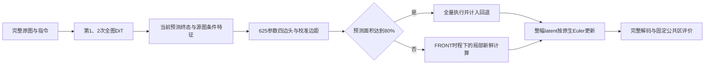

# 无硬 mask 局部执行与轻量四边扩张头：H800 实验报告

**后续更新：**本文件保留688DiT四边头轮次；随后新增260DiT的FIX32对象选择与刷新监督见[报告05](05_FIX32基线对象选择与刷新监督诊断.md)。错误优先刷新门失败，未训练新头或RL。

日期：2026-10-28，Asia/Shanghai。状态：执行器验证、625参数四边头训练、主闭环与固定32补充对照均已完成；语义质量门未通过，净延迟未测。本报告记录实际实验及失败。

## 1. 任务与冻结条件

目标是在原生 Qwen-Image-Edit＋原版匹配 Lightning 8-step LoRA 上，使整幅目标 latent 自由更新，同时通过计算区域减少目标 token 的新鲜 QKV、attention 行和 MLP 计算。没有逐步背景覆盖、最终 RGB 复制、裁剪或额外参考图。原图条件和文本每一步仍完整计算；域外目标 KV/velocity 可以复用，因此目标 token 节省比例不是端到端加速比例。

使用用户确认的 H800，驱动名称仍为 NVIDIA L20Y；80GB、计算能力9.0。BF16、CFG1、8步、1024×1024、原生 SDPA、不量化、不卸载、不编译；相同源图、prompt、显式初始噪声和 Shift3 scheduler。权重沿用已验证的40文件58,570,075,909字节。代码位于 zeta `/workspace/diffusers-fix/research/manual_mask_local_20261028`。

所有局部方法沿用 FRONT 调度：第1、2、8步全图，第3步刷新核心及一半背景组，第4—7步刷新核心与固定余数 token；每层可见完整 KV 上下文，但部分目标 KV 为历史值。框头在第2步结束后运行一次，第3步开始改变计算域。此版本尚不包含后续动态探测或 RL。

## 2. 执行器真实模型验证

先冻结4个已见开发来源：巧克力奶油、羔羊换山羊、木质球棒、猫换黑色拉布拉多幼犬。犬例允许姿态变化，属于明确登记的新开发指令，不能用来改写旧“保持站姿”的失败。比较 F、FIX16、FIX48，并在奶油例增加全选局部执行器 ALL。

|attempt|成功请求|实际 DiT invoked/completed|结果|
|---|---:|---:|---|
|free_contract_v1|0|8/8|原生生成完成，但检查器错误地提前将 velocity 转为 FP32，误报 Euler 不一致；保留失败及调用成本|
|free_contract_v2|13|104/104|全选执行器与原生8步逐位一致；所有方法整幅 latent 按原生 Euler 更新，框外每步均可变化|
|free_full20_v1|20|160/160|补齐24来源完整参考及前两步特征；不新增同状态教师调用|

v1检查问题通过8个随机数值用例复现和修复，额外 DiT 为0。原生调度器先以 BF16 完成 `dt * velocity`，再与 FP32 sample 相加；检查器现在使用同设备、同运算顺序和 dtype。模型和局部执行器未因该检查错误而修改。v2在质量检查前保存原始状态，避免分析异常导致生成证据未落盘。

4个开发样例的 F/FIX16/FIX48 均被单次非盲 AI 视觉审阅判为完成当前指令，未见严重结构截断。这不是独立测试或人类盲评。

|来源|FIX16 对F图像 MAE|FIX48 对F图像 MAE|FIX16目标更新比例|FIX48目标更新比例|
|---|---:|---:|---:|---:|
|15953 奶油|0.003841|0.003335|55.78%|63.09%|
|286770 山羊|0.005310|0.005219|51.00%|57.87%|
|26498 球棒|0.003381|0.003762|46.66%|50.95%|
|486018 幼犬|0.002787|0.002393|55.29%|62.54%|

MAE按RGB归一化至[0,1]后统计。该结果支持继续训练与闭环研究，但既不表示无损，也不表示所有来源达标。扩大计算域没有逐例单调降低误差，球棒例即为反例。


## 3. 来源、完整参考与标注

采用既有研究训练来源24个，按来源固定16拟合、4校准、4内部验证。它们在本次框头拟合中不跨组，但都属于此前研究的训练来源；不能称为新独立 Dev16 或最终 Test。Test64保持封存。

首次候选框从缩略图录入，随后在原始500像素源图上纠正了6个粗框，修改记录为 `free_head24_master_v2.json`。当时尚未用这些框进行任何局部候选生成或头拟合。F不读取框，原完整参考可以复用。prompt、来源分组及质量门不随框修正而改变。这一过程属于已见开发，明确保留v1，不作未经查看的验证声明。

24个F中18个判为可用。失败/不确定6例完整保留：建筑背景被全景重绘、两个靠垫同时变红、猫改变姿态、给另一人额外加帽子、花椰菜形态不确定、杯子替换误改已有马克杯。最终可用拟合来源12、校准来源3。内部验证F为3/4，杯子例失败，不能从分母删除。

标签来自对源图与完整F的AI审阅：目标轮廓粗框、原对象提示框的并集及必要接触范围，再外扩16源像素。标签是近似框，有标注误差；不是人工精确分割，也不是通过同状态教师证明的最优计算域。仅拟合/校准标签写入训练标签文件；验证输出不参与训练、阈值或 checkpoint 选择。

## 4. 四边扩张头

从第2步完整计算取得预测终态：

\[
\hat z_0^{(2)}=z_2-\sigma_2v_2.
\]

以它与原图条件 latent 的通道 RMS 差构造空间特征，按原框四边统计4个距离带的均值/最大值，加入核心差异、框几何、方向编码和冻结文本池化特征。每边37维，四边共享 `37→16→1` MLP，共625参数；softplus输出非负外扩量，并裁到画幅边界。

\[
\mathcal L=\operatorname{MSE}(\Delta,\Delta^*)
 +4\,\mathbb E[\max(\Delta^*-\Delta,0)^2]
 +0.002\,\mathbb E[\Delta].
\]

冻结基座，固定seed20261028，AdamW，学习率0.003、weight decay0.001、1200更新；不根据验证分数挑checkpoint。校准来源上每边最大正残差形成安全边距。这是经验校准，不是经过概率保证的置信度头。预测面积达到80%时全量回退，成本按全量计。

在线代码必须在第2步之后由当前请求状态运行小头，不在线读取F终态或标签。在线与静态相同选区逐步等价、全量回退等价、请求隔离、异常清理及梯度均经CPU测试；增加同预算几何对照后另留v2检查凭据。

更精确的调用位置是第2次DiT返回后、该步scheduler更新前；预测依赖该次DiT的输入latent、sigma及velocity，从第3次DiT开始使用新选区。该位置不改变第二次Euler更新。



训练已实际完成：12拟合来源、3校准来源、1200更新、625参数，梯度训练循环1.5866秒；该时间不含参考生成、标签审阅和特征准备。四边经验安全边距为左7.18、上21.51、右约0、下2.48源像素。checkpoint SHA256：`044dc6fcef142b1a52a48d04de25518f436eb1413b83c62245af1c83bf2a8508`。训练末期框回归MSE很低，但小样本拟合误差不能替代闭环或新来源表现。

## 5. 闭环对照与质量门

比较 FIX16、FIX48、HEAD；增加 MATCH 对照：保留HEAD所需矩形的token宽高，将其围绕原提示框居中，严格匹配每一步目标 token 数量。MATCH也计算相同小头，仅改变选区位置，用于检验方向预测在相同预算下的增量，不能当作无学习开销的固定规则。

正式计时前的内部验证门在生成前冻结：4/4任务通过、严重截断0、新增语义回退0；每例对F全图MAE≤0.015、公共评估区域外MAE≤0.01；F本身失败也计为不通过。公共评估范围固定，不能随候选选区缩放。由于完整F已出现1例失败，整组不能自动进入计时；仍完成候选对照，以区分基座与加速算法的问题。

## 6. 闭环结果与补充固定32诊断

主闭环40请求/320DiT全部完成。主实验后另登记固定32像素扩边12请求/96DiT；它是探索性补充，不把它伪装成最初预登记的确认性对照。小头checkpoint、来源分组、prompt与质量门始终未改。

12例总表包含4拟合来源、4校准来源和4内部验证来源，不能将12例整体称为独立泛化。平均计算比例均相对完整8步的目标token更新总量；文本与原图条件完整计算。

|方法|对F平均MAE|目标token更新比例|含条件图的图像token更新比例|数值通过|语义通过|
|---|---:|---:|---:|---:|---:|
|FIX16|0.005177|55.42%|77.71%|11/12|10/12|
|FIX32|0.004886|58.29%|79.14%|12/12|10/12|
|FIX48|0.004747|61.20%|80.60%|12/12|10/12|
|HEAD|0.004882|58.17%|79.09%|12/12|10/12|
|MATCH|0.004945|58.17%|79.09%|12/12|10/12|

单独的4个内部验证来源：

|方法|对F平均MAE|目标token更新比例|数值通过|语义通过|
|---|---:|---:|---:|---:|
|FIX16|0.006709|54.48%|3/4|3/4|
|FIX32|0.006368|57.11%|4/4|3/4|
|FIX48|0.006188|59.78%|4/4|3/4|
|HEAD|0.006390|57.92%|4/4|3/4|
|MATCH|0.006508|57.92%|4/4|3/4|

HEAD相对同预算MATCH为7好、3坏、2相同，平均MAE下降1.2795%；校准组均值略差，内部验证均值下降1.8158%。该增量很小，尚无多seed或新独立来源确认。HEAD对标注目标粗框覆盖率在12例为100%，MATCH为97.82%，FIX32为95.26%；覆盖标签近似且包含拟合/校准来源，不能解释为真实影响域被完全覆盖。

补充FIX32显示：全12例HEAD平均MAE仅低0.0909%，目标更新量58.17%对58.29%，基本相同；内部验证HEAD的MAE反而高0.3535%，目标更新量57.92%对57.11%，多0.81个百分点。**当前四边头没有证明比简单固定32扩边更有价值。**低训练误差和更高粗框覆盖率尚未转化为稳定的终图质量—计算量优势。

这也提示标签局限：完整对象包络并不等于每一步都必须重新计算的区域。前两步全图计算已生成部分新结构，后续历史velocity仍会更新域外latent，因此几何覆盖不能单独预测缓存误差和刷新收益。下一版需要面向真实计算收益的标签或更强动态规则，而非仅增加同一框回归任务的epoch。

### 6.1 失败与停止条件

- 内部验证272738：源图有一个玻璃杯和一个已有花纹马克杯。F与所有局部方法均把二者改成红色杯子，发生非目标对象改动。HEAD与MATCH输出相同，证明这不是学习扩边特有的问题；它仍是整组质量失败，不能从分母删除。
- 校准57395：白色替代物具有光滑团块外观，花椰菜形态不确定；F及局部方法均保留失败，不因数字接近F而视作正确。该来源未用于拟合或安全边距校准。
- FIX16在272738的公共区外MAE=0.0101687，超过冻结阈值0.01；HEAD为0.0095725，数值过门，但语义错误仍存在。
- 未观察到HEAD独有的新增明显语义失败或严重轮廓截断；这是单次非盲AI视觉初筛，不是人类盲评或数学无损证明。

正式决定为 **NO_GO_NET_LATENCY**：HEAD内部数值4/4、语义3/4，未达到冻结的4/4语义门。**本轮净延迟0请求、RL0更新。**运行日志中的带状态保存耗时仅用于诊断，不用于端到端加速主张；没有把目标token减少41.83%写成速度提高41.83%。


### 6.2 当前结论

1. 无硬mask局部执行在H800上跑通，全选等价和自由Euler更新有真实权重与原始轨迹证据。局部执行可以保留新轮廓，固定扩边本身已是很强的基线。
2. 625参数四边头可以小样本拟合并在线运行，但在当前数据和目标函数下没有稳定超越FIX32。保留checkpoint与全部负面结果，当前不将该头作为已成立的论文创新或默认最优候选。
3. 框选头无法自动修复完整基座已经发生的误改对象问题；对象定位/编辑语义与计算调度应分别诊断。
4. 下一轮以FIX32为强规则基线，先解决开发源中的基座选择性，再比较早期差分规则、常量安全边距和面向误差收益的学习头；冻结新候选后建立新的LocalDev，质量门通过才计时。

### 6.3 实际总账与审计

|环节|成功请求|实际DiT|训练更新|
|---|---:|---:|---:|
|首版检查器失败|0|8|0|
|无硬mask合同v2|13|104|0|
|补充完整参考20|20|160|0|
|四边头拟合|0|0|1200|
|主闭环比较|40|320|0|
|补充FIX32|12|96|0|
|本轮合计|85|688|1200|

688次DiT均进入并返回，其中8次属于随后被检查器误拒的请求。额外同状态dense教师0；用于标签的24次完整F请求/192DiT已包含在上表，不是免费数据。CPU测试和416个保存轨迹Euler更新的复算不计DiT。新机阶段含此前硬mask192DiT共109成功请求/880DiT；项目累计1344成功请求/12137DiT，历史dense教师648不变。

代码快照、输入配对、逐步同预算、调用账和416个Euler更新均复核。训练读取12拟合＋3校准来源，验证图像/标签未进入拟合脚本。新接口5项最终CPU合同通过，先前4项版本也保留。GPU结束后空闲；没有提交或推送Git。

运行器的原始status保留生成结束时的quality_pending字段，最终质量状态以[data/free_head_closed_decision_v2.json](data/free_head_closed_decision_v2.json)为准。

## 7. 可追溯材料

- [执行器协议v2](data/free_contract_v2_preregistration.json)、[执行器指标](data/free_contract_v2_metrics.json)
- [24来源与头协议v2](data/free_head24_master_v2.json)、[F视觉审阅](data/free_full24_visual_review_v1.json)
- [拟合/校准标签](data/free_head24_labels_v1.json)
- [方法方案](03_轻量影响区域预测头方案.md)、[执行计划](02_后续实验与执行计划.md)

- [主闭环指标](runs/free_head_closed_v1/analysis/metrics.csv)、[含FIX32的完整指标](runs/free_head_closed_v1/analysis_fixed32/metrics.csv)
- [训练结果](runs/expansion_fit_v1/result.json)、[头权重](runs/expansion_fit_v1/head.pt)
- [逐例视觉审阅](data/free_head_closed_visual_review_v2.json)、[最终决定](data/free_head_closed_decision_v2.json)、[最终审计](data/free_head_final_audit_v2.json)

## 8. 复现与归档

在zeta的研究目录使用 `/workspace/venvs/manual-mask-local/bin/python`。所有生成脚本拒绝覆盖既有attempt；重跑必须使用新名字，并追加真实费用。以下为复现入口，不表示已经再次执行：

```bash
cd /workspace/diffusers-fix/research/manual_mask_local_20261028
/workspace/venvs/manual-mask-local/bin/python scripts/test_online_expansion.py
/workspace/venvs/manual-mask-local/bin/python scripts/run_free_pilot.py --protocol data/free_contract_v2_preregistration.json --attempt free_contract_reproduction
/workspace/venvs/manual-mask-local/bin/python scripts/train_expansion_head.py --attempt expansion_fit_reproduction
/workspace/venvs/manual-mask-local/bin/python scripts/run_free_pilot.py --protocol data/free_head_closed_v1_preregistration.json --attempt free_closed_reproduction
/workspace/venvs/manual-mask-local/bin/python scripts/analyze_free_head.py --fixed32
```

训练入口读取已经归档的原始F特征；闭环协议固定使用原checkpoint及其SHA，不会自动切换到重新拟合的权重。若研究新checkpoint，必须另外冻结协议，不覆盖本轮结果。分析入口汇总本轮固定目录，复现新attempt时应显式指向新结果，避免混用。

原始PNG、每步latent、初始噪声、条件与第2步特征、checkpoint、代码快照、调用事件均已保存。重复的`*_raw_before_checks.pt`在远端完整保留；本地精简档案含非重复完整轨迹与生成结果。固定32与主闭环分别归档，SHA和字节数见各receipt。机器状态和论文/进度更新前版本亦保留。

- [完整参考与训练归档收据](data/free_reference_fit_archive_receipt.json)
- [主闭环归档收据](data/free_closed_archive_receipt.json)
- [固定32归档收据](data/free_fixed32_archive_receipt.json)
- [本轮文件与报告SHA清单](data/free_head_artifact_manifest_v1.json)
