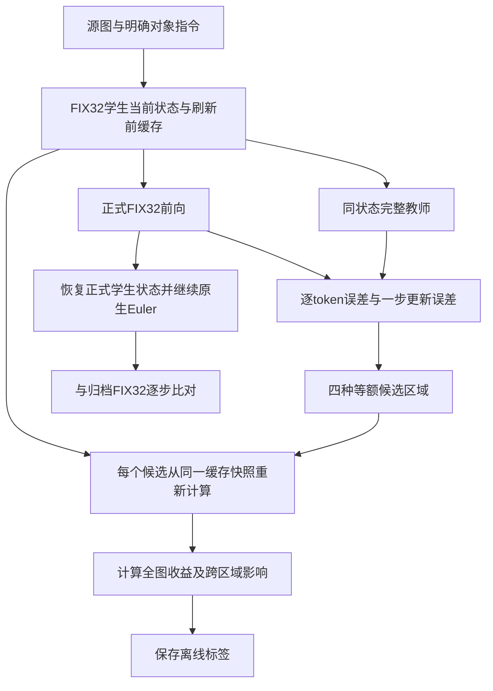

# FIX32强基线下的对象选择修复与刷新监督诊断

日期：2026-10-28。环境：zeta，用户确认H800；原版Qwen-Image-Edit＋8步Lightning、BF16、CFG1、1024×1024。本文为研究记录草稿，不是已投稿论文。本轮先诊断基座误改对象，再在既有训练来源上研究刷新监督；不引入硬mask、不做背景复制、不增加条件图片。

## 1. 研究问题与边界

上一轮625参数四边扩张头未稳定胜过FIX32：四边头与FIX32在12例开发比较中平均MAE接近，内部4例中头还略差。因此本轮冻结FIX32作为强规则：原对象框在500像素源图上向四边各扩32像素，映射到64×64目标token网格；沿用FRONT刷新时程。全目标latent每步按原生Euler更新，域外继续使用历史速度；域外KV参与全局读取，原图条件和文本始终重新计算。

原内部验证的杯子案例，完整F本身也误改另一只杯子。这个错误不能归因于局部执行，更不能用“局部结果接近F”认定正确。修复完整基座的对象选择，是有效教师标签的前提。原内部验证仍为语义3/4、NO_GO_NET_LATENCY；新提示词与新种子的诊断不回写旧结果。

## 2. 对象选择诊断

### 2.1 冻结协议

采用3个已见开发来源：272738杯子、210597靠垫、213020帽子。每例预先写两版指令，P1明确目标位置，P2额外描述需要保留的相似对象。先各生成完整F，共6请求48DiT。预先规定优先选择通过任务审阅的P1，否则选P2；两者失败则保留未解决状态。

其他模型与采样配置不变。第一种子为原显式噪声；选定指令后生成3个FIX32配对，再用种子2026102802生成3个F＋3个FIX32。新增15个完整生成请求，共120DiT。没有微调基座，也没有把框或mask输入视觉编码器；改进来自人工编写、更明确的文本指令，自动定位能力尚未实现。

### 2.2 逐例结果

|来源|原始完整F错误|P1|P2|冻结选择|
|---|---|---|---|---|
|272738杯子|把目标玻璃杯和左侧原有花纹杯都改成红杯|仅替换右侧玻璃杯，左杯保留|目标与左杯也能区分|P1|
|210597靠垫|左右两个蓝靠垫都变红|仍出现两个红靠垫，且另一个被移到右侧竖起|右侧平放靠垫变红，左侧保留蓝色|P2|
|213020帽子|给原本未戴帽子的女性也加了红帽|仅男性既有帽子变红，女性保留|女性虽然未加帽，但发型明显改变|P1|

选定版本在两种子下，F和FIX32均完成6/6任务级对象选择与保留审阅。帽子的编织纹理在F和FIX32中均有减弱；第二种子下F帽带偏深色、FIX32帽带偏浅色，存在局部细节差异。6/6仅指预登记的对象选择与任务级保持，不能称细节一致或无损编辑。审阅为单一助手、非盲评；没有独立人工评分。第二种子是同来源的稳健性诊断，不是增加3个独立验证来源。

|来源|种子|FIX32对F全图MAE|固定公共框外MAE|数值门|
|---|---:|---:|---:|---|
|272738|1|0.006511|0.003616|通过|
|272738|2|0.010189|0.007639|通过|
|210597|1|0.002285|0.002170|通过|
|210597|2|0.006203|0.006346|通过|
|213020|1|0.005269|0.004931|通过|
|213020|2|0.009235|0.006928|通过|

阈值沿用全图MAE≤0.015、公共区域外MAE≤0.01。公共区域统一按原始提示框扩32源图像素定义，与每个输出内容无关。所有配对前两步latent逐位一致。数值接近F与任务完成分别检查；不是将F当作编辑真值。


**结论：**明确位置与保留对象的指令，缓解了这3个已见来源上的误改；不能主张解决所有基座定位问题。提示词越长并不一定越好，显式“保留女性头发”的候选也发生了外观改动。后续需在新来源上冻结定位规则后验证，并计入文本长度变化的实际成本。

## 3. 从对象轮廓标签转向刷新监督

### 3.1 同状态误差标签

记FIX32学生在第t步的完整目标latent为 \(z_t\)，历史缓存为 \(H_t\)，冻结条件为 \(c\)，活动目标token集合为 \(C_t\)。基座参数保持冻结：

\[
v_t^F=D_\theta(z_t,c,t),\qquad
\widetilde v_t^B=D_\theta^{\rm local}(z_t,H_t,c,t;C_t).
\]

教师在学生的同一latent、时间步、文本和原图条件上计算。不能用独立F轨迹的第t步速度替代它；两条轨迹已经分叉时，那不是同状态标签。

\[
e_{t,i}=\frac{1}{d}\|v_{t,i}^F-\widetilde v_{t,i}^B\|_2^2.
\]

该标签表示“误差在哪里”，还不能直接解释为“刷新哪里收益最大”。例如，活动token自身也可能受域外旧KV影响；误差小的上下文区域被刷新后，可能改善其他位置。

令 \(\Phi_t(z,v)\) 为实际原生Euler更新，包括BF16速度乘法与最终类型转换：

\[
\Phi_t(z,v)=\operatorname{BF16}\!\left[
 \operatorname{FP32}(z)+
 \operatorname{BF16}\big((\sigma_{t+1}-\sigma_t)v\big)
\right].
\]

代码直接使用原调度器对应运算的dtype语义，而不提前把速度转为FP32。一步更新损失为：

\[
L_t(C)=\frac1{Nd}\|\Phi_t(z_t,\widetilde v_t^C)
                         -\Phi_t(z_t,v_t^F)\|_F^2.
\]

### 3.2 实际刷新收益标签

在完全相同的学生输入与**刷新前缓存**上，反事实增加区域 \(A\)，定义：

\[
G_t(A)=L_t(C_t)-L_t(C_t\cup A).
\]

正值表示此时刷新A降低了一步更新误差；负值表示反而增加误差。教师与候选均不写入正式学生的缓存或状态。每个候选从同一刷新前快照出发，结束后恢复FIX32正式状态；最终8步轨迹必须与已归档FIX32逐位一致。

该收益包含被刷新区域自身与其他位置的变化，可分解为：

\[
G_t(A)=G_t^{\rm own}(A)+G_t^{\rm spill}(A).
\]

计算全图损失的下降，能够记录跨区域影响；不能只在被选区域内评分，掩盖对其他位置的损害。

### 3.3 固定预算诊断

只使用原fit分区的山羊、狗、巧克力蛋糕、木球棒4个来源；不读取内部验证来拟合。每个学生8步，零起点步骤2—6各加一次完整教师；在步骤3、5做4种刷新候选。每种候选都额外刷新64个目标token，由16个完整2×2网格小块组成：

|候选|选区依据|在线可获得性|
|---|---|---|
|ERROR|按同状态教师误差选择最大的网格块|教师oracle，仅离线诊断|
|NEAR|优先选择FIX32核心边缘最近的域外网格块|可部署规则|
|FAR|选择离核心最远的网格块|负对照规则|
|RANDOM|固定随机种子选择域外网格块|随机对照|

**四种候选之间严格等额；它们比原FIX32每个诊断步多64个token。**因此本轮只能比较预算投放位置，不能宣称在原FIX32相同成本下已有收益，更不能将教师oracle部署成加速算法。

预登记的探索继续门：ERROR在8个状态中至少6次优于RANDOM，且至少6次有正的一步更新收益。4来源内部的20个时间状态彼此相关，不能当20个独立样本做显著性或泛化主张。



## 4. 刷新诊断实测结果

84次DiT采集完成：4条学生轨迹、20个同状态教师标签、32次反事实刷新。4条轨迹均与原FIX32的8步latent逐位相同。冻结的误差选区继续门**未通过**。

|同额候选|正收益状态数/8|平均一步更新误差下降比例|最好|最差|
|---|---:|---:|---:|---:|
|ERROR|2/8|−2.654%|+1.437%|−8.951%|
|NEAR|4/8|−0.384%|+5.498%|−4.779%|
|FAR|4/8|−0.865%|+2.525%|−5.659%|
|RANDOM|4/8|−1.272%|+3.124%|−7.765%|

这里“下降比例”为正才是改善。ERROR在0/8状态胜过RANDOM、1/8胜过NEAR；因此直接用误差大小作刷新排序，在此小样本诊断中没有证据支持。也不能把“多刷新64个token”自动解释为更接近完整教师。

20个学生状态中，误差平均只有31.16%位于当步未活动区域，约68.84%已在活动区域；核心及外侧4-token环内平均占65.19%。误差最大的10%目标token合计占约41.04%。这些数字描述当前学生误差分布，不能推导相同区域的刷新收益。

早期预测与原图条件的差分，选出域外前10%位置时，仅捕获约10.27%的域外误差，接近面积占比；教师误差oracle前10%捕获约21.55%。这进一步削弱“早期变化大＝值得重算”的直接标签解释，但尚不足以否定更丰富的状态特征。

### 4.1 一个值得后续验证的机制

将ERROR的总收益按被新增刷新位置与其他位置拆开：被刷新位置自身平均贡献**−5.415%**，其他位置贡献**+2.761%**，合计−2.654%。NEAR相应为−3.761%、+3.377%，合计−0.384%。这些百分比均相对同一状态的全图基线一步损失归一化，不是终图MAE变化。

这说明此处的新鲜局部计算，对新活动位置输出的速度可能比其旧缓存速度更差，同时对其他位置产生改善。可能与局部计算仍依赖大量旧上下文、刷新后中间表示不一致有关。**原因尚未被隔离证明，不能把该推断写成已经验证的KV因果结论。**

后续可以检验“刷新上下文缓存”与“接收新活动位置的速度”是否应该分开决策。若只在本步输出上保留新增区域原速度、其余位置使用反事实结果，按现有损失分解可推导该步收益等于spillover项；这是输出门控的算术推断，尚未实际运行持续缓存的闭环方法。

### 4.2 排除采集器问题的追加控制

已另行冻结同选区REPLAY和全量FULL两个控制：相同刷新前缓存下，REPLAY应逐位复现FIX32；FULL应与同状态完整教师一致。预算56DiT，包含32学生、8教师、16控制。实际56DiT全部完成、4条生成请求成功。8次REPLAY的一步增益图逐位为0；8次FULL的velocity MSE和一步更新MSE均为0。4条控制学生轨迹仍与归档FIX32逐位一致。控制支持负结果来自所测局部刷新行为，而非快照恢复或教师对齐错误；仍不能唯一归因于某一层KV。

## 5. 训练目标与后续实验

当前不训练“最大误差优先”的区域头，也不直接扩大同类标签采集。下一候选应预测带符号的真实刷新效用，并包含“不刷新”动作；先验证刷新上下文与接收新速度的解耦机制，再决定是否训练轻量网格头。可用输入限于推理时已知的时间步、当前latent变化、早期预测与原图条件的差分、缓存年龄、到FIX32核心的距离、冻结文本特征；不可输入教师、未来F终态或真实收益。

候选监督分两层：误差图提供稠密辅助信号，实际反事实收益提供动作排序与负收益监督。建议的待实施目标为：

\[
\mathcal L =
\lambda_e\,\mathrm{Huber}(\widehat e,e)
+\lambda_g\,\mathrm{Huber}(\widehat G,G)
+\lambda_r\sum_{G(A)>G(B)+\epsilon}
 \log(1+\exp(-(\widehat G(A)-\widehat G(B)))).
\]

权重、置信度和阈值需在扩大训练采集前冻结，本文不把该公式当作已训练成果。区域误差与动作收益的样本粒度不同，不能把动作总收益复制成每个token的真值。

|顺序|下一步|必须保持的对照与验收|
|---|---|---|
|1，已完成|标签价值判断及采集器控制|误差排序门未过；负收益保留，REPLAY/FULL控制全部通过|
|2|先比较保留旧速度、接收新速度、整块一致刷新和不刷新|固定FIX32底座，同状态及闭环分别验证；有稳定正收益后才扩到至少8来源，不立即拟合误差头|
|3|冻结候选做闭环验证|检查一步收益是否转化为终图质量，保留所有失败；至少对比FIX32和同额规则|
|4|检验固定总预算重新分配|可从早期背景刷新中移出预算给后期必要位置；保持FIX32核心，单独冻结动作与总量。等总量不自动等于等延迟|
|5|新来源质量门与净延迟|旧内部4源已见；新LocalDev预登记后一次性评价，过门才计入全部开销计时|
|6|条件性策略/RL与SGLang|监督或规则稳定有增量后才考虑RL；当前均未运行|

## 6. 过程、成本与复现

本轮全部实际调用如下，运行失败0；提示词质量失败仍保留在结果分母中。

|attempt|完整生成请求|学生/普通生成DiT|同状态教师|反事实/控制|合计DiT|
|---|---:|---:|---:|---:|---:|
|object_selectivity_v1|6|48|0|0|48|
|object_selectivity_fixed32_v1|3|24|0|0|24|
|object_selectivity_seed2_v1|6|48|0|0|48|
|refresh_supervision_v1|4|32|20|32|84|
|refresh_controls_v1|4|32|8|16|56|
|合计|23|184|28|48|260|

新机阶段累计132成功请求/1140实际DiT；项目累计1367成功请求/12397实际DiT，dense同状态教师676。与上一轮相比，本轮新增训练0、RL0、净延迟0；此前四边头1200更新及历史PPO记录保持原样。7个实际来源被反复用于诊断，23个请求不是23个独立样本。

最终离线审计复算184步原生Euler、28份同状态标签、32个同额区域及16个控制，全部通过。首次审计错误要求CPU与GPU的FP32均值归约逐位一致，触发断言；日志保留，未导致新DiT。修订后归约使用rtol=2e-6、atol=1e-10；latent轨迹、REPLAY以及FULL等价仍按严格相等检查。见[审计收据](data/fix32_supervision_audit_v2.json)。

CPU首版2项测试、增加控制后3项测试均通过；tiny调用未单独计数，不虚构累计次数。所有原始噪声、完整轨迹、教师速度、误差图、候选收益图、代码快照、失败日志和协议均保存。旧协议需配合对应attempt的代码快照使用，不能拿修改后的采集器绕过旧SHA检查。

主要入口：

```text
scripts/run_free_pilot.py --protocol data/object_selectivity_v1_preregistration.json --attempt object_selectivity_v1
scripts/run_free_pilot.py --protocol data/object_selectivity_fixed32_v1_preregistration.json --attempt object_selectivity_fixed32_v1
scripts/run_object_selectivity.py --protocol data/object_selectivity_seed2_v1_preregistration.json --attempt object_selectivity_seed2_v1
scripts/run_refresh_supervision.py --protocol data/refresh_supervision_v1_preregistration.json --attempt refresh_supervision_v1
```

历史attempt禁止覆盖。每个attempt包含协议、代码快照、显式噪声、真实调用账本、状态与输出。本文中的命令是既有复现入口，不可直接对同名attempt重跑。

当前对象选择证据：[初轮复核](data/object_selectivity_v1_review.json)、[两种子诊断决定](data/object_selectivity_decision_v1.json)、[数值表](runs/object_selectivity_analysis_v1/metrics.json)。刷新CPU合同为2项测试，含FP32/BF16轨迹隔离与异常恢复；CPU tiny前向次数未单独计数，不与真实GPU DiT混合。

## 7. 本轮决定

保留FIX32作为强基线；明确对象指令只认定为已见开发集上的修复。暂停误差优先头的拟合与扩量，保留带符号刷新收益和不刷新动作作为后续候选标签。先做缓存刷新与新速度接收解耦的同状态及闭环对照，再决定是否有值得学习的正收益。最优候选加不刷新动作，在当前8状态的事后oracle平均潜在一步改善仅1.266%，5/8状态存在正收益，3/8全部候选非正；这也是小样本上限诊断，不能当策略性能。

[本轮最终决定](data/fix32_supervision_decision_v1.json)为不训练当前误差优先头；质量决定仍为NO_GO_NET_LATENCY。无新的独立LocalDev、RL或SGLang实验。各attempt的status.json保留生成或采集结束时状态，后续审阅与分析结论以最终决定为准。

归档校验：5个attempt共252个结果/日志文件已完整下载，原始PT轨迹与标签均包含；归档378,809,061字节，SHA256为8c16e2133542c8ce5bdd17858c9b7a1c183c2926e7a2ad1be93e0e90bf0c538c。详见[归档收据](data/fix32_archive_receipt_v1.json)。GPU最终0MiB、无计算进程；代码未提交或推送。
