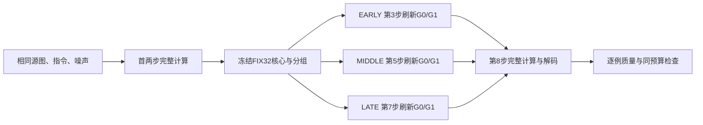

# F/FIX32 诊断性净延迟与等预算重算时机实验

日期：2026-10-28。状态：两项实验、逐例审阅、离线审计和原始数据本地校验均完成。

## 1. 结论与本轮交付

H800两项诊断完成：82请求／656DiT，模型执行失败0。F/FIX32完整流水线6.9884→6.3643秒，1.0981×，耗时减少8.9298%；DiT 3.6294→2.9843秒。等预算时机的事后最优分布为EARLY 2／MIDDLE 3／LATE 3；相对最佳固定时机的MAE改善空间为全8源2.0987%、历史粗审通过6源5.6094%。这是策略可学习空间的诊断，尚无本轮训练或RL收益。严格任务＋保持本轮各臂均5/8（助手非盲审），旧LocalDev16 NO_GO不变。

这次已经确认执行器有实际省时，同时找到了比原固定扩边候选更值得进一步检验的时机选择空间。允许进入下一轮监督学习试验；尚不满足“已训练出有效策略”“无损加速”或“任务质量已达标”的结论。MIDDLE/LATE只有等token预算闭环结果，尚未测它们的正式净延迟，不能把FIX32的速度直接转移给新策略。

|工作包|成功请求|实际DiT|状态|
|---|---:|---:|---|
|F/FIX32各一次预热|2|16|完成，不纳入正式计时|
|8来源×2臂×3次配对计时|48|384|完成|
|8来源×F/EARLY/MIDDLE/LATE闭环|32|256|完成；其中2请求同时作独立算子剖析|
|合计|82|656|无模型执行失败、无额外重跑|
|本轮训练／RL／额外同状态教师|0|0|未执行|

## 2. 实验对象、环境与冻结规则

采用原版Qwen-Image-Edit＋对应8步Lightning LoRA，BF16、CFG=1、1024×1024、batch=1、native attention；无量化、offload或编译。H800由用户确认，驱动标签为NVIDIA L20Y，compute capability 9.0；Torch 2.9.1+cu129。模型和LoRA沿用已校验版本，Git HEAD为`4222cd5955b8033842748a7d676a5d180ab4c22d`。本轮不提交或推送Git。

使用旧主清单前8个原S1训练来源，不按本轮生成好坏选择；历史已知的路桩、靠垫失败保留。全部来源已见，不能作为新的独立验证。本轮没有访问Test64，也没有下载新数据。原图为500×500，FIX32指原图坐标下32像素外扩；粗框仅控制计算，不裁剪原图、不添加第二张条件图、不做硬mask融合或最终RGB复制。

冻结协议：[完整参数与执行顺序](data/latency_temporal_v1_preregistration.json)，SHA256：`23d4c92431b84a1fc1317f21f1232b0f314e5b9eb00ee57eead5bba88f39e4c9`。保存11份冻结代码。新诊断来自用户明确授权，不修改旧LocalDev16的失败判定。

## 3. 净延迟：测量口径与结果

模型、源图和固定初始噪声已加载，模型加载和输入文件读取不计入单请求延迟。计时包含每次重新执行的图像预处理、提示编码、源图VAE编码、在线计算域构造、8步DiT和调度、VAE解码、PIL后处理、局部缓存分配与清理。输出落盘、散列、轨迹复算在计时外。没有复用文本embedding或源图VAE编码来偏向某一臂。

两种方法各预热一次，随后每个来源各测3次；交替F/FIX32顺序，第二轮反向遍历来源。使用轻量CUDA事件记录模块区间，仅在请求边界同步，计时过程中没有逐步张量下载或torch profiler。硬件频率未锁定，原始重复值完整保留。

令 (t_{i,a,r}) 是来源 (i)、方法 (a)、重复 (r) 的流水线耗时，主汇总为

[
ar T_a=
rac1{8}sum_{i=1}^{8}operatorname{median}_{r=1,2,3}t_{i,a,r},qquad
S=
rac{ar T_F}{ar T_{mathrm{FIX32}}}.
]

|指标|F|FIX32|解释|
|---|---:|---:|---|
|完整单请求流水线|6.9884 s|6.3643 s|1.0981×；耗时减少8.9298%|
|DiT区间合计|3.6294 s|2.9843 s|耗时减少约17.78%|
|提示编码|0.3738 s|0.3741 s|基本不变|
|源图VAE／latent准备|1.1340 s|1.1373 s|基本不变|
|VAE解码|1.7967 s|1.7963 s|基本不变|
|平均峰值已分配显存|54.6771 GiB|57.6497 GiB|局部缓存使显存增加约2.97 GiB|

模块列为各来源模块CUDA区间中位数的均值；流水线为墙钟时间，两者不可当作严格可加分解。8/8来源均省时，单来源加速范围1.0798–1.1145×；来源级bootstrap的速度比区间为1.0886–1.1071×，只描述这8个已见来源，不代表部署泛化。单臂3次耗时的最大极差/中位数为3.86%。

|来源|F中位数/s|FIX32中位数/s|加速比|FIX32整图MAE|域外MAE|数值阈值|
|---|---:|---:|---:|---:|---:|---|
|286770|6.9762|6.3500|1.0986×|0.005139|0.001473|通过|
|486018|6.9782|6.4543|1.0812×|0.002515|0.001358|通过|
|178810|6.9944|6.3008|1.1101×|0.080581|0.083883|失败|
|429111|7.0072|6.2874|1.1145×|0.005980|0.003656|通过|
|15953|6.9976|6.4552|1.0840×|0.003766|0.002425|通过|
|26498|6.9855|6.3128|1.1066×|0.003547|0.003452|通过|
|452168|6.9573|6.4428|1.0798×|0.005604|0.003992|通过|
|210597|7.0108|6.3115|1.1108×|0.002347|0.002280|通过|

数值阈值沿用整图MAE≤0.015、固定评估区外MAE≤0.01，仅作描述，不能替代语义正确。路桩例的大误差保留在主均值、计时和图表中。

## 4. 缓存、索引和条件图的开销

平均目标token更新比例为53.4317%，而两类图像token合并后的更新比例是76.7159%。文本行也持续重算，实际联合attention的平均Q行数比例为80.1466%，K/V总长度仍为完整长度。不能把目标token少算46.57%称为总计算量或净耗时减少46.57%。

设目标与条件图各有 (N=4096) 个token，第 (t) 步重算 (n_t) 个目标token，文本长度为 (T)。则

[

ho_{
m target}=
rac{sum_t n_t}{8N},quad

ho_{
m image}=
rac{1+
ho_{
m target}}2,quad

ho_Q=
rac{T+N(1+
ho_{
m target})}{T+2N},quad
ho_{KV}=1.
]

剩余图像行更新中约65.18%是原图条件行；这是一项计算结构比例，不是将65.18%的实测时间独立归因于条件分支。条件行与目标行在同一矩阵算子中执行，本轮没有单独测出其可移除时延。源图一次VAE编码与每步DiT条件行计算是两种不同开销。

每请求原始目标KV及velocity缓存为3,020,947,456字节，即2.8135 GiB；在线计算域构造平均约9.21 ms。单个山羊来源的独立全流程profiler中，局部执行产生968次`index_copy_`，算子自身GPU时间约24.24 ms；`cat`自身GPU时间F约111.15 ms、局部约100.94 ms。因此当前证据不支持把主要瓶颈归咎于缓存写回；未减少的图像条件/文本计算，以及约3.3秒的VAE编解码与提示编码更值得关注。

这些算子数据只来自一对带追踪的诊断请求，不能直接从流水线耗时中扣除；`index_select`的自身时间也不是索引路径的全部开销。完整明细见[开销分析](runs/latency_temporal_v1/analysis/overheads.json)。

## 5. 等预算时机对照：只改变何时刷新

令G0…G3为固定、等大小的域外token分组。原FIX32采用FRONT：首两步全量，另在零基第2步刷新G0＋G1，最后一步全量。本轮固定区域、分组和每个token的累计更新次数，只移动G0＋G1这次刷新。区域仍沿用FIX32，域外未被选中的位置继续使用缓存velocity更新完整latent。

|候选|一基第1步|第2步|第3步|第4步|第5步|第6步|第7步|第8步|
|---|---|---|---|---|---|---|---|---|
|EARLY＝原FIX32|全量|全量|核心＋G0/G1|核心|核心|核心|核心|全量|
|MIDDLE|全量|全量|核心|核心|核心＋G0/G1|核心|核心|全量|
|LATE|全量|全量|核心|核心|核心|核心|核心＋G0/G1|全量|

表中“核心”还包括分组除不尽时始终更新的余数token；精确索引均在冻结协议中。本轮额外分组同时刷新KV和velocity，未同时展开解耦动作搜索。

以山羊例为例，EARLY每步更新数为[4096,4096,2418,740,740,740,740,4096]；MIDDLE和LATE把2418对应的那一步分别移到第5、第7步，其余位置为740。三种方法各token累计更新次数的多重集合相等，比仅总token数量相等更严格。

## 6. 时机质量、选择空间与边界

|来源|EARLY MAE|MIDDLE MAE|LATE MAE|最优时机|严格任务＋保持（各臂）|
|---|---:|---:|---:|---|---|
|286770|0.005139|0.004765|0.005467|MIDDLE|通过|
|486018|0.002515|0.002641|0.002772|EARLY|通过|
|178810|0.080581|0.076040|0.074883|LATE|失败|
|429111|0.005980|0.006518|0.005893|LATE|失败|
|15953|0.003766|0.003213|0.003706|MIDDLE|通过|
|26498|0.003547|0.004268|0.003892|EARLY|通过|
|452168|0.005604|0.004836|0.005215|MIDDLE|通过|
|210597|0.002347|0.002338|0.001889|LATE|失败|

|汇总范围|EARLY平均MAE|MIDDLE平均MAE|LATE平均MAE|最佳统一时机|逐例最优额外改善|
|---|---:|---:|---:|---|---:|
|全部8源，主结果|0.013685|0.013077|0.012965|LATE|2.0987%|
|历史粗审通过6源，预先冻结|0.004425|0.004373|0.004491|MIDDLE|5.6094%|
|本轮严格复核通过5源，仅事后敏感性|0.004114|0.003945|0.004210|MIDDLE|4.2947%|

这里的“逐例最优”读取完整终图答案，仅用于计算动作空间的潜力：

[
E_{i,a}=operatorname{MAE}(x_{i,a},x_{i,F}),quad
E_{
m oracle}=
rac1nsum_imin_a E_{i,a},quad
G_{
m oracle}=1-
rac{E_{
m oracle}}{min_a
rac1nsum_iE_{i,a}}.
]

全8源中EARLY/MIDDLE/LATE分别最优2/3/3例，最大统一赢家占比37.5%；事后最优相对最佳统一策略再改善2.0987%，达到事先冻结的2%探索门。历史6源的收益为5.6094%，也并非由路桩单例独自贡献。当前严格5源的事后分析仍有4.2947%空间，但其bootstrap区间包含0；样本很少，不能宣传稳定泛化或视觉显著改善。

全部8源平均值中LATE最好；历史6源中MIDDLE最好，LATE甚至略差于EARLY。因此现在不应把全体默认时程直接换成LATE。保留三个候选，通过来源外监督验证来判断能否预测选择。

在与旧FIX16/32/48记录可直接对齐的4个来源上，以每例不超过FIX32的目标预算为约束，固定扩边的事后MAE改善空间为1.1053%，本轮三种时机为6.1935%（共同参照FIX32）。这支持优先研究时机选择，但只涉及4个已见来源、候选数与预算约束也有差异，不能推广为“时间调度普遍优于空间选择”。详见[配对敏感性分析](runs/latency_temporal_v1/analysis/secondary.json)。

## 7. 失败案例与视觉复核

本轮逐一查看8张源图/F/FIX32面板和8张源图/F/EARLY/MIDDLE/LATE面板。是助手非盲审，没有独立人工盲评。各臂都实现了主要编辑动作8/8，但严格“编辑＋其他内容保持”均为5/8；未观察到局部方法相对F新增的明显严重结构失败，不等于证明绝无感知损失。

|失败来源|现象|归因与处理|
|---|---|---|
|178810 路桩|F和局部都大范围重绘建筑、树冠和地面；不同局部时机之间背景也有可见差异；三时机均未过绝对数值阈值|完整基座已触发广域修改，当前局部近似也不可靠。保留在全8源主结果，不删除|
|429111 遥控器|遥控器变大，原红手机下方的白色播放器不再可见|F与三种局部时机共同违反保持其他物体。历史粗审曾判通过，本轮纠正，旧记录原样保留|
|210597 靠垫|只要求右侧平放靠垫变红，却把两只蓝靠垫都改红|F与局部共同发生的对象选择失败，时间调度没有修复|

历史6源分组中包含遥控器，故它不能被称为本轮已确认正确的6源；本轮严格5源只作事后敏感性，不替换预先冻结主结果。其余山羊、狗、蛋糕、球棒、标牌的主要结构和请求保持较稳定，存在细节/色调误差，不称无损。

## 8. 执行审计、工具问题与归档

三个CPU小模型测试通过。离线审计通过：272个保存步骤的Euler更新复算一致，24个局部时机/完整F首两步配对一致，8个来源的精确预算与逐token更新多重集合一致；50次与既有参考的终态逐位一致，82份原始输出、PNG和冻结代码散列通过检查。

两份torch profiler的`key_averages`调用树整理明显慢于生成本身：原始张量保存后到算子统计完成约587.6秒和681.4秒。栈采样定位到反向栈追溯整理，但实际为无梯度推理，最终两份统计都正常完成。曾准备恢复草案，实际中断被状态保护阻止；没有发送SIGINT，没有运行恢复批次，没有额外DiT。之后需要剖析时应缩小到DiT或指定步骤，避免再次采集全流程巨大事件树。

本地原始归档为`/tmp/latency_temporal_raw_20261028.tar.gz`，419,159,390字节，SHA256为`289545c8dea5b60435f58d501b2eb1585a42128cb2b1f9a6ee57fb3d0353b774`。本地逐文件复检298个文件、546,831,018字节通过。归档解包API兼容性及离线二级分析的语法/同名路径断言在本地修正，未影响任何冻结推理、结果或DiT计数。

本轮新增82请求/656DiT，新机累计460请求/3764DiT，自由生成路线累计3572DiT；项目累计1695成功请求/15021实际DiT。额外同状态教师累计676不变；保存轨迹Euler累计复算2840步。计时、预热与剖析均已计费，不重复计数。

- [执行审计](data/latency_temporal_audit_v1.json)
- [逐例速度与重复值](runs/latency_temporal_v1/analysis/latency.json)
- [三时机数值结果](runs/latency_temporal_v1/analysis/temporal.json)
- [最终视觉审阅](data/latency_temporal_visual_review_v1.json)
- [最终研究决定](data/latency_temporal_decision_v1.json)
- [归档校验](data/latency_temporal_local_archive_check_v1.json)

生成阶段status和数值脚本中的`pending`保留原始阶段含义，最终审阅与决定以上述两个最终JSON及本报告为准。当前工作没有提交或推送Git。

## 9. 后续计划与完成状态

|事项|状态|下一项可审阅产物|
|---|---|---|
|F/FIX32诊断性净延迟|已完成|本报告、48次原始计时、模块与缓存分析|
|等预算时机闭环|已完成|24个候选终图、8个F、逐例胜者与失败|
|时机选择的可学习空间|探索门通过|仅允许监督试验，不代表训练或部署通过|
|扩充并训练时机收益头|未执行|建议先形成32来源开发集，来源级拟合/校准；本轮8源只作训练来源|
|新候选独立Dev与净延迟|未执行|冻结头与最佳统一规则，另取未见来源；不能复用已打开LocalDev16作独立验证|
|RL、SGLang|未执行|只有监督策略有稳定闭环增量、且序列决策确有必要后再推进|

下一轮头优先使用首两步全量计算已经得到的变化量、缓存状态、源图/指令特征，预测EARLY/MIDDLE/LATE的终图收益；与校准选定的最佳固定时机比较。特征不能读取F终图，训练标签可来自离线完整闭环。先研究一次选择，避免把三选一问题直接扩成PPO。

工程上，VAE编解码和提示编码是下一项成本优化对象，但任何公共优化必须同时应用于F和局部臂。当前结果仅覆盖启用VAE tiling的冻结环境，不能据此承诺关闭tiling或更换后端的收益。八个月窗口仍为2026-10-22—2027-06-21：已完成执行器诊断和时机机会验证，学习算法的独立泛化、最终系统评测与论文主贡献仍未完成。
