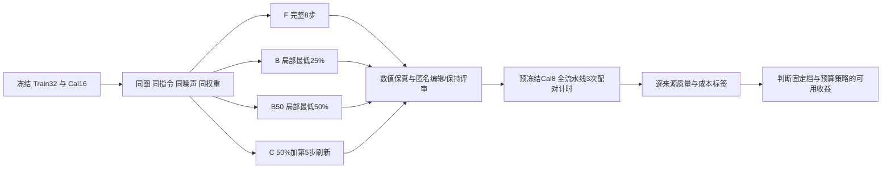

# 固定预算空间与刷新对照：LOCAL128 的质量—成本曲线

日期：2026-10-30。状态：48 来源四臂质量审阅、8 来源三次配对净延迟及原始数据归档均完成。

本轮新增 260 次完整请求、2080 次 DiT，全部成功。当前证据支持“局部低预算＋中途完整刷新”的方向：C 在 Cal16 的平均参考误差比 B 降低 29.39%，15/16 来源改善；完整请求 4.299→2.932 秒，1.466×、节时 31.81%。B 保留为速度档（2.480 秒，1.734×）。B50 更慢且平均参考误差更高，当前不作为主候选。匿名语义审阅 Cal16 四臂均 11/16；Train32 的 C 相比 B 修复一例狗张嘴，独角兽缺角仍失败。没有新训练或 RL 成果，也没有新的独立泛化结论。

## 1. 研究问题与冻结配置

固定 LOCAL128 推理权重，仅比较计算区比例与全图刷新时机。B 的完整锚点为第 1/2/8 步，局部最低 25%；B50 同锚点、最低 50%；C 为第 1/2/5/8 步完整锚点、最低 50%。完整锚点关闭新增 LoRA，局部步骤开启；Lightning 保持融合。三档算量不同，不称为等预算消融。原图条件与文本缓存策略、模型、噪声、提示词、1024 分辨率及 8 步固定。

源图框只提供重算位置提示，无硬 mask、外围 latent 覆盖或最终像素粘贴。非活动区域仍通过历史 velocity 执行 Euler 更新。

## 2. 数据与计算预算

按原冻结顺序取前 32 个 Train 来源、前 16 个 Cal 来源，不使用已见 Dev32 或 Test64。Cal16 的 F/B 共 32 份结果按图像、状态、元数据 SHA256 复用。新增 160 个完整请求、1280 次 DiT；不新增教师查询、学生优化或 RL 更新。所有原始结果按来源保留，基座自身编辑失败单列。

预生成计划合同：48 个 B 计划逐字段复现训练时版本，48 个 C 计划复现旧版本；B50 与 C 的共同 7 步选区逐位一致，336 次检查通过。三档都存在核心框升档，实际 token 成本单独报告。

|来源|B 平均目标更新比例|B50|C|B/B50 实际相同来源|
|---|---:|---:|---:|---:|
|Train32|58.4961%|70.2148%|76.1719%|8/32|
|Cal16|60.9375%|69.7266%|75.7813%|7/16|

上表来自生成前冻结计划。B 的局部比例分布为 33 个 25%、11 个 50%、4 个 75%；B50/C 为 44 个 50%、4 个 75%。15 个相同实际预算来源仍按冻结协议执行，作为完整闭环一致性对照。空间预算收益另在真正发生扩大的 33 个来源中报告。

## 3. 评估规则

RGB MAE、编辑框外扩 32 源图像素区域内/外误差，只衡量对 F 的保真度，不作为编辑正确性的替代。匿名视觉评审分别记录任务与保持结果，模糊项不能当通过；同一助手评审的限制明确披露。逐来源汇总 B→B50、B50→C、B→C，并使用来源级 bootstrap。

净延迟另用预先选定的前 8 个 Cal 来源、4 臂、3 次配对重复和每臂一次预热，预计 100 请求、800 DiT。包含条件编码、计划/索引、DiT、VAE；权重加载与文件保存不计。冻结计时协议后方可执行。质量不足时只能报告诊断性速度。

## 4. 结果与进度

新增 160 请求／1280 DiT 全部成功，另复用 32 份已有结果。训练和 RL 更新均为 0。数值结果如下；语义与完整延迟在后续节补齐。

### 数值结果（对 F 的参考误差）

|来源|档位|RGB MAE|区域内 MAE|区域外 MAE|目标更新比例|
|---|---|---:|---:|---:|---:|
|Train32|B|0.010309|0.026306|0.006426|58.50%|
|Train32|B50|0.012149|0.024852|0.008740|70.21%|
|Train32|C|0.007899|0.015300|0.005790|76.17%|
|Cal16|B|0.010007|0.024133|0.005806|60.94%|
|Cal16|B50|0.010910|0.023003|0.006947|69.73%|
|Cal16|C|0.007066|0.013349|0.004827|75.78%|

|来源|比较|平均误差变化|改善／相同|来源级 bootstrap 95% 区间|
|---|---|---:|---:|---|
|Train32|B→B50|+17.85%|5/32 改善，8 相同|[+9.93%, +26.99%]|
|Train32|B50→C|-34.98%|30/32 改善，0 相同|[-42.52%, -27.63%]|
|Train32|B→C|-23.38%|26/32 改善，0 相同|[-32.65%, -14.05%]|
|Cal16|B→B50|+9.02%|2/16 改善，7 相同|[+0.54%, +22.41%]|
|Cal16|B50→C|-35.23%|15/16 改善，0 相同|[-44.72%, -25.76%]|
|Cal16|B→C|-29.39%|15/16 改善，0 相同|[-39.88%, -18.90%]|

区间仅是固定开发来源重采样的不确定性估计，不代表独立总体泛化。实际扩大预算的子集中，Train24/Cal9 的 B50 误差分别增加 28.01%/24.12%，改善仅 5/24、2/9。B50 的区域内误差略减，但外围误差增加，说明当前冻结适配器下“多算更多行”并不必然改善闭环。

C 在同空间选区上增加中途全量刷新，Train32/Cal16 比 B50 分别降低 34.98%/35.23%，且区域内外都改善。该实验支持完整刷新动作的价值；尚未分离新鲜源图/文本 KV、目标行重算、velocity 刷新和关闭该步 LoRA 的各自贡献。不能把结果归因为单一缓存误差。

数值事后 oracle 的最优档分布：Train32 为 B 6、B50 1、C 25；Cal16 为 B 1、C 15。仅最小化 MAE 时，相比固定 C 的额外改善空间只有 Train 3.88%、Cal 1.15%。因此下一版策略主要应研究以较低成本保持质量，而不是承诺 RL 会显著超过 C 的保真度。

### 已完成的执行审计

- 192 份输出的图像哈希、有限状态及最终状态一致性检查通过。
- 三个局部档与 F 的前两步逐位一致：288 个状态检查。
- B50/C 前四步逐位一致：192 个状态检查（与上项包含重叠，不作为互不重复数量相加）。
- 15 个相同实际 B/B50 计划的全部 8 步逐位一致：120 个状态检查。
- 所有新旧配置、源图、条件缓存和冻结噪声的哈希一致。离线检查没有新增 DiT。

## 5. 算法与比较边界

记完整目标 token 数为 $N=4096$，第 $t$ 步活动行集合为 $A_t$。完整锚点取全图目标行并重算条件与文本；局部步只对活动目标行计算新的 Q/K/V、注意力输出与 MLP，读取外围和条件的缓存 K/V。外围速度按执行器规则复用，全部目标 latent 仍更新：

$$z_{t+1}=z_t+(\sigma_{t+1}-\sigma_t)\hat v_t.$$

新增适配只在局部计算图中生效：

$$W_t=W+\mathbb{1}[t\notin H]\,\Delta W,\qquad H_B=H_{B50}=\{1,2,8\},\quad H_C=\{1,2,5,8\}.$$

强制覆盖对象核心 tile 后，从 $\{0.25,0.5,0.75,1\}$ 取满足最低预算与核心覆盖的最小比例；余量约 7/8 分配邻近 tile、1/8 分配按来源确定的轮换远处探针。B→B50 改变预算及具体探针布局，活动集合不保证严格嵌套。B50→C 保持其他七步选区一致，第五步增加完整刷新并关闭该步新增 LoRA，因此效果应归于整个刷新动作，不能单独归因于某个缓存分量。

目标更新比例：

$$\rho=\frac{1}{8N}\sum_{t=1}^8 |A_t|.$$

若无核心升档，B/B50/C 分别为 53.125%/68.75%/75%。该比例只描述目标 token 更新，条件/文本、解码与索引开销必须由实际净延迟衡量，不能将 $1/\rho$ 当速度比。

## 6. 策略学习的下一步接口

本轮每个训练来源得到三个完整闭环结果与实际成本，可产生质量—成本动作标签。训练信号先区分任务失败、外围保持失败与对 F 的保真误差；F 自身错误不能作为“正确标签”。预算头在线输入可用源框几何、指令特征和前两次公共完整步骤的状态统计，不能读候选终图、F 终图或后续步骤。

先用 Train32 的来源级交叉验证判断是否优于最佳固定档，再用 Cal16 选阈值。若存在稳定动作差异，补齐 Train128 标签后训练监督头；随后冻结学生做 128 个真实 RL episode。仅离线挑选三张已生成图中的最优者属于事后 oracle，不算已学得策略，不计作 RL。Dev32 已见，下一次泛化判断另设独立来源；Test64 继续封存。

## 7. 本轮流程

Cal16 曾参与上一轮候选选择，Train32 是学生训练内来源；本轮是机制与策略标签开发实验，不是独立泛化测试。记录原始输入、全部输出及失败，不因基座编辑失败而替换来源。尚未执行的训练/RL步骤保持为待办。

### 策略与 RL 的问题定义

第一版若只在公共前两步后选择一次 B/B50/C，它是带终局质量奖励的上下文 bandit，不应包装成多步序列规划。可先监督拟合每档质量与成本，再优化带成本惩罚的动作分布。只有后续允许每步根据状态重新选择预算/刷新，才形成真正的多步决策；届时必须记录行为策略、状态、动作、终局奖励和真实 DiT 成本。

当前先把冻结学生与预算策略分开。若 C 是稳定的固定强基线，就以 C 对照预算头；若不同样本的最优动作差异只是小幅数值噪声，不为宣称 RL 成功而继续堆 episode。若有可重复的语义修复和成本差异，则补齐更多训练来源标签并进入真实闭环策略训练。

## 8. 逐来源数值记录

|来源|角色|B MAE|B50 MAE|C MAE|C 相对 B|最低 MAE 档|
|---|---|---:|---:|---:|---:|---|
|420478|train|0.019348|0.025483|0.020002|+3.38%|B|
|139108|train|0.010852|0.017372|0.011190|+3.12%|B|
|478067|train|0.012963|0.012963|0.011841|-8.65%|C|
|410708|train|0.003147|0.004859|0.004203|+33.53%|B|
|560266|train|0.018925|0.023528|0.011307|-40.25%|C|
|563267|train|0.014655|0.017246|0.008210|-43.98%|C|
|288923|train|0.024825|0.024825|0.018433|-25.75%|C|
|414492|train|0.004418|0.005232|0.002815|-36.28%|C|
|365220|train|0.007989|0.007651|0.005102|-36.14%|C|
|344857|train|0.004336|0.003511|0.003233|-25.44%|C|
|522661|train|0.009064|0.010445|0.008389|-7.45%|C|
|193664|train|0.007579|0.010700|0.005402|-28.72%|C|
|104739|train|0.011834|0.016622|0.005158|-56.41%|C|
|567825|train|0.015477|0.015477|0.013090|-15.43%|C|
|257117|train|0.010296|0.016530|0.011888|+15.46%|B|
|40966|train|0.004635|0.004702|0.004533|-2.22%|C|
|337843|train|0.005914|0.005914|0.002413|-59.19%|C|
|118997|train|0.005129|0.009463|0.004276|-16.64%|C|
|227059|train|0.008442|0.008442|0.004158|-50.75%|C|
|542625|train|0.004275|0.004944|0.003612|-15.50%|C|
|98853|train|0.013453|0.021711|0.016961|+26.07%|B|
|351809|train|0.002745|0.005002|0.005152|+87.65%|B|
|520181|train|0.005985|0.005225|0.005491|-8.25%|B50|
|189648|train|0.011874|0.013148|0.006484|-45.40%|C|
|503793|train|0.007314|0.010276|0.004255|-41.83%|C|
|208882|train|0.022908|0.022908|0.020488|-10.56%|C|
|306593|train|0.009295|0.011408|0.004507|-51.51%|C|
|90139|train|0.014800|0.014800|0.005244|-64.57%|C|
|557855|train|0.012117|0.011659|0.010273|-15.22%|C|
|156301|train|0.014350|0.014350|0.006981|-51.35%|C|
|327155|train|0.005005|0.004434|0.004330|-13.49%|C|
|96984|train|0.005934|0.007942|0.003345|-43.63%|C|
|372317|calibration|0.019032|0.019032|0.013821|-27.38%|C|
|236484|calibration|0.015919|0.015919|0.013646|-14.28%|C|
|45626|calibration|0.006174|0.004981|0.004380|-29.06%|C|
|181796|calibration|0.006153|0.007930|0.005521|-10.27%|C|
|399532|calibration|0.013164|0.013164|0.010669|-18.95%|C|
|108442|calibration|0.010398|0.010869|0.009407|-9.54%|C|
|385707|calibration|0.007465|0.008588|0.001524|-79.58%|C|
|302289|calibration|0.007944|0.007944|0.004021|-49.39%|C|
|463844|calibration|0.002703|0.003339|0.004006|+48.24%|B|
|522229|calibration|0.011147|0.011147|0.006681|-40.06%|C|
|445972|calibration|0.008492|0.011851|0.007857|-7.49%|C|
|343552|calibration|0.003500|0.003199|0.002268|-35.19%|C|
|286442|calibration|0.019233|0.019233|0.010906|-43.30%|C|
|352264|calibration|0.013754|0.013754|0.005356|-61.06%|C|
|196699|calibration|0.004929|0.005158|0.003771|-23.50%|C|
|47893|calibration|0.010100|0.018450|0.009221|-8.70%|C|

## 9. 匿名编辑质量与失败分析

先审阅 12 张匿名总览、6 张原分辨率细节页并冻结 192 份评分，再读取映射。评审者为单一助手，不是多人类盲评。

|来源|档位|编辑通过|保持通过|严格联合通过|不确定|
|---|---|---:|---:|---:|---:|
|Train32|F|25/32|24/32|21/32|1|
|Train32|B|23/32|24/32|19/32|1|
|Train32|B50|23/32|24/32|19/32|1|
|Train32|C|24/32|24/32|20/32|1|
|Cal16|F|13/16|13/16|11/16|0|
|Cal16|B|13/16|13/16|11/16|0|
|Cal16|B50|13/16|13/16|11/16|0|
|Cal16|C|13/16|13/16|11/16|0|

### 有效修复、残留失败与基座问题

- **351809，狗张嘴**：F/C 的嘴部可见张开与牙齿；B/B50 仍近乎闭口。C 修复一例明确的动作细节错误，未出现相对 B 的新增联合失败。
- **478067，马变独角兽**：F 有清晰螺旋角；B/B50/C 均只有耳朵，没有角。增加一次中途刷新仍不足以恢复所有细粒度结构。
- **352264，飞机受损**：四臂都主要把机头改白，未出现清晰损伤，属于共同的任务失败，不能解释为局部缓存独有损失。
- 其他共同失败包括：139108 添加斑马却替换两匹马，98853 删除错误的人，520181 改下方鸟色却删除上方鸟，208882 出现红色矩形覆盖，557855 添加水晶球却保留原棒球；Cal 中 108442 添加狗却删掉原猫、385707 把关瓶变成删瓶、302289 同时改两块屏幕、196699 生成未切开的苹果。
- 567825 的粘稠液体更像融化的奶酪/酱，是否满足“汁液”不明确，四臂均不计严格通过。不通过案例全部保留。

### 评分复现性限制

对复用的 16 张 F 进行前后盲评分对照，有一例 445972“绿色 STOP 牌”在保持判断上不一致：上一轮把标牌下移判为失败，本轮在揭晓前判为通过。本轮冻结评分不事后修改。若沿用上一轮更严格的位置保持口径，该例四臂都不通过，Cal16 联合通过均为 **10/16**；档位之间的比较关系不变。由此可见绝对通过率仍需要双人评审和分歧仲裁，不能把单助手评分视为确定真值。

本次 Cal16 四臂的通过数量相同，不能声称 C 在 Cal16 提高了语义成功率；其可确认收益是参考保真度改善，另有训练来源的一例语义修复。旧 Dev32 的 B 失败结论不被覆盖；C 尚未经过新独立来源评估。

## 10. 完整请求净延迟

预冻结前 8 个 Cal 来源，4 臂×3 次配对重复＋4 次预热＝100 次请求、800 DiT。源图在计时前读入内存，计时包含选区计划、索引、文本/源图编码、8 步 DiT、VAE 解码、PIL 转换、缓存清理和 CUDA 同步。模型/检查点加载、硬盘输入读取与输出保存不计。组件驻 GPU，VAE 不分块；计时期间无其他 GPU 任务，也无归档压缩/大文件传输任务。

|档位|平均秒|中位秒|P90 秒|相对 F 加速|节时|来源级 95% 加速区间|峰值 GiB|
|---|---:|---:|---:|---:|---:|---|---:|
|F|4.2994|4.2683|4.2940|1.0000×|0.00%|[1.0000, 1.0000]|62.304|
|B|2.4797|2.5127|2.5880|1.7338×|42.32%|[1.6825, 1.7857]|68.904|
|B50|2.5871|2.5774|2.5880|1.6618×|39.83%|[1.6415, 1.6898]|68.904|
|C|2.9319|2.9280|2.9406|1.4664×|31.81%|[1.4529, 1.4872]|68.904|

C 相比 B 多耗时 0.4521 秒（18.23%），换取 Cal16 平均参考误差降低 29.39%。全部 100 次完整流水线的 RGB 哈希与对应质量评估一致，重复结果也一致；没有用预编码的 DiT 时间代替净延迟。8 个来源×3 重复不是 24 个独立来源，区间按来源重采样。运行时驱动名仍为 NVIDIA L20Y，用户确认实际硬件为 H800，显存约 80GB；两者同时记录。

缓存方案峰值约 68.90GiB，高于 F 的 62.30GiB，因此收益是时间而非显存。该测量仍为开发期诊断性计时。下图的质量误差和速度均使用相同 8 个来源；上面的主要保真表使用完整 Cal16，二者不混为同一分母。

## 11. 当前算法选择与下一包计划

当前保留 **B 速度档** 和 **C 保真档**。B50 在本组开发均值上被 B 同时以更低误差和更短延迟超过，降为消融；这不意味着任何数据或重新训练后都不可能有用。C 是本轮最佳固定保真档，尚不能替代独立验证。

下一包先补齐空间×刷新 2×2 消融的缺角：**R25**，完整锚点 1/2/5/8，局部最低 25%，完整步关闭新增 LoRA。它与 B 只相差第 5 步刷新，与 C 使用相同锚点但更小空间预算。固定当前学生，先检验能否保留 C 的修复并降低成本，不增加新的学生训练混杂因素。

|顺序|任务|数量与预算|完成标准|状态|
|---|---|---|---|---|
|1|Train32＋Cal16 的 R25 闭环|48 新请求、384 DiT；复用现有 F/B/B50/C|冻结协议后生成；审阅动作细节、外围漂移与相同实际预算对照|下一包|
|2|F/B/R25/C 配对计时|前8 Cal×4臂×3重复＋4预热＝100请求、800 DiT|同输出哈希、真实成本、质量同时报告|下一包；合计1184 DiT|
|3|形成刷新动作监督标签|优先复用已有结果；按需要补齐 Train128；新增查询逐项登记|输入限于源图/指令/框及前两公共步；来源级交叉验证|待前两步决定动作集合|
|4|监督风险/收益头|从小模型开始，按来源划分；Cal 仅校准阈值|与最佳固定档同质量/同成本比较，不只报训练损失|未执行|
|5|真实策略优化|冻结学生；先128真实 episode＝1024 DiT，小试后才增量|报告相对监督头增量、奖励代价与真实计数；一次选档则称 contextual bandit|未执行|
|6|新独立来源验证|另行源图去重、冻结来源和唯一候选；Test64继续封存|避免把已见 Dev32 或 Cal16 重称独立|未执行|

若 R25 仍不能恢复缺角，再在训练来源补采不同刷新时机/预算下的同状态标签，做预算条件化适配；不直接追加同一 B 训练配置的 epoch。对于共同基座错误，源图指令消歧和对象保持需要另设受控实验，不靠回归 F 误差解决。

## 12. 实际计算账本

|项目|本轮新增|项目累计|
|---|---:|---:|
|完整成功请求|260（质量160＋计时100）|2731|
|实际 DiT 前向|2080（1280＋800）|27190|
|训练教师查询|0|1441|
|LoRA 优化更新|0|153|
|新增 RL 更新/episode|0/0|本路线仍未开展真实RL|

复用 32 份 Cal 结果只计复用，不重复算新生成。192 份质量输出中的完整 F 参考属于上表生成量，不另称新增同状态训练教师。新机累计 1396 成功请求、15933 DiT；本轮无失败前向或失败请求。原始轨迹离线比较不计 DiT，也不冒充梯度训练。旧 LoRA 累计拟合来源140个保持不变。

## 13. 归档与复现

- 生成协议：[budget_sweep_v1_preregistration.json](data/budget_sweep_v1_preregistration.json)，含48来源、每步选择行、权重/条件/噪声/代码哈希及32份复用数据凭据。
- 数值及逐来源数据：[results.json](runs/budget_sweep_v1/analysis/results.json)、[source_metrics.csv](runs/budget_sweep_v1/analysis/source_metrics.csv)。
- 匿名评分冻结：[scores_before_unblinding.json](runs/budget_sweep_v1/blind_review/scores_before_unblinding.json)，SHA256 `b6bd31b4f48a9335c6012779caf0e54ff27575e2d31861bcf2dd0e26ea9b99ed`；[揭晓后结果](runs/budget_sweep_v1/blind_review/unblinded_results.json)、[重复评分审计](runs/budget_sweep_v1/blind_review/repeated_Cal_review_audit.json)。
- 计时协议：[budget_sweep_latency_v1_preregistration.json](data/budget_sweep_latency_v1_preregistration.json)；[逐请求计时](runs/budget_sweep_latency_v1/records.jsonl)、[配对汇总](runs/budget_sweep_latency_v1/analysis/results.json)。
- 原始输出/八步轨迹/计时运行包在 zeta `/workspace/diffusers-fix/research/manual_mask_local_20261028/runs/budget_sweep_v1` 和 `runs/budget_sweep_latency_v1`；本地保存协议、元数据、全部匿名页、重点图片与报告，完整 PT/PNG 未全部下载。
- 远端完整压缩包 `/tmp/budget_sweep_raw_v1.tar.gz`，829文件、原始1,363,151,846字节；压缩包1,109,067,316字节，SHA256 `1e0bec614fe9a6337406399101ce4e691c6744522a05b9e47cfee76a7f69ae55`。原始目录保留；临时目录中的压缩包不替代长期备份。详见[逐文件清单](data/budget_sweep_raw_manifest_v1.json)、[归档凭据](data/budget_sweep_raw_archive_receipt_v1.json)。
- 环境检查 `check_ai.py` 与 `diffusers-cli skills list` 在既有虚拟环境和代理下通过；初次系统 Python 版本不匹配、无代理注册服务超时均发生在 GPU 实验前。torchao 可选扩展未加载提示与此前相同，实际执行路径成功。
- GPU 已空闲；Git HEAD 保持 `4222cd5955b8033842748a7d676a5d180ab4c22d`，无新增提交或推送。Test64 未打开。旧报告和进度已备份在 `versions/20261030_预算档位实验前`。
