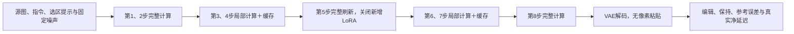

# R25：低空间预算与中途完整刷新的闭环验证

日期：2026-10-30。状态：48来源质量、匿名复核、配对净延迟与原始数据归档全部完成。

本轮148次新增完整请求、1184次DiT全部成功。R25成为当前主开发候选：Cal16对F的平均参考MAE为0.006422，比B降低35.82%、比C降低9.11%；同批配对计时F 4.283秒→R25 2.852秒，1.502×加速、节时33.42%。R25比C再快3.16%，两者48来源语义通过状态相同；B保留速度档。独角兽缺角仍失败，本轮不是新的独立泛化验证。新增训练与RL更新均为0。

本轮检验 LOCAL128 冻结权重下，局部最低 25% 加第 5 步完整刷新，能否获得 C 的保真度并减少成本。训练与 RL 更新均为 0。计划不计为完成量。

## 1. 对照与可检验假设

|档位|完整锚点（步号1–8）|局部最低比例|本轮输出来源|
|---|---|---:|---|
|F|全部8步|100%|复用48份|
|B|1、2、8|25%|复用48份|
|B50|1、2、8|50%|复用48份|
|R25|1、2、5、8|25%|新生成48份|
|C|1、2、5、8|50%|复用48份|

B/B50/R25/C 补齐空间预算与刷新动作的 2×2 设计，计算量不同，不称为等预算比较。新增 LoRA 只在局部步骤启用，完整锚点关闭；刷新动作同时更新全部目标行、源图/文本上下文及 velocity，不能将收益单独归因于 V 或 KV。

R25 与 B 的其他七步活动行集合相同，前四步状态必须逐位一致。15 个核心较大来源令 R25/C 的实际计划相同，其全部八步应一致。核心覆盖会升档，最终报告实际目标 token 更新比例。

## 2. 冻结数据与预算

延用原 Train32＋Cal16，源图、提示词、噪声、条件、基座、Lightning 与 LOCAL128 权重均不变。该数据用于开发；已见 Dev32 不重新充当独立验证，Test64 封存。

- 质量：48 个新增 R25 请求，384 次 DiT；复用 F/B/B50/C 共192份已有输出及轨迹。
- 计时：冻结前8个 Cal，F/B/R25/C 各3次配对重复，加4个预热，100请求、800DiT。
- 总计划：148新增完整请求、1184DiT，新增教师0、优化0、RL0。

候选规则在 R25 生成前冻结：Cal16 平均 RGB 参考 MAE 不高于 C 的105%；相对 C 无新增严格联合质量失败；配对净延迟低于 C。通过只意味着开发候选，仍需新独立来源验证。

## 3. 质量与净延迟口径

数值记录全图、框外扩32源像素的内外参考 MAE、latent MAE；参考误差衡量与 F 一致性，不代表指令正确性。匿名评审 F/B/R25/C 的编辑、保持与不确定状态。评审者已看过历史输出，只称匿名方法标签的单助手复核；不称首次盲评。

本轮预先明确 STOP 标牌445972的移动属于保持失败。上轮四臂该例通过与旧更严格口径存在分歧，旧结果保留，本轮另报同口径差异，不把评分变化当算法进步。

净延迟包含在线计划、条件编码、8步DiT、VAE解码、PIL与缓存清理；模型常驻GPU，CUDA同步计时。权重加载与磁盘读写不计，质量路径的诊断耗时不当作净延迟。质量缺陷仍如实报告。

## 4. 结果、逐来源数据与执行进度

48新增请求、384DiT已全部完成。R25/B前四步192个检查、R25/F前两步96个检查、15个R25/C相同计划来源全部8步120个检查通过。240份新旧输出的哈希与状态验证通过。检查项存在重叠，不相加宣称独立样本量。

数值汇总：Train32 R25 MAE 0.006663，比B降低35.37%、比C降低15.65%；Cal16 R25 MAE 0.006422，比B降低35.82%、比C降低9.11%。Cal16 15/16来源比B改善；对C则7改善、7相同、2变差。预冻结数值、语义和延迟三项开发候选条件均通过，详见下文。

## 5. 后续决策

R25已通过本轮开发候选规则，以B/R25构建质量—成本标签，C保留消融。下一阶段输入只能使用源图、指令、几何与公共前两步状态；不能将候选终图或 F 的未来输出作为在线输入。

先通过 Train 来源交叉验证建立风险/成本监督策略，再扩充标签并进行真实生成的上下文 bandit；离线 oracle 不计为 RL。新独立开发集与最终 Test64 用于泛化验证。SGLang 在执行合同与候选档位稳定后迁移。

## 6. 算法公式与执行流程

设目标图共有 $N=4096$ 个 token。活动集合 $A_t$ 的核心来自输入框外扩32源像素的2×2 tile覆盖；预算不足时从25/50/75/100%中升档。剩余名额优先邻近区域并加入固定比例远处探针。R25完整锚点为 $H=\{1,2,5,8\}$，其余步骤使用当前活动行与历史全局上下文：

$$\hat v_t(i)=\begin{cases}v_{\theta+\Delta\theta}(z_t,c;i;K_{\mathrm{cache}},V_{\mathrm{cache}}),&t\notin H, i\in A_t,\\v_{\mathrm{cache}}(i),&t\notin H, i\notin A_t,\\v_\theta(z_t,c;i),&t\in H.\end{cases}$$

所有目标latent继续执行 $z_{t+1}=z_t+(\sigma_{t+1}-\sigma_t)\hat v_t$。完整锚点重新建立上下文与速度缓存，新增适配器关闭。源图是条件输入，不把未编辑区像素或latent复制回目标。

$$\rho=\frac{1}{8N}\sum_{t=1}^{8}|A_t|,\qquad \rho_{R25,\mathrm{nominal}}=\frac{4+4\times0.25}{8}=0.625.$$

实际核心升档会使平均比例高于62.5%。$\rho$不含条件/文本等开销，不能替代实测净延迟。R25相对B增加第5步完整刷新，比较的是整个执行动作；R25相对C则比较四个局部步的空间预算。

## 7. 完整数值与匿名语义结果

|来源|档位|RGB MAE|区域内|区域外|目标更新比例|
|---|---|---:|---:|---:|---:|
|train|B|0.010309|0.026306|0.006426|58.50%|
|train|B50|0.012149|0.024852|0.008740|70.21%|
|train|R25|0.006663|0.014692|0.004524|66.80%|
|train|C|0.007899|0.015300|0.005790|76.17%|
|calibration|B|0.010007|0.024133|0.005806|60.94%|
|calibration|B50|0.010910|0.023003|0.006947|69.73%|
|calibration|R25|0.006422|0.012775|0.004160|68.75%|
|calibration|C|0.007066|0.013349|0.004827|75.78%|

|来源|比较|平均误差变化|改善／相同|来源级 bootstrap95%|
|---|---|---:|---|---|
|train|B_to_R25|-35.37%|30改善，0相同|[-43.35%,-27.44%]|
|train|C_to_R25|-15.65%|20改善，8相同|[-23.93%,-7.64%]|
|calibration|B_to_R25|-35.82%|15改善，0相同|[-45.95%,-25.96%]|
|calibration|C_to_R25|-9.11%|7改善，7相同|[-21.17%,-1.27%]|

区间仅描述本批来源重采样的不确定性，不代表独立总体泛化。R25/C实际不同的Train24中20例改善，Cal9中7例改善；同计划15例相同不算新增获胜。扩大空间预算在有/无中途刷新时均未提高平均保真度；这项结论限于当前缓存策略、探针布局和冻结适配器。

|来源|档位|编辑通过|保持通过|严格联合通过|不确定|
|---|---|---:|---:|---:|---:|
|train|F|25/32|24/32|21/32|1|
|train|B|23/32|24/32|19/32|1|
|train|R25|24/32|24/32|20/32|1|
|train|C|24/32|24/32|20/32|1|
|calibration|F|13/16|12/16|10/16|0|
|calibration|B|13/16|12/16|10/16|0|
|calibration|R25|13/16|12/16|10/16|0|
|calibration|C|13/16|12/16|10/16|0|

先审阅12页匿名总览及6页原分辨率细节，再冻结192份评分并解盲。R25相对B修复狗张嘴351809，没有新增严格联合失败；与C的逐来源通过状态相同。相对F仍有独角兽478067缺角失败。单助手已看过历史输出，不能称首次严格盲评或多人共识。

重复评分审计对F/B/C共144份相同图像进行比较，只有标牌445972因本轮预先明确“位置移动为保持失败”而改变；其余141份布尔评分一致。旧报告的11/16保留，本轮同口径均10/16，不能跨口径比较为性能变化。

图为解盲后从已审阅细节页重排的展示图，推理原PNG未修改。F、B、R25、C在同一源图、提示词和噪声下比较。

### 失败类别

- 基座共同失败：添加斑马却替换两匹马；关闭瓶子却删除瓶子；切开苹果却生成完整苹果；添加狗同时删除原猫；仅改下方鸟却删除上方鸟。
- 加速新增失败：独角兽缺少明确额角。当前三种局部策略都未解决，不能用较低平均MAE掩盖。
- 被刷新修复的细节：狗张嘴；B闭嘴，R25与C出现开口和牙齿。图像MAE对此例并不与语义正确性单调一致。
- 不确定项：三明治的橙色粘稠液更像融化奶酪，未按汁液编辑成功计分。

## 8. 逐来源参考误差与联合质量

|来源|角色|B MAE|R25 MAE|C MAE|R25相对B|联合 F/B/R25/C|
|---|---|---:|---:|---:|---:|---|
|420478|train|0.019348|0.013347|0.020002|-31.02%|通过/通过/通过/通过|
|139108|train|0.010852|0.005962|0.011190|-45.06%|失败/失败/失败/失败|
|478067|train|0.012963|0.011841|0.011841|-8.65%|通过/失败/失败/失败|
|410708|train|0.003147|0.002485|0.004203|-21.05%|通过/通过/通过/通过|
|560266|train|0.018925|0.005597|0.011307|-70.43%|通过/通过/通过/通过|
|563267|train|0.014655|0.007905|0.008210|-46.06%|通过/通过/通过/通过|
|288923|train|0.024825|0.018433|0.018433|-25.75%|通过/通过/通过/通过|
|414492|train|0.004418|0.002554|0.002815|-42.19%|通过/通过/通过/通过|
|365220|train|0.007989|0.004619|0.005102|-42.18%|失败/失败/失败/失败|
|344857|train|0.004336|0.004175|0.003233|-3.71%|通过/通过/通过/通过|
|522661|train|0.009064|0.005871|0.008389|-35.23%|失败/失败/失败/失败|
|193664|train|0.007579|0.002937|0.005402|-61.25%|失败/失败/失败/失败|
|104739|train|0.011834|0.005198|0.005158|-56.07%|通过/通过/通过/通过|
|567825|train|0.015477|0.013090|0.013090|-15.43%|失败/失败/失败/失败|
|257117|train|0.010296|0.010063|0.011888|-2.26%|通过/通过/通过/通过|
|40966|train|0.004635|0.003448|0.004533|-25.61%|通过/通过/通过/通过|
|337843|train|0.005914|0.002413|0.002413|-59.19%|通过/通过/通过/通过|
|118997|train|0.005129|0.002572|0.004276|-49.85%|通过/通过/通过/通过|
|227059|train|0.008442|0.004158|0.004158|-50.75%|通过/通过/通过/通过|
|542625|train|0.004275|0.002820|0.003612|-34.04%|通过/通过/通过/通过|
|98853|train|0.013453|0.009322|0.016961|-30.71%|失败/失败/失败/失败|
|351809|train|0.002745|0.003584|0.005152|+30.53%|通过/失败/通过/通过|
|520181|train|0.005985|0.005461|0.005491|-8.75%|失败/失败/失败/失败|
|189648|train|0.011874|0.007177|0.006484|-39.56%|失败/失败/失败/失败|
|503793|train|0.007314|0.002837|0.004255|-61.21%|通过/通过/通过/通过|
|208882|train|0.022908|0.020488|0.020488|-10.56%|失败/失败/失败/失败|
|306593|train|0.009295|0.004181|0.004507|-55.01%|通过/通过/通过/通过|
|90139|train|0.014800|0.005244|0.005244|-64.57%|通过/通过/通过/通过|
|557855|train|0.012117|0.010012|0.010273|-17.37%|失败/失败/失败/失败|
|156301|train|0.014350|0.006981|0.006981|-51.35%|失败/失败/失败/失败|
|327155|train|0.005005|0.005308|0.004330|+6.06%|通过/通过/通过/通过|
|96984|train|0.005934|0.003129|0.003345|-47.26%|通过/通过/通过/通过|
|372317|calibration|0.019032|0.013821|0.013821|-27.38%|通过/通过/通过/通过|
|236484|calibration|0.015919|0.013646|0.013646|-14.28%|通过/通过/通过/通过|
|45626|calibration|0.006174|0.003203|0.004380|-48.12%|通过/通过/通过/通过|
|181796|calibration|0.006153|0.005111|0.005521|-16.93%|通过/通过/通过/通过|
|399532|calibration|0.013164|0.010669|0.010669|-18.95%|通过/通过/通过/通过|
|108442|calibration|0.010398|0.009753|0.009407|-6.21%|失败/失败/失败/失败|
|385707|calibration|0.007465|0.001914|0.001524|-74.36%|失败/失败/失败/失败|
|302289|calibration|0.007944|0.004021|0.004021|-49.39%|失败/失败/失败/失败|
|463844|calibration|0.002703|0.003263|0.004006|+20.74%|通过/通过/通过/通过|
|522229|calibration|0.011147|0.006681|0.006681|-40.06%|通过/通过/通过/通过|
|445972|calibration|0.008492|0.006082|0.007857|-28.39%|失败/失败/失败/失败|
|343552|calibration|0.003500|0.001725|0.002268|-50.72%|通过/通过/通过/通过|
|286442|calibration|0.019233|0.010906|0.010906|-43.30%|通过/通过/通过/通过|
|352264|calibration|0.013754|0.005356|0.005356|-61.06%|失败/失败/失败/失败|
|196699|calibration|0.004929|0.003260|0.003771|-33.87%|失败/失败/失败/失败|
|47893|calibration|0.010100|0.003347|0.009221|-66.86%|通过/通过/通过/通过|

## 9. 监督信号、策略学习与RL的可用空间

已经导出32个Train与16个Cal来源的B/R25/C闭环动作标签，保存参考误差、编辑/保持结果、基座是否成功和实际目标更新比例。Cal只用于选阈值，不能混进训练。当前没有新增策略训练、优化或真实RL episode。

仅按最终参考MAE取B/R25/C事后最优，相比固定R25还能降低Train32误差1.64%、Cal16误差1.26%；这个空间很小。进一步检验“容许一定逐来源参考误差增加，是否能选择更快的B”，同时禁止相对R25新增联合质量失败：

|来源|逐来源MAE容差相对R25|事后可选B来源|目标更新量相对固定R25减少|
|---|---:|---:|---:|
|train|0%|1|0.44%|
|train|5%|3|1.32%|
|train|10%|5|2.05%|
|train|20%|7|2.49%|
|calibration|0%|1|0.85%|
|calibration|5%|1|0.85%|
|calibration|10%|2|1.70%|
|calibration|20%|3|2.27%|

这里使用未来终图标签，只是事后机会测量，不是在线策略、实测净延迟或RL收益。连逐来源容许20%参考误差的事后选择，目标token节省也只有约2%–2.5%。因此不宜把“B/R25二选一头”作为主要创新或预期大幅加速来源；应先验证R25这条有效固定算法的泛化，再探索更有收益的动态动作。

后续学习接口分为三层：

1. **学生适配**：当前LOCAL128权重冻结，完整锚点关新增LoRA、局部步开LoRA；保持学生权重固定，使动作对照可解释。若跨种子或新来源仍有独角兽、文字等结构失败，再采同状态教师与局部边界损失训练，并用Train/Cal决定超参数。
2. **监督风险/收益头**：输入源框几何、源图/指令特征及公共完整步骤的区域velocity统计，输出不同刷新动作的风险、质量变化和代价。候选终图、F终图及后续状态仅作训练标签。先来源级交叉验证，再固定Cal阈值；对照固定R25及简单几何规则。
3. **真实策略优化**：一开始只在第2步之后决定一次刷新计划，按上下文bandit定义；奖励使用编辑/保持、细节结构和完整成本，不能只有像素MAE。以后若逐步决定刷新时机才使用序列策略。先128个真实生成episode，冻结生成器、记录行为概率/奖励/来源/seed/实际DiT；只有相对监督头与固定R25有增量再扩大预算。

拟用约束目标：

$$\min_\phi\;\mathbb E[T(\pi_\phi(x))],\quad\mathrm{s.t.}\;\Delta Q_{\mathrm{edit}}\ge-\epsilon_e,\;\Delta Q_{\mathrm{preserve}}\ge-\epsilon_p.$$

其中在线决策不能访问离线真值。小批单助手标签目前不够支持高容量策略；优先补更丰富但受控的刷新时机标签，而不是盲目扩成大动作空间。

## 10. 下一包及进度安排

|顺序|任务|预算与交付|当前状态|
|---|---|---|---|
|1|R25闭环与完整审计|48请求384DiT；240份新旧结果|已完成|
|2|匿名语义复核及重复评分审计|192评分、12总览、6细节、144旧图重复评分比较|已完成|
|3|同源配对净延迟|100请求800DiT、三重复、输出哈希检查|已完成，100请求800DiT|
|4|冻结R25候选，新增第二seed稳定性|现Train32＋Cal16 × F/B/R25 ×1个新seed＝144请求1152DiT；来源不换，seed预先冻结|待执行，不计入完成量|
|5|登记新的独立开发来源|新Dev32，F/B/R25三臂＝96请求768DiT；先去重并冻结，再一次性打开|待执行；旧Dev32仍为已见，Test64封存|
|6|小型风险/刷新收益头|Train交叉验证→Cal选择；现32训练标签已导出，是否扩128由动作机会决定|标签完成，训练未执行|
|7|真实bandit与可选多步RL|先128真实episode＝1024DiT；与固定R25/监督头配对，不能把离线挑图计作RL|待执行，更新0|
|8|系统实现与论文|Diffusers保留正确性参考；预算与刷新接口稳定后再迁移SGLang|尚未迁移|

新Dev必须在第二seed开发结束、候选重新冻结后启用。若打开独立Dev后再修改算法，该集即转为开发，不能反复称独立验证。八个月总计划保持2026-10-22至2027-06-21；M1已有训练和实际净加速证据，M2重点转向固定候选泛化与受控策略增量，M4仍为系统迁移。

## 11. 完整请求净延迟与候选决定

|档位|平均秒|相对F加速|节时|加速来源级95%区间|峰值GiB|
|---|---:|---:|---:|---|---:|
|F|4.2829|1.0000×|0.00%|[1.0000,1.0000]|62.30|
|B|2.4828|1.7251×|42.03%|[1.6712,1.7843]|68.90|
|R25|2.8516|1.5020×|33.42%|[1.4716,1.5332]|68.90|
|C|2.9447|1.4544×|31.25%|[1.4455,1.4610]|68.90|

来源为预先冻结Cal16中的前8个，每档每源3次重复，另每档1次预热。100份输出全部与闭环质量评估的RGB哈希相同，同源重复逐位一致。计时期间没有并发图像渲染、压缩或传输任务。驱动显示NVIDIA L20Y，硬件型号按用户确认记录H800；80GB级显存，单卡全组件驻留。

R25比B多用14.85%时间，换取Cal16平均参考误差降低35.82%及训练内狗张嘴修复；比C少用3.16%时间，配对来源重采样时间差95%区间为[-5.09%,-1.23%]，8来源中6个更快。速度差包含部分实际计划相同来源的运行噪声，不以单例细小耗时差推断算法成本。

质量—延迟图严格使用同8来源：B/R25/C的MAE为0.010781/0.007767/0.007874。Cal16全组的9.11%改善和Cal8计时来自不同大小的子集，不能混称16来源全部已测速。以上均为开发实验；旧Dev32的质量失败结论不因本轮改善而作废。

|来源|F秒|B秒|R25秒|C秒|
|---|---:|---:|---:|---:|
|372317|4.2707|2.5803|2.9332|2.9287|
|236484|4.2761|2.6194|2.9353|2.9275|
|45626|4.3028|2.3679|2.8084|2.9632|
|181796|4.2766|2.3669|2.7453|2.9314|
|399532|4.3040|2.5950|2.9313|2.9328|
|108442|4.2805|2.3906|2.7522|2.9453|
|385707|4.2751|2.3588|2.7765|2.9311|
|302289|4.2777|2.5833|2.9303|2.9979|

预生成候选规则逐项验收：Cal16 R25 MAE≤C的105%通过；R25相对C无新增联合失败通过；配对净延迟更低通过。因此冻结R25作为下一阶段主开发候选，B为速度档，C/B50保留消融；不声称无损或已经通过新独立测试。此处“更优”指本批平均保真/时间与当前单助手语义口径。

## 12. 执行账本、归档和复现

|项目|本轮新增|项目累计|
|---|---:|---:|
|成功完整请求|148（质量48＋计时100）|2879|
|实际DiT|1184（384＋800）|28374|
|同状态训练教师|0|1441|
|LoRA优化更新|0|153|
|LoRA拟合来源|0|140|
|本路线真实RL更新|0|0|

新机累计1544完整请求／17117DiT，其中自由区域路线16925DiT。192份旧质量输出只作复用，不重复计入。历史动作头的1000次拟合及1000次恢复重放不计为RL。本轮GPU生成失败0；一次分析在生成完成前调用，被完成量断言拦截，未写结果也未增加DiT，随后完成后重跑成功。

原始快照994文件、1,772,019,844字节；压缩包1,363,590,240字节。远端归档`/tmp/budget_r25_raw_v1.tar.gz`，全部994成员逐文件SHA256验证通过。压缩包SHA256：`f6038eadb8f58da70074db8647ab5b4e0d15c5a35dc9507b7cb27f6752c04f20`。完整原始轨迹及推理PNG留在zeta，约1.36GB压缩包未完整下载到本地；本地保存元数据、匿名页、细节图、评分、表格与报告。归档之后新增的可读版绘图及配对统计补充纳入最终交付清单。

- [冻结质量协议](data/budget_r25_v1_preregistration.json)、[冻结计时协议](data/budget_r25_latency_v1_preregistration.json)
- [逐来源数值CSV](runs/budget_r25_v1/analysis/source_metrics.csv)、[数值JSON](runs/budget_r25_v1/analysis/results.json)
- [冻结匿名评分](runs/budget_r25_v1/blind_review/scores_before_unblinding.json)、[解盲结果](runs/budget_r25_v1/blind_review/unblinded_results.json)、[重复评分审计](runs/budget_r25_v1/blind_review/repeated_score_audit.json)
- [净延迟原始记录](runs/budget_r25_latency_v1/records.jsonl)、[统计](runs/budget_r25_latency_v1/analysis/results.json)
- [动作监督标签](data/budget_r25_action_labels_v1.json)、[执行账本](data/budget_r25_ledger_v1.json)
- [原始文件清单](data/budget_r25_raw_manifest_v1.json)、[归档校验收据](data/budget_r25_raw_archive_receipt_v1.json)

环境与复现入口：zeta `/workspace/diffusers-fix/research/manual_mask_local_20261028`，解释器`/workspace/venvs/manual-mask-local/bin/python`；代码快照与输入/权重哈希见各run目录。质量入口`scripts/evaluate_budget_r25.py`，净延迟入口`scripts/benchmark_budget_r25.py`。运行目录必须是新attempt，禁止直接覆盖已有实验。固定噪声、缓存条件、1024²、CFG1、8步、BF16、非分块VAE、未合并FP32新增LoRA均保持不变。

本轮未创建Git提交或push。GPU实验已结束；Test64未打开。该批结论足以支持继续验证固定R25主线，下一批先补种子稳定性与新来源证据，再决定训练和RL的具体增量。
