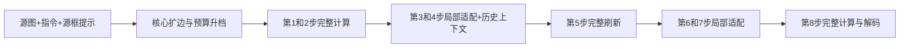

# R25第二种子稳定性与新独立验证

日期：2026-10-30。状态：第二种子与新独立Dev32质量验证完成，均通过预冻结条件；新Dev前8来源配对净延迟、原始归档与逐成员校验完成。

**本轮结论：R25的收益已从已见校准来源延续到新独立来源。** 新Dev32平均参考误差比B降低31.41%，28/32来源改善；编辑＋保持联合通过F/B/R25＝22/21/22。新Dev前8来源净延迟4.290→2.878秒，1.490×加速、节时32.90%。按冻结单助手规则通过开发验证，但仍有相对F新增骑车人失败1例和3个共同不确定项。315请求2520DiT全部完成，新增训练/RL为0。

## 1. 冻结设置与执行顺序

保持LOCAL128适配权重、Qwen-Image-Edit＋Lightning8、1024²、CFG1、非分块VAE、未合并FP32新增LoRA、源框计划与所有提示词不变。R25完整锚点为1/2/5/8，局部最低25%；B完整锚点1/2/8，局部最低25%。完整锚点关闭新增LoRA，局部步启用。无硬mask、无外围像素粘贴。

第二种子固定2026103102，CPU生成BF16 packed noise 1×4096×64。源图/文本条件独立于目标噪声，复用既有条件缓存，只替换目标初始噪声。同一个来源的F/B/R25使用同一新噪声。48来源共144请求、1152DiT；本轮不重训，不把诊断生成耗时当净延迟。

进入新Dev的预冻结条件：Cal16平均参考MAE相对B降低至少10%，至少10/16来源改善，R25相对B新增联合语义失败不超过1例，Train32平均参考MAE也低于B。语义评分采用匿名方法标签、单助手，保留不确定项与基座失败；标牌位置移动按已统一口径判保持失败。

## 2. 新Dev来源准备

旧360来源池中，原视觉审阅已接受但未使用的官方dev仅17个。另按旧父级hash顺序冻结64个尚未读取过的官方dev第一轮来源，只读取源图与mask标注，排除既有池、历史已见/保留/test ID及跨split重复。复用原正方形、框面积0.2%–50%、保守图像去重与局部对象语义范围标准；从新增合格来源按固定顺序补足15个。

mask只转换为源框提示，不作为目标硬约束，也不读取目标图。来源选择依据输入和历史登记，不依据本轮F/B/R25输出。第二种子继续条件通过后才冻结新Dev32生成协议；计划F/B/R25三臂96请求768DiT。若条件不通过，本轮不自动打开新Dev。

## 3. 进度与结果

|工作|计划|当前状态|
|---|---:|---|
|第二种子质量|144请求1152DiT|144/144完成，生成失败0，数值与语义继续条件通过|
|新Dev候选补采|64源图及标注，无DiT|64/64完成，几何与去重合格35个，源图视觉接受34个，按顺序取前15个|
|新Dev32质量|96请求768DiT|96/96完成，生成失败0；在冻结单助手评分口径下通过|
|新Dev前8来源配对净延迟|75请求600DiT|75/75完成，全部输出与质量评估哈希一致|
|新训练/策略/RL|0|本轮不执行|

第二种子和新独立Dev32质量执行240请求1920DiT，追加计时75请求600DiT，合计315请求2520DiT全部完成。旧Dev32已见，本轮新Dev在评估后也转为已见开发数据，Test64封存。

## 4. 第二种子稳定性结果

|数据|B参考RGB MAE|R25参考RGB MAE|相对B下降|改善来源|来源bootstrap 95%相对变化区间|
|---|---:|---:|---:|---:|---|
|Train32|0.00987293|0.00658851|33.27%|29/32|−41.10%至−25.32%|
|Cal16|0.01248709|0.00762719|38.92%|15/16|−46.66%至−31.12%|
|合计48|0.01074432|0.00693474|35.46%|44/48|−41.19%至−29.56%|

R25/B前四步192个逐位状态检查、两个局部臂/F前两步192个检查通过；这些检查部分重叠。全部144输出RGB哈希、8步状态与有限值检查通过。源框和实际目标更新比例不变，Train32为66.80%、Cal16为68.75%。

|数据|F编辑/保持/联合|B编辑/保持/联合|R25编辑/保持/联合|
|---|---|---|---|
|Train32|27/24/21|22/24/17|24/24/19|
|Cal16|13/13/11|14/13/12|14/13/12|

单助手对12页匿名输出、5张预设细节和4张追加细节评分，冻结后才揭示映射。Train32三臂各1个不确定项；Cal16仅F有1个不确定项。联合通过要求编辑和保持均通过且无不确定；不是人工共识评分。

R25相对B在Train32修复344857漏花瓶、257117斑马未张嘴，未新增联合失败；两者在414492漏猴子、478067独角兽缺角仍失败。Cal16两者逐来源联合状态相同，无新增退步。196699中F的苹果切面不明确，B/R25反而呈现明确切面；这是参考误差与编辑语义可能分离的实例，不能因为更像F就自动认为任务更成功。源图误删/多对象改色、保龄球误画成沙滩球等共享失败仍保留。

预冻结继续条件全部满足，结论是**种子稳定性支持进入独立验证**，不据此宣称无损。保留第二种子相对F在训练来源上的2个新增失败。

## 5. 新独立Dev32协议

来源由17个原已接受但未生成储备加15个新源组成。64个新源按原父级hash顺序采样；几何/保守去重后35个，源图视觉排除1个整片地毯换木地板，前15个合格来源被选中。剩余候选不用于依输出补换。全部32来源与已登记历史生成协议source ID无交集；保留审计路径和SHA。Test64仅使用已封存ID排除，未读取媒体，故未做Test图像感知去重。

协议SHA：`4510577f0e2697111a325f36c87f7d5a3bd8930da9d1479e18dd28648e0a6749`。沿用原种子2026102201与同一噪声文件，冻结LOCAL128权重和B/R25计划。每个来源独立捕获源图与文本条件，共32次条件编码，不计作DiT；随后F/B/R25各8步，96请求768DiT。

生成前冻结规则：R25平均参考MAE较B至少降低10%，至少20/32来源改善；相对B新增联合失败≤1，相对F新增联合失败≤1。所有基座失败都保留在分母，不依F表现筛样。本轮仅验证质量，生成诊断秒数不当净延迟；此前Cal8配对计时1.502×仍仅限其原测量范围。

## 6. 当前算法与结论边界

F指原始Qwen-Image-Edit＋8步Lightning的全量执行；B和R25均使用同一LOCAL128局部适配权重，B不是未训练基线。实验硬件为用户确认的单张H800，驱动显示NVIDIA L20Y，显存81559MiB。

本轮固定适配权重，唯一比较差异是B与R25的第5步动作。令完整锚点集合为 $H_B=\{1,2,8\}$、$H_{R25}=\{1,2,5,8\}$，目标活动行集合为 $A_t$：

$$\hat v_t(i)=\begin{cases}
v_\theta(z_t,c;i), &t\in H,\\
v_{\theta+\Delta\theta}(z_t,c;i;K_{cache},V_{cache}), &t\notin H, i\in A_t,\\
v_{cache}(i), &t\notin H, i\notin A_t.
\end{cases}$$

$$z_{t+1}=z_t+(\sigma_{t+1}-\sigma_t)\hat v_t,\qquad
\rho=\frac{\sum_{t=1}^{8}|A_t|}{8\times4096}.$$

核心由源框外扩32像素后映射到64×64目标token网格，按2×2块选择。核心必须覆盖；预算从25/50/75/100%升档，剩余容量以邻域为主并留固定远处探针。所有目标latent继续更新，外围不是原图复制。局部步省下未选目标行及源图/文本流的部分投影、attention输出和MLP，历史KV仍作为上下文被活动Q读取。新增LoRA仅用于局部步，完整锚点关闭新增LoRA并刷新缓存。

本轮不能单独把收益归因于新鲜V、KV或外围velocity：第5步完整刷新同时改变这些量。数值更接近F是轨迹保真证据；是否完成编辑另由编辑/保持审阅判断。两个种子对应同一48来源，不构成96个独立来源。合并两种子的Cal16平均参考误差相对B降低37.54%，15/16来源在两个种子都改善；按来源聚类bootstrap95%为下降29.96%—45.24%。

## 7. 下一阶段计划：训练和RL各自解决什么

当前固定R25已提供可测的速度收益。下一步的策略目标是保持其质量的同时节省刷新成本，并识别微小对象漏生成等风险。仅靠B/R25二选一的旧事后oracle空间较小，不能预先承诺RL带来显著增益。

|顺序/参考日期|任务与数据约束|完成判据和交付|当前状态|
|---|---|---|---|
|1 / 10-30|第二种子48来源三臂稳定性|144请求1152DiT，固定门、完整审阅与失败表|已完成，通过进入独立验证的条件|
|2 / 10-30|新Dev32固定候选验证|96请求768DiT；不删F失败，不重选参数|已完成，按冻结单助手评分通过|
|3 / 10-31—11-02|在既有训练来源上补第4/5/6步刷新的完整动作标签|同一执行器、相同完整步数和局部预算；先8训练源×2新增动作×8步＝128DiT，复用R25；必要时扩到32源|待执行，不与旧FIX32时机实验混算|
|4 / 11-02—11-04|训练低成本刷新收益/失败风险头|只使用源图、指令、几何、公共前两步可得状态；来源分组交叉验证，比较固定R25与同状态监督头|待执行；不得将F终图或未来动作输出作为在线输入|
|5 / 11-04—11-07|真实上下文bandit初包128episode|每episode真正执行8步闭环，最多新增1024DiT另计教师/回退；记录动作、奖励、概率、时间、失败|待执行；离线标签和oracle不记作RL|
|6 / 11-07—11-10|冻结策略并在未用于拟合的校准来源审查，随后新验证|与同数据监督策略、固定R25比较；全部回退时间计入，给出配对净延迟与质量|待执行；本轮已读Dev32此后只能算已见开发数据|
|7 / 11月中旬起|同基座外部方法复现、关键消融、SGLang迁移|可复现的质量—速度表，检查训练/缓存/刷新各自贡献|待执行|

刷新收益头预测各动作的质量损失与执行成本；优先监督学习，真正交互后才比较RL增益。可采用来源级配对归一化奖励：

$$r(a,x)=-\lambda_q\frac{E(a,x)}{E(R25,x)+\epsilon}-\lambda_c\frac{T(a,x)}{T(R25,x)}-\lambda_f\mathbf1[\text{新增编辑/保持失败}].$$

$E$同时记录参考图误差、局部结构差异；任务失败标签必须来自独立任务判定，不以低MAE替代。该公式是待验证设计，系数和判定器必须在训练/校准集预先固定。若只能获得数值奖励，就明确把RL目标限定为参考保真—成本，不声称优化了真实语义成功率。验证输出不得用于更新策略或改阈值；任何基于本轮失败开展的新训练都需要新的未见评估。

## 8. 新独立Dev32：完成结果

保持权重、噪声、所有提示词和预算计划不变，96请求768DiT全部完成，生成失败0。R25/B前四步128个逐位检查、两个局部臂/F前两步128个逐位检查通过；96份图像哈希、完整8步状态和有限值检查通过。

|指标|B|R25|R25相对B|
|---|---:|---:|---:|
|全图RGB参考MAE|0.01204228|0.00826013|下降31.41%|
|编辑框外扩32像素内MAE|0.02611791|0.01750096|下降32.99%|
|上述区域外MAE|0.00717360|0.00506894|下降29.34%|
|latent参考MAE|0.02480120|0.01695895|下降31.62%|
|实际目标token更新比例|63.87%|71.09%|增加7.23个百分点|

28/32来源参考误差下降，4/32变差；来源bootstrap95%为下降24.35%—38.40%。选区比例不等于总FLOPs或净延迟，条件流、文本流和缓存仍有开销。

|方法|编辑通过|保持通过|联合通过|不确定项|
|---|---:|---:|---:|---:|
|F|26/32|28/32|22/32|3|
|B|25/32|27/32|21/32|4|
|R25|26/32|27/32|22/32|3|

R25相对B无新增联合失败，修复129062落猫模糊破碎一例。相对F，R25新增393226骑车人失败，同时修复566041钱包右侧花瓣未变白；保留F正确来源中的21/22。**总数相同不代表逐例无损**。数值下降≥10%、改善≥20/32、相对B新增失败≤1、相对F新增失败≤1四项冻结规则全部满足，故记为“按冻结单助手评分通过固定候选独立验证”。

评审覆盖8张匿名总览、9张细节页，96个输出在揭示当前方法映射前评分并冻结。共同不确定项为106772胡椒瓶身份、145741苍蝇形态、177572相机识别。它们均未计作联合通过。人工若把这三例均判为F通过而R25失败，新增失败会由1变4，超过阈值；这是标签敏感性情景，既非已观察结果，也不是置信区间。独立复核应优先覆盖这些例子及落猫、花瓣、骑车人和混合木/铁床架，冻结主评分不因复核猜测回改。

### 8.1 关键成功、退步与共享失败

|来源|观察|归属与处理|
|---|---|---|
|129062 落猫|F猫清晰；B身体破碎/模糊，R25恢复可辨猫身体但仍有边缘模糊|R25相对B修复；保留细节与不确定性说明|
|393226 新增骑车人|F新增独立骑车人，保留原行人；B/R25把自行车放到原行人身上|明确的对象绑定错误，局部算法相对F新增失败|
|566041 钱包花瓣变白|F右花瓣仍粉；B/R25两朵近白，中心仍粉|局部方法相对F的任务修复，说明F不是语义真值|
|26735、357865|红色床面/马桶开盖任务伴随矩形框贴图和结构改变|共享基座失败，保留在32分母中|
|428304、393243|去香蕉却增加橘子；去头发同时改变脸和视线|共享保持失败|
|544519、381199|添麦片碗但牙刷仍在；水果仍不像蔬菜|共享任务未完成|
|106772、145741、177572|瓶子种类、昆虫种类与相机形态不能稳定判定|三臂共同不确定，需人工复核，不包装成功|

图中A/B/C列保留评分时匿名顺序。落猫映射为{'A': 'F', 'B': 'R25', 'C': 'B'}；骑车人映射为{'A': 'R25', 'B': 'B', 'C': 'F'}。完整映射见可审计的unblinding_key与冻结评分。完整逐例编辑、保持、联合、不确定和评语在`paired_source_review.csv`，不只展示成功图。

### 8.2 全部32来源配对记录

联合通过记✓，不通过（含不确定）记×；不确定原因与评分在CSV/JSON。MAE为对F参考误差。

|source ID|B MAE|R25 MAE|相对变化|F/B/R25联合|R25目标更新比例|
|---|---:|---:|---:|---|---:|
|109776|0.007019|0.004510|-35.7%|✓/✓/✓|62.50%|
|129062|0.014147|0.009529|-32.6%|✓/×/✓|62.50%|
|207833|0.013209|0.009178|-30.5%|✓/✓/✓|75.00%|
|557105|0.007107|0.004765|-33.0%|✓/✓/✓|87.50%|
|7730|0.006252|0.004574|-26.8%|✓/✓/✓|62.50%|
|540816|0.034947|0.024899|-28.8%|✓/✓/✓|87.50%|
|493074|0.003586|0.002535|-29.3%|✓/✓/✓|62.50%|
|57357|0.017009|0.010201|-40.0%|✓/✓/✓|62.50%|
|399759|0.014221|0.010130|-28.8%|✓/✓/✓|75.00%|
|26735|0.010977|0.005874|-46.5%|×/×/×|75.00%|
|566041|0.006742|0.004844|-28.2%|×/✓/✓|62.50%|
|106772|0.004489|0.004464|-0.6%|×/×/×|62.50%|
|163114|0.033874|0.029983|-11.5%|✓/✓/✓|87.50%|
|142400|0.010201|0.005694|-44.2%|✓/✓/✓|75.00%|
|538741|0.009009|0.002875|-68.1%|✓/✓/✓|62.50%|
|501972|0.020828|0.015453|-25.8%|✓/✓/✓|75.00%|
|25989|0.004906|0.004291|-12.5%|✓/✓/✓|62.50%|
|357903|0.005479|0.002481|-54.7%|✓/✓/✓|75.00%|
|177824|0.005689|0.003611|-36.5%|✓/✓/✓|87.50%|
|125106|0.004749|0.003795|-20.1%|✓/✓/✓|62.50%|
|393226|0.016248|0.016721|+2.9%|✓/×/×|62.50%|
|428304|0.012799|0.005798|-54.7%|×/×/×|87.50%|
|393243|0.013377|0.006539|-51.1%|×/×/×|87.50%|
|544519|0.037849|0.024427|-35.5%|×/×/×|62.50%|
|563122|0.004543|0.002091|-54.0%|✓/✓/✓|62.50%|
|145741|0.010144|0.007151|-29.5%|×/×/×|75.00%|
|381199|0.017591|0.005724|-67.5%|×/×/×|75.00%|
|357865|0.011567|0.004978|-57.0%|×/×/×|62.50%|
|289514|0.009323|0.009445|+1.3%|✓/✓/✓|62.50%|
|219590|0.006338|0.006019|-5.0%|✓/✓/✓|75.00%|
|177572|0.002574|0.003000|+16.5%|×/×/×|75.00%|
|221427|0.008561|0.008744|+2.1%|✓/✓/✓|62.50%|

## 9. 质量门后补测：新Dev前8来源净延迟

本轮前两包原计划仅做质量验证。通过固定质量规则后，追加冻结新Dev原始顺序前8来源，F/B/R25各3次重复，另3次预热，共75请求600DiT。来源未按语义成功或速度筛选；方法顺序按来源及重复轮次循环轮换。计时期间不并行执行归档或重型分析。

计时范围：模型常驻，源RGB与噪声已在内存；包含在线计划、输入预处理、文本编码、源图VAE、8次DiT、图像解码、PIL输出与缓存清理；不含权重加载和输出写盘。三臂共用非分块VAE，新增LoRA不合并，完整锚点关闭新增适配。每次完整请求前后CUDA同步。该净延迟不是预编码条件缓存下的诊断生成秒数。

|方法|平均净延迟|相对F加速|节时|来源bootstrap95%加速区间|峰值显存|
|---|---:|---:|---:|---|---:|
|F|4.2898秒|1.000×|0|—|62.30GiB|
|B|2.5206秒|1.702×|41.24%|1.602—1.791×|68.90GiB|
|R25|2.8785秒|1.490×|32.90%|1.427—1.545×|68.90GiB|

R25比B耗时增加14.20%，换得新Dev32平均参考误差下降31.41%以及落猫一例修复。R25在新Dev前8来源保持约1.49×净加速，与此前Cal8的1.502×方向一致；两个来源集分开报告，不混合成更大独立测速样本。24个计时样本/臂来自8个来源×3重复，来源bootstrap不是全任务总体保证。

该前8来源的联合通过F/B/R25＝8/7/8；选样沿用原冻结顺序，未按成功筛选。75/75图像RGB哈希与对应冻结质量结果一致，所有同源同臂重复输出一致。平均来源内CV：F 0.69%、B 1.04%、R25 0.64%。计时与质量路径衔接验证通过，未用降分辨率、提前终止或不同解码器获得速度。执行器仍带来约6.59GiB缓存/适配显存增量。

## 10. 实际计算账本与阶段决定

|本轮批次|完整请求|实际DiT|其他实际工作|
|---|---:|---:|---|
|第二种子Train32＋Cal16，F/B/R25|144|1152|144输出、8步状态与匿名复核|
|新独立Dev32，F/B/R25|96|768|32份条件捕获，不另计DiT|
|新Dev前8来源配对计时|75|600|72测量＋3预热，输出哈希对齐|
|合计|315|2520|64新源只读采集，0DiT|

项目累计3194次成功完整请求、30894次实际DiT；训练教师1441不变。新机累计1859请求、19637DiT；无硬mask路线GPU DiT累计19445。LoRA累计153优化更新、140拟合来源不变。本轮新增训练0、策略更新0、RL0；早期其他路线的历史训练/RL不改写。完整F参考生成已经包含在请求/DiT中，不能再算一份训练教师工作量。

**阶段决定：保留R25为主候选，B为速度档，开始准备刷新收益/风险监督头与真实bandit初包。** 本轮新增的实证贡献是两种子稳定性、一个未调参的新独立Dev32验证，以及同批新来源的净延迟。主候选达到当前开发验收条件，未完成的仍是独立人工复核、学习策略增量、可比外部基线、最终Test64和SGLang实现。

已验证后续工作应围绕“发生对象绑定或细小结构风险时如何调配计算”。若训练监督只最小化F像素误差，会把F的基座错误一起学入，因此策略的任务语义目标与参考保真目标必须分别报告。新Dev32从此不能再次称未见验证；本轮输出不参与已冻结R25的拟合或参数选择。

## 11. 复现入口、归档与交付

- 实验与逐状态数据：`runs/r25_seed2_v1/`、`runs/r25_fresh_dev32_v1/`；计时：`runs/r25_fresh_latency_v1/`。
- 生成协议：`data/r25_seed2_v1_preregistration.json`、`data/r25_fresh_dev32_v1_preregistration.json`、`data/r25_fresh_latency_v1_preregistration.json`，包含来源、提示词、预算、权重与代码hash。
- 来源筛选：`data/r25_source_screening_contract_v1.json`、`data/r25_dev_source_visual_review_v1.json`、`inputs/r25_dev_candidates_v1/manifest.json`及`review/qc.json`。未下载目标图，Test媒体未读取。
- 审阅：每个质量run的`blind_review/scores_before_unblinding.json`、`freeze_receipt.json`和`unblinded_results.json`；评分冻结hash可回验，原图总览与细节页完整保留。
- 统计：各run的`analysis/results.json`、`paired_source_review.csv`与`final_decision.json`；两种子合并结果单独聚类统计。
- 账本：[r25_validation_ledger_v1.json](data/r25_validation_ledger_v1.json)。GPU释放收据：[r25_validation_gpu_final_receipt_v1.json](data/r25_validation_gpu_final_receipt_v1.json)。

远端完整原始归档位于`zeta:/tmp/r25_validation_raw_v1.tar.gz`，含1430个文件，原始2376160614字节，压缩1838872268字节。全部1430成员逐文件SHA256与长度验证通过。归档SHA256：`23c2b983bba310c13e6b1763bfb2ef692d0d07e75a0e3c7a60c8f161447ad380`。清单SHA256：`9edd1ae45ec1dbb4d98eab2e03c9ca3d2ed30c3d986c9b4f8b074461c3956e36`。完整图像、全部8步轨迹和新条件文件位于远端原始目录与归档；本地保存元数据、逐例CSV、全部审阅页和源图，不重复下载全部PT轨迹。

固定LOCAL128检查点与第二种子继承的旧条件缓存引用上一批归档，路径和hash在协议中；本归档明确登记这些外部依赖，不称脱离基座/旧检查点即可单包运行。当前模型/Lightning权重仍位于远端已验证模型目录。

本轮12个研究脚本语法检查、来源文件引用与账本求和检查通过；真实H800全程输出及状态检查已在对应协议中记录。报告图表经过视觉核查。Git工作分支仍为`test/manual-mask-local-20261028`，本轮没有新commit或push。最终GPU 0MiB、0%利用率、无计算进程。文档和元数据交付清单为`data/r25_validation_delivery_manifest_v1.json`，远端一致性校验收据另列，避免自引用hash。
