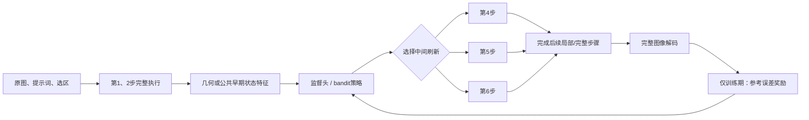

# 等预算刷新时机、轻量监督头与真实 Contextual Bandit 实验

日期：2026-10-30。环境：zeta / 用户确认 H800，驱动显示 NVIDIA L20Y。代码分支 `test/manual-mask-local-20261028`。本文件为本轮新增研究记录，旧报告不覆盖。

> 已完成：256 新请求／2048 DiT、最终监督头 500 次更新、真实 bandit 128 episode／16 次更新、Cal16 两策略闭环。保留 R25 主线，监督头作为研究候选；本轮 RL 未获增量收益。

## 1. 研究问题与已有基础

固定 LOCAL128 + R25 已在第二噪声种子与新 Dev32 完成开发验证；新 Dev8 配对完整流水线延迟为 F 4.2898 秒、R25 2.8785 秒，约 1.4903×。这些是上一轮固定算法的结果，不是本轮策略头或 RL 的测量。

本轮直接进入进一步工作，回答：在四次完整刷新、相同局部预算下，是否可以按样本选择中间刷新时机，提高质量？日历日期不构成等待条件。新策略不需要先替代已有主线，固定 R25 持续作为可复现强基线。

## 2. 等预算动作与执行合同

模型、1024×1024 分辨率、8 步 Lightning、CFG=1、BF16、原始噪声和 LOCAL128 权重均保持冻结。完整步骤停用新增 LoRA，局部步骤启用；Lightning 始终保留。不存在输出硬 mask 或源图像素粘贴。

动作集合为：

\[
\mathcal A=\{R4,R25,R6\},\qquad
\mathcal F_a=\{1,2,a,8\},\quad a\in\{4,5,6\}.
\]

R25 名称沿用上一轮，含义是第 5 步完整刷新、局部最低 25%。若对象核心较大，按原有规则上调到 50%／75%／100%；三个时机动作使用同一上调结果。用 B 的逐步局部选区作为底稿，只把选定的中间一步替换为全图；其余步骤的局部索引完全复用。

每个来源都满足：

\[
\sum_{t=1}^{8}|S_t^{R4}|=
\sum_{t=1}^{8}|S_t^{R25}|=
\sum_{t=1}^{8}|S_t^{R6}|=4N+4\rho_iN.
\]

该式为目标 token 更新量，不能直接当作 FLOPs 或净延迟。源图／文本与外围历史 KV 的刷新时机也随完整步骤移动；因此这是完整刷新调度实验，不单独隔离某一层 KV 或 velocity。

8 个训练来源首包新增 16 请求／128 DiT；达到预冻结继续规则后扩展另外 24 训练＋16 校准来源，新增 80 请求／640 DiT。F、B、R25 复用原冻结输出，不重复计费。

## 3. 监督目标与头结构

离线标签使用完整 F 参考输出，但不将 F 作为语义真值。参考保持损失为：

\[
E_i(a)=\operatorname{MAE}(I_i^a,I_i^F)
+0.25\operatorname{MAE}_{\mathrm{outside}}(I_i^a,I_i^F),
\]

\[
y_{i,a}=\operatorname{clip}\left(\log\frac{E_i(a)+10^{-8}}{E_i(R25)+10^{-8}},-2,2\right).
\]

外围指标取对象框外扩 32 像素后的外部区域。它是相对 F 的外围保持代理，不是编辑正确率，也不是经过校准的语义失败概率。

输入共 32 维：8 维几何／提示词长度；核心与外围各 6 维前两步状态、源 latent、有限差分 velocity 估计及变化统计；4 维空间梯度；8 维文本池化。推理输入只来自原图、提示词、选区及已完成的公共前两步，不读取 F 终态或其他候选的终图。

比较 8→2 线性几何头与 32→8→2 的 tanh MLP。只预测 R4、R6 对 R25 的相对分数，R25 分数固定为零；选择最低预测损失的动作。标准化仅在各折训练来源上拟合。

Train32 按 source group 哈希均分四折。每个结构每折 500 次 AdamW 更新，学习率 0.01、weight decay 0.01、SmoothL1 beta=0.2。按交叉验证的逐来源所选动作损失选结构，再在全部 32 来源拟合 500 次。共 4500 次监督优化调用，其中最终可用头 500 次；不把交叉验证更新写成学生 LoRA 更新。

交叉验证选择了 18 参数几何头，MLP 为 282 参数。几何头外折代理损失比 R25 低 6.53%，比逐折最佳固定时机低约 2.08%；这仍属于训练来源内部验证，尚非独立泛化。

## 4. 真实 bandit，而非离线 oracle

监督头初始化策略，温度固定为 0.25：

\[
\pi_\theta(a\mid x)=\operatorname{softmax}(-\hat y_\theta(x)/0.25)_a,
\qquad r_i(a)=\operatorname{clip}\left[-\log\frac{E_i(a)+10^{-8}}{E_i(R25)+10^{-8}},-2,2\right].
\]

\[
\mathcal L_{RL}=-\mathbb E[r\log\pi_\theta(a\mid x)]
+0.05D_{KL}(\pi_\theta\Vert\pi_{SUP})-0.02H(\pi_\theta).
\]

32 个训练来源各 4 轮，共 128 episode；每 8 episode 更新一次，计划 16 次 Adam 更新，学习率 0.0005、梯度裁剪 1。每个 episode 实际重新执行 8 次 DiT、VAE 解码并计算图像损失；旧 F/R25 仅作奖励参考。重复使用同一噪声，环境是确定性的；主要探索来自抽样动作，不宣称新增了 128 个独立来源。

动作发生在当前请求前两步完成之后，直接切换现有执行器后续计划，保留已形成的 KV 缓存；未另跑一个 F 请求来获取在线特征。每次输出与对应冻结动作逐步状态、RGB 哈希校验。完整 F 标签可离线使用，推理时没有额外教师。

该实验是单次决策的 contextual bandit，不是多步 PPO。由于动作总 token 预算相同，本轮优化质量，不预先宣称它比 R25 更快。语义奖励、跨 seed RL 和联合速度成本尚未实施。

## 5. 失败案例与评审范围

首 8 个训练样例已非盲检查：F 联合通过 7/8，R25/R4/R6 均 6/8。增加斑马的指令被基座执行为把原有马改成斑马，这是共同错误；独角兽例只有 F 有清晰角，三个刷新动作均未修复。其他 6 例未观察到新增明显任务或保持失败。评审为单助手，图像与逐例记录保留。

## 6. 完整结果与决定

|方法|Train32 RGB MAE|Cal16 RGB MAE|Cal16 外围 MAE|Cal16 代理损失|严格联合通过|
|---|---:|---:|---:|---:|---:|
|R25|0.006663|0.006422|0.004160|0.007462|10/16|
|R4|0.006340|0.006218|0.004366|0.007310|10/16|
|R6|0.006697|0.006144|0.003610|0.007047|10/16|
|SUP|—|0.006233|0.003883|0.007204|10/16|
|RL|—|0.006327|0.003996|0.007326|10/16|

SUP 在 Cal16 选择 R4/R25/R6＝5/1/10，RGB 参考误差较 R25 下降 2.95%，10 改善、1 相同、5 退化；来源 bootstrap 95% 区间为 −8.01%～+0.80%。RL 选择 7/1/8，平均下降 1.48%，9 改善、1 相同、6 退化，区间 −6.58%～+2.46%。两者区间均跨零。

RL 比 SUP 的平均 RGB 误差增加约 1.51%，本轮未形成 RL 增量。奖励训练均值四轮为 0.04485/0.04222/0.07038/0.06362，后期奖励更好不代表校准泛化更好。真实动作抽样次数 R4/R25/R6＝34/37/57。

训练选出的固定强基线为 R4。SUP 相对它的代理损失下降 1.45%，但 RGB MAE 增加 0.24%；Cal16 事后最佳固定动作 R6 的平均 RGB MAE 也低于 SUP。按照预冻结“代理与 RGB 均不差于训练选定固定策略”的规则，监督头不晋级。不能只与较弱的某个固定动作比较来宣称学习优势。R6 是本轮发现的固定候选，尚未完成新独立验证，不能把 Cal16 最优当作已泛化。

Train32 的代理损失事后最佳分布 R4/R25/R6＝11/4/17，oracle 比最佳固定 R4 低 8.21%；Cal16 分布为 5/1/10，oracle 比最佳固定 R6 低 4.96%。相同动作占比不表示逐例选择正确，也不表示已学到 oracle。

Cal16 全部 64 张 F/R25/R4/R6 候选图完成单助手非盲比对，旧 F/R25 冻结严格口径不改写。SUP/RL 的图片与所选固定动作哈希一致，因此可以继承对应逐例分数；六臂均联合通过 10/16。狗替换了原有猫、酒瓶被擦除、两个屏幕同时变红、标牌移位、飞机未明确损坏、苹果未切开等失败保留。没有观察到本轮时机动作新增的明显语义退步，也没有观察到语义完成率提高。参考误差和语义结果分别报告。

Cal16 是当前学生路线的既有校准来源，并非新独立泛化。结构、超参数和长度在本轮校准结果打开前冻结；本轮未根据结果再训练。新 Dev32 已见，Test64 封存。

## 7. 实际账本与执行核对

|任务|实际新增请求|实际 DiT|实际参数更新|状态|
|---|---:|---:|---:|---|
|训练首8来源 R4/R6|16|128|0|完成|
|其余24训练＋16校准 R4/R6|80|640|0|完成|
|监督来源交叉验证与最终拟合|0|0|4500，其中最终头500|完成|
|真实 bandit 32源×4轮|128|1024|16|完成|
|SUP/RL 各16校准闭环|32|256|0|完成|
|合计|256|2048|监督4500＋RL16|完成|

标签与环境生成使用 H800，18 参数头的监督拟合和策略反向使用远端 CPU。最终几何头 500 更新约 0.18 秒，仅是小头拟合耗时，不包含标签采集、交叉验证和 RL 生成。没有新 LoRA 更新，没有新完整流水线测速，不能把旧 1.4903× 标到新策略上。

项目累计 3450 成功请求／32942 实际 DiT、1441 额外训练教师；新机累计 2115 请求／21685 DiT。LoRA 累计仍为 153 更新、140 拟合来源。144 份 F/B/R25 旧输出作为引用复用，不重复计入新增请求；RL 的128次真实重复生成均计入。

固定时机首缀合同 528 次通过；策略闭环160次的全部1280状态与所选动作逐位一致，RGB哈希全通过。128个训练episode实际使用的8维几何输入与离线输入逐位一致。审计发现未采用的早期状态统计存在最大2.98×10⁻⁷差异，原因是模型加载将CPU归约线程从4改为8；在8线程复算32源后全向量精确复现。实际18参数头未读取这些差异维度，行为和终图校验不受影响。该差异作为后续MLP在线部署必须统一线程或使用容差合同的事项保留。

RL 权重相对监督初始化的 L2 改变量为0.01756789，确认发生真实学习。一次分析在生成尚未完成时触发完整性断言，未产出指标，待完成后原数据重分析通过；无生成重跑、无额外DiT。严格特征检查的诊断记录与两次CPU检查说明保留，不算GPU生成失败。新增模型执行失败0。

## 8. 下一阶段，不再等待日历日期

当前已有可用的算法研究主线：缓存感知 LOCAL128 学生＋R25 四次完整刷新，上一轮独立开发验证与净延迟证据已经成立。本轮补齐了“样本依赖的刷新时机—监督拟合—真实RL—闭环校准”的证据链，其中RL不优于监督是实验结论，不再无条件追加同一32源的epoch。

|顺序|具体工作|预算／交付|开始条件|完成状态|
|---|---|---|---|---|
|1|冻结16个生成结果未见的新开发来源，比较F/R25/R6/SUP|64请求／512DiT；逐例质量与错误归因|可立即准备；已有候选和固定代码|待执行|
|2|整理R25可配置刷新接口与复现入口，准备SGLang接口映射|公开输入为图像、prompt、ROI、profile；无额外条件图或教师|现在即可推进，不等待RL成功|待实现|
|3|新来源上选择质量稳定的固定／监督候选，再完整流水线配对计时|预定前8源、3重复，候选数量决定最终DiT；事先冻结|质量不差于R25，完整报告个别退步|待执行|
|4|若还研究学习增量，扩至128来源与两个seed训练，加入任务语义／细节信号|先形成固定策略与学习曲线，再决定RL增量包|使用训练池；不调Test64|待设计冻结|
|5|整理算法、消融、失败、质量—成本曲线并推进论文|固定学生与刷新贡献为主，策略/RL如实列消融|已有证据足够开始论文方法与实验章节|可立即推进|

新 Dev16 用于候选验证，生成后转为已见；最终 Test64 仍待模型、接口和评测规则全部冻结后一次性评估。SGLang迁移不需要等到RL“成功”，也不把迁移当作已完成的加速贡献。

八个月总窗口继续为2026-10-22至2027-06-21。本轮实际完成项提前填入当前阶段，后续日期是工作安排而非启动限制。近期优先级是新候选验证和工程接口；不继续把同一批Cal上的微小MAE改善当作新的独立里程碑。

## 9. 复现与归档

- 冻结协议：`data/refresh_timing_pilot8_v1_preregistration.json`、`data/refresh_timing_remaining40_v1_preregistration.json`、`data/refresh_policy_v1_preregistration.json`。
- 原始结果：远端 `runs/refresh_timing_pilot8_v1`、`runs/refresh_timing_remaining40_v1`、`runs/refresh_policy_v1`、`runs/refresh_bandit_v1`；保留PNG、逐步PT、calls、optimizer、源级CSV。
- 监督头SHA256：`da8a58f34513716471741f181d7fdb9ec32a4992b3eb9b829ff2e836ecd8a699`；RL头SHA256：`18df09d3dd0bae8729220eca21548549679f54ae677a1a3716300999c454431e`。
- 机器可读决定、账本与核对：`data/refresh_policy_final_decision_v1.json`、`data/refresh_policy_ledger_v1.json`、`data/refresh_policy_execution_audit_v1.json`。
- 原始压缩归档：远端 `/tmp/refresh_policy_raw_v1.tar.gz`；逐文件清单和校验收据在`data/refresh_policy_raw_manifest_v1.json`与`data/refresh_policy_raw_archive_receipt_v1.json`。旧F/B/R25输出及模型/条件缓存作为明确的外部依赖引用，不重复打包。
- 本轮未Git提交或push。代码、权重与数据保留在当前研究分支工作目录，可审阅后按仓库规则另行发布。
