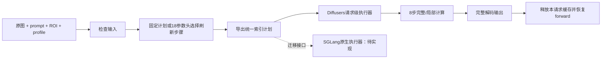

# 无硬 mask 局部编辑：统一执行入口与 SGLang 适配说明

日期：2026-10-30。本文件区分已经实现的 Diffusers 请求接口、已导出的迁移部件和尚待执行的 SGLang 原生生成。实验结果见同目录报告 21。

## 1. 实际输入、输出与支持范围

用户输入为一张原图、编辑提示词、原图坐标系中的 ROI 和执行档位。ROI 只指导计算选区，不遮住源图，不增加一张图像条件，不把生成结果裁回原框。当前验证范围是正方形源图、输出 1024×1024、原版 Qwen-Image-Edit、8 步 Lightning、CFG=1、单请求、单 GPU、BF16、未切片 VAE。

输出始终为完整图像。外围 latent 每一步继续做 Euler 更新；局部步外围的 velocity 与注意力 KV 可以来自历史步骤。因此外围像素不保证与源图相同。生成对象允许超出原始 ROI；ROI 过小或指令绑定错误仍可能失败。

代码入口：

- `scripts/local_edit_runtime.py`：请求结构、固定/学习计划选择、后端计划导出、请求级执行上下文。
- `scripts/run_local_edit.py`：真实完整管线 CLI，或只导出计划的 CPU 模式。
- `scripts/benchmark_local_edit_runtime.py`：成对重复计时与图像一致性检查。
- `scripts/sglang_student_adapter.py`：SGLang 风格二元返回线性层的学生增量桥接。
- `scripts/prepare_sglang_local_edit.py`：导出 72 层 FP32 增量权重、验证 CPU 运算与生成迁移清单。

CLI 使用示例（路径和 ROI 替换为待编辑原图；坐标须在原图范围内）：

```bash
cd /workspace/diffusers-fix/research/manual_mask_local_20261028
/workspace/venvs/manual-mask-local/bin/python scripts/run_local_edit.py \
  --image /absolute/path/source.png \
  --prompt 'Replace the cat with a dog. Preserve the surrounding scene.' \
  --roi 120 180 380 430 \
  --profile R25 --output /absolute/path/result.png
```

`--profile SUP` 使用冻结的 18 参数监督头。`--export-plan-only --output ...json` 只导出计算计划，不加载大模型或执行 DiT。支持 F/B/R4/R25/R6/SUP。已有输出路径会报错，避免覆盖。复现历史试验需同时指定历史 `--request-key` 和 `--noise-file`；request key 会参与外围探针的确定性选样，只复制 seed 不足以保证旧选区完全一致。

## 2. 执行合同

目标图与源图分别有 4096 个图像 token。对象框外扩 32 源像素，投影到 64×64 token 网格，按 2×2 tile 对齐；核心完整保留，必要时把局部预算从 25% 升到 50%/75%/100%。补充预算沿用邻近区域和确定性外围探针。完整步骤刷新全部目标/源图/文本路径，局部步骤只重新计算选中的目标查询、对应新 KV 和 MLP，读取其余历史 KV。

\[
\begin{aligned}
Q_t&=Q_t[S_t],\\
K_t&=\operatorname{scatter}(K_{t-1},S_t,K_t^{\rm fresh}[S_t]),\\
V_t&=\operatorname{scatter}(V_{t-1},S_t,V_t^{\rm fresh}[S_t]),\\
\hat v_t&=\operatorname{scatter}(\hat v_{t-1},S_t,v_t^{\rm fresh}[S_t]),\\
z_{t+1}&=\operatorname{BF16}\left(\operatorname{FP32}(z_t)+(\sigma_{t+1}-\sigma_t)\hat v_t\right).
\end{aligned}
\]

KV 式表达目标 token 的更新；源图和文本 KV 在局部步整体读取缓存，在完整步重新计算。具体运算顺序以冻结代码为准，不能随意把乘法操作数提前升为 FP32，否则可能改变 BF16 轨迹。

新增学生 LoRA 仅在局部步骤启用，Lightning 始终启用；完整步骤使用原来的 8 步基线教师。学生采用 FP32 的低秩计算后转为主干输出 dtype，再相加：

\[
y=Wx+\operatorname{BF16}\big[B\,A\,\operatorname{FP32}(x)\big].
\]

不能把学生直接永久合并进 BF16 主干：既有实验已发现合并轨迹差异，而且完整刷新需要关闭学生增量。

## 3. 把监督决策移到生成前

上一轮比较过早期状态 MLP 和几何线性头，最终选择的是只读取 8 维几何/文本长度特征的 18 参数头。这些信息在 DiT 前就存在，因此可直接预选 R4/R25/R6，无需再等公共前两步。这个调整没有增加输入信息，也未重新训练。

CPU 合同记录 `data/local_edit_runtime_cpu_contract_v1.json`：192 个历史固定计划一致，32 个训练几何向量一致，16 个旧 Cal 动作及预测分数一致，4 个非法 ROI 被拒绝。新 Dev16 对选中 R25/R6 的监督输出又进行了全 8 步轨迹复核；真实完整管线计时继续验证终图与质量实验逐像素一致。



`install_local_edit` 拒绝嵌套安装，在正常退出或异常退出时恢复原 forward 并清理缓存。当前接口供串行单请求使用，不能直接在共享模型上并发进入。并发调度需要将缓存和计划放入每个请求的独立状态。

## 4. SGLang 迁移的固定版本和具体差异

官方源码固定在 `227189488449d97d89d8da2fd5c1ee4bf1e2f955`，远端路径 `/workspace/sglang-localedit`。机器已有 `0.0.0+aim0829.0` 自定义版本，不能假定与本次官方源码相同。未替换现有 Diffusers 环境，也未把自定义安装当作已验证的迁移运行时。

|项目|Diffusers 当前合同|固定版 SGLang 源码差异|适配动作|
|---|---|---|---|
|流水线|原版 QwenImageEditPipeline|有对应原生类，也有 Plus/2511 独立变体|继续使用原版模型，不换成 Plus/2511|
|时间步|冻结 sigma、mu=ln(3)|`prepare_mu` 默认按序列长度线性偏移|覆盖并逐项核对 sigma；不能依赖默认值|
|模型 timestep|现有调用方已遵循 Diffusers 合同|原生模型内部把原始 timestep 除以 1000|避免重复缩放，保留完整时间步收据|
|投影返回值|通常返回 Tensor|并行 Linear 返回 `(output, deferred_bias)`|新增二元返回学生桥接，保留 bias|
|学生挂载|60 个 attention 输出 + 12 个 MLP 输出|对应 `attn.to_out.0`、`img_mlp.net.2` 名字仍存在|导出 144 张量、逐层校验名称形状|
|文本 QKV|独立投影|未量化路径也可能打包 added-QKV|缓存执行器须读取实际布局，不能照抄模块调用|
|位置编码|冻结全图位置再选 query|原生频率缓存和复数 RoPE 路径不同|保留原全图位置索引，禁止局部重编号|
|其他优化|本实验仅自己的局部缓存|原生可叠加融合/量化/图/缓存|首阶段关闭叠加优化，先验证数值|

以上来自固定版本的 [原生 Qwen 模型](https://github.com/sgl-project/sglang/blob/227189488449d97d89d8da2fd5c1ee4bf1e2f955/python/sglang/multimodal_gen/runtime/models/dits/qwen_image.py)、[流水线](https://github.com/sgl-project/sglang/blob/227189488449d97d89d8da2fd5c1ee4bf1e2f955/python/sglang/multimodal_gen/runtime/pipelines/qwen_image.py) 和 [模型配置](https://github.com/sgl-project/sglang/blob/227189488449d97d89d8da2fd5c1ee4bf1e2f955/python/sglang/multimodal_gen/configs/models/dits/qwenimage.py)。源码存在对应模块不代表本项目的原生运行已通过。

## 5. 已交付的迁移部件及其验证边界

`export_backend_plan` 输出版本化 JSON，包含 8 步原始全图索引、完整步、KV/velocity 策略、学生开关和请求级缓存范围。它描述计算语义，本身不执行原生 SGLang 注意力。

`TupleStudentLinear` 保留 SGLang 二元返回值，增量仍为 FP32 A/B、未合并，关闭时精确返回基座结果。挂载器限制 TP=SP=1、未量化、60 层原版结构，并在修改模型前检查全部 72 个目标层。CPU 运算检查覆盖启用/关闭、即时/延后 bias；这检验了桥接算式，不替代真实 SGLang 模型检查。

远端导出目录为 `exports/sglang_local_edit_v1/`；该导出通过检查后，因用户停止机器尚未取回本地，可由本地已校验的学生权重重建。清单保存官方 commit、三份关键源码哈希、学生来源哈希、144 个张量与 4,423,680 参数统计，以及未完成的原生验证标志。权重保持 FP32 safetensors，scale=1，不改训练权重。

尚未完成：固定版原生环境导入、完整 F 生成、原生局部注意力/MLP 执行器、跨后端质量与净延迟。不能将本轮 Diffusers 的加速数字写成 SGLang 的加速数字。

## 6. 下一阶段执行表

|阶段|具体任务|有界预算与验收|
|---|---|---|
|SG0 环境与组件|隔离安装固定版本；验证 FP32 学生、BF16 基座、时间步、RoPE、bias 合同|CPU 与组件检查；不改当前可用环境|
|SG1 原生 F|先 1 个已见来源跑 8 步，再扩到固定 8 来源|最多 64 次新增 DiT；保存逐步 latent、终图与单步差异；数值不等价时先定位|
|SG2 原生 R25|复用版本化计划实现原生稀疏 query、缓存 KV、学生开关与全 latent 更新|同 8 来源最多 64 次 DiT；比较原生 F/R25，也比较 Diffusers 对应输出|
|SG3 原生净延迟|组件和质量核对完成后冻结两后端计时协议|完整预处理/文本/VAE/DiT/清缓存计时，不能只测 kernel|
|SG4 交付|整理复现命令、环境锁、差异/失败清单、论文系统章节|Test64 继续封存到最终模型/评测冻结；发布另按仓库规则|

不必等待 RL 成为正结果才推进系统实现。论文目前已有局部缓存、缓存感知学生、完整刷新调度、学习策略和负面消融的证据链，工程工作可以沿固定 R25 主线独立推进。
