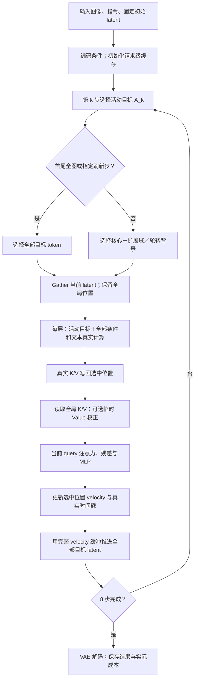
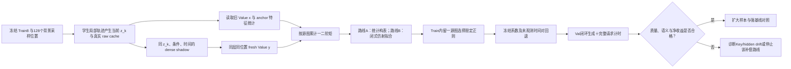

# 基于边界扩展与小样本上下文校准的局部图像编辑加速研究

## 阶段性研究总结报告

**研究载体：**原版 Qwen-Image-Edit 与对应 8 步 Lightning LoRA  
**实验平台：**zeta，H800 单卡（用户确认；驱动报告 NVIDIA L20Y，CUDA capability 9.0）  
**统计截止：**2026 年 10 月 22 日，Asia/Shanghai  
**编制日期：**2026 年 10 月 23 日  
**报告性质：**研究进展、机制分析与后续方案；方法有效性仍处于开发验证阶段  
**总体判断：**工程路径可行，研究问题值得继续；当前算法应修订，尚未达到完整质量与加速联合目标。

---

## 摘要

针对扩散式图像编辑中“编辑局部、计算全图”的成本问题，本研究探索在少步编辑模型上，利用语义与结构边界扩展计算区域，并通过背景上下文维护降低局部执行的质量损失。研究以原版 Qwen-Image-Edit 及其对应的 8 步 Lightning LoRA 为载体，在单张 H800 上完成模型基线、真实目标 token 局部执行、边界扩展、同状态误差归因、背景轮转及多种 Value 校正实验。已归档成功完整生成请求 347 个、真实 DiT 前向 3432 次，其中包含 72 次诊断教师查询；这些调用均围绕三个公开开发样例和一个固定生成种子开展，不能视为 347 个独立质量样本。

实验发现：第一，局部执行器能够实际减少目标 token 的 Q/K/V 投影与 MLP 计算，并保留全局注意力上下文，在当前模型上具有端到端节时空间；第二，仅扩大编辑区域尚未稳定改善保真度，结构扩展相对等 token 数对照的优势未成立；第三，同状态诊断中，活动目标区域占速度预测误差能量约 82%–92%，说明活动分支接收旧上下文后的误差传播值得优先研究，但这不单独证明 Value 是唯一原因；第四，等预算背景轮转改善三个样例的感知距离，但跨案例净延迟下降约 8.02%，未达到 10% 目标；第五，读取阶段 Value 校正出现局部正结果：去毛发案例的 SHIFT 方法将 LPIPS 从 0.009014 降至 0.001217，同时保留 13.52% 的配对净延迟下降。逐通道校正在文字与衬衫案例中将 LPIPS 降至约 0.030，仍未满足 0.02 门槛，文字亦存在错字。

因此，现阶段结论是保留局部加速执行器，将研究重点由单纯空间扩展调整为“边界完整性与时间上下文可靠性的联合控制”。下一阶段拟使用独立的 Train8 校准集，比较特征统计校准与同学生状态的旧 Value 到当前 Value 闭式仿射拟合，再决定是否扩展到 Train16/32。真实小样本采集、拟合、独立验证、自动边界选择、SGLang 移植和强化学习尚未完成。强化学习仅作为主线稳定后的可选扩展。

**关键词：**图像编辑；扩散 Transformer；局部计算；边界扩展；特征缓存；小样本校准；推理加速

## 1 引言与研究问题

### 1.1 研究动机

局部图像编辑通常只要求改变少量对象、文字、属性或细线结构，但扩散 Transformer 仍对整张目标图反复计算。直观方案是只执行变化区域，并复用背景。然而，图像对象并不总有独立、清晰的几何边界：发丝与衣服相交，手部遮挡衣领，细线跨过盘面和背景，文字字符之间存在布局约束。若活动区域过紧，边界附近及活动区域内部都可能因缺少可靠上下文而发生变化。

用户提出的“将局部适当扩展到边界更清晰、结构更完整的位置”有合理性。这里需要优化的不是最小变化像素集合，而是**包含必要编辑对象与耦合上下文、且实际执行成本可控的计算域**。本轮实测进一步表明：即使空间选区已固定扩展，域外缓存仍随去噪过程变旧，活动区域可能接收到不准确的上下文。因此，需要同时处理空间边界与时间缓存误差。

### 1.2 本阶段回答的四个问题

1. 原版 Qwen-Image-Edit 的 8 步 Lightning 能否在现有单卡上作为稳定研究底座？
2. 局部执行是否真正减少算子工作量，并产生端到端收益？
3. 质量问题主要由区域外旧 velocity，还是活动区域的上下文近似引起？
4. 能否通过少量背景刷新或低成本 Value 校正改善质量，并为后续小样本学习提供依据？

当前证据支持前两个问题的工程可行性，缩小了第三个问题的研究范围，并对第四个问题给出局部正例；尚未形成跨任务稳定有效的完整算法。

### 1.3 研究边界与术语

本报告将“加速”定义为相对**同期、同权重、同调度器的完整 8 步参考**的请求端到端耗时下降。原版 50 步到 Lightning 8 步的提速属于底座变化，单独报告，不能当作本研究局部算法的贡献。

“保真”至少包含接近完整计算参考、编辑语义正确、边界连贯及允许变化区外的保持性。有限 LPIPS 或人工看起来相近不构成数学无损证明。完整 8 步结果本身也不是人工编辑真值。

## 2 研究基础与相关工作

### 2.1 Qwen-Image-Edit 与 Lightning 底座

原版 Qwen-Image-Edit 建立在 Qwen-Image 上，利用视觉语言编码与 VAE 编码提供编辑条件。官方原版示例使用 50 步、`true_cfg_scale=4.0`；LightX2V 发布了与原版编辑模型对应的 8 步 Lightning LoRA，其编辑示例使用 8 步、CFG 1.0。本研究使用确切的原版编辑适配器，没有切换到 2509/2511 版本。[Qwen 官方模型卡](https://huggingface.co/Qwen/Qwen-Image-Edit)、[Lightning 开发者说明](https://github.com/ModelTC/LightX2V-Qwen-Image-Lightning)。

本研究没有自行完成 50→8 步蒸馏。下载并验证作者权重，是当前实验的起点。50 步与 8 步的步数比也不能直接当作实际加速倍数。

### 2.2 RegionE、SpotEdit 与 LinCa 的方法关系

| 工作 | 已有主要机制 | 与本研究重叠的基础 | 本研究需验证的具体差异 |
|---|---|---|---|
| RegionE | 自适应编辑区域、形态学处理、局部目标 token 执行、背景/参考 KV、周期全图刷新和末尾平滑 | 局部执行、区域处理和全局上下文均已有基础 | 显式影响域扩展能否在等 token 预算下更好；读取校正能否减少为恢复质量而付出的全图刷新 |
| SpotEdit | 选择局部 query，读取全局缓存 KV；SpotFusion 按时间同时融合背景 K 与 V | 局部 query 与上下文修复已被研究 | 只校正 Value、保持 raw cache 底本与真实时间戳不变，能否在固定执行预算下更稳定；是否需要联合 K/V |
| LinCa | 学习可逆特征分解，对不同子空间进行分段、多阶时间预测；预测步骤跳过 backbone | 小量特征样本训练、历史特征预测均不是空白 | 保留活动 token 实算，只补偿背景注意力 Value；与整网残差预测及其简单组合相比是否有额外收益 |

RegionE 还利用活动区域速度的时间相似性进行自适应衰减缓存。它虽将方法称为 training-free，其时间校正系数仍由随机采样数据拟合。因此，“不训练主干”与“完全不使用校准数据”需要区分。[RegionE 论文，式 7–9](https://arxiv.org/html/2510.25590v1)。

SpotEdit 的论文公式将背景 K 和 V 同时向参考图特征插值，而非仅静态缓存，时间权重为 \(\alpha(t)=\cos^2(\pi t/2)\)。当前官方仓库还提供背景 velocity 更新方式，未来复现必须固定论文或代码版本，不能混用二者。[SpotEdit 论文，式 7–10](https://arxiv.org/html/2512.22323v1)、[作者代码](https://github.com/Biangbiang0321/SpotEdit)。

LinCa 预测的是网络末层累计残差的分解表示，而本研究关注局部执行中背景注意力的 raw Value。LinCa 已包含 Qwen-Image-Edit 实验，并报告使用约 100–200 份预生成特征样本训练，单张 12GB GPU 约一小时；教师特征提取成本另计。其可逆映射约束投影重建，但不消除时间预测误差。因而“小样本训练缓存预测”不能作为本研究的独有贡献。[LinCa 论文及附录](https://arxiv.org/html/2608.17973v1)。

### 2.3 当前学术定位

当前可以准确描述的设计是：**在显式扩展的局部计算域内执行目标 token，对域外缓存背景 Value 进行读取阶段的时间校正，保留真实缓存底本；后续用小量校准轨迹拟合该校正。**

这是研究方案的具体位置，尚不是已成立的创新性结论。边界扩展、局部 query、全局 KV、因果历史预测及少量样本训练都有直接相关研究。要形成论文贡献，至少需要证明：在相同模型与预算下，边界设计、只读校正或二者联合能改善独立数据上的质量—延迟前沿，而简单组合或已有基线不能解释全部收益。

当前尚未完成三项工作的可比实跑。其论文中的硬件、步数、数据与当前 8 步实验不同，不能把公开倍数与本报告的约 10% 节时直接排名。

## 3 问题定义与数学描述

### 3.1 区域定义

设输入图像为 \(I\)，编辑指令为 \(p\)，目标 token 集合为 \(\mathcal T\)，条件图像 token 为 \(\mathcal C\)，文本/视觉语言条件 token 为 \(\mathcal P\)。定义：

- \(M_{\rm sem}\)：编辑所指对象或语义核心。
- \(M_{\rm allow}\)：允许输出发生合理改变的评价区域。
- \(A_k\subseteq\mathcal T\)：第 \(k\) 步真正重算的目标 token 集合。
- \(\mathcal T\setminus A_k\)：本步复用历史上下文与 velocity 的目标位置。

计算域应覆盖必要的语义核心，但**计算域不等于允许变化区**。为获得上下文而重算对象外部，并不自动获得修改这些像素的许可；评价 mask 不能随计算域扩大而放宽。

集合运算中的区域统一映射到同一目标 token 网格；输出质量仍在预先固定的像素评价区域上计算。

### 3.2 少步去噪与局部速度复用

令 \(k=0,\ldots,7\)，完整模型预测为：

$$
v_k^D=F_\theta(z_k,I,p,t_k),\qquad
z_{k+1}=z_k+\Delta\sigma_k\,v_k,
\quad\Delta\sigma_k=\sigma_{k+1}-\sigma_k.
\tag{1}
$$

本轮局部执行器使用当前活动位置的局部模型预测 \(v_k^L\)，其余位置复用历史输出 \(\bar v\)：

$$
\widetilde v_{k,i}=
\begin{cases}
v^L_{k,i},&i\in A_k,\\
\bar v_i,&i\notin A_k.
\end{cases}
\tag{2}
$$

所有目标 latent 仍由 scheduler 前进；“不重算”不表示这些 latent 停止更新。第 1、8 步执行完整目标图；其他步骤局部执行。位置重新激活时，从**当前 latent**进入模型，而非使用上次激活时的旧输入。

式（1）是实数形式的 Euler 表达。实际 BF16 执行还包含乘法与更新舍入；诊断中另外核对了真实 scheduler 更新，不能仅由实数公式推断逐位一致。

### 3.3 联合质量与成本目标

令 \(J_\psi\) 为候选算法的终图，\(J_F\) 为同期完整 8 步参考，\(T_\psi\) 为实际端到端耗时。探索性目标为：

$$
\min_\psi\;\mathbb E[T_\psi]
\quad\text{s.t.}\quad
d_{\rm LPIPS}(J_\psi,J_F)\le\epsilon_L,
\quad\Delta E_{\rm bg}\le\epsilon_B,
\quad S_{\rm edit}=1,
\quad S_{\rm boundary}=1.
\tag{3}
$$

其中 \(S_{\rm edit}\) 和 \(S_{\rm boundary}\) 表示按固定规则检查编辑语义与边界是否合格。本轮 pilot 取 \(\epsilon_L=0.02\)、\(\epsilon_B=1/255\)，并以相对 F 净延迟下降不小于 10% 为时间侧目标。上述数值是项目探索门槛，不是行业“无损”标准，也不是已建立的正式非劣性界值。

## 4 已实现算法

### 4.1 全局上下文保留的局部执行器

对第 \(\ell\) 层，令 \(a_i\) 表示位置 i 最后真实重算的步号。缓存的 Key 已完成对应归一化与全局位置 RoPE；Value 为 raw Value。当前活动位置先真实重算并写回，未激活位置保持历史底本：

$$
\bar K_{\ell,i}\leftarrow K_{\ell,k,i},\quad
\bar V_{\ell,i}\leftarrow V_{\ell,k,i},\qquad i\in A_k.
\tag{4}
$$

实现中持久时间戳在整次 forward 末尾提交；层内读取使用有效 anchor：

$$
\widetilde a_{k,i}=\begin{cases}
k,&i\in A_k,\\
a_i,&i\notin A_k.
\end{cases}
$$

这样，本层刚真实重算的 Value 使用当前时间恒等读取，未选中的位置才使用旧 anchor 校正。式（10）、（12）、（16）均引用这个读取 anchor。

本轮条件图像与文本分支每步重新计算。活动查询使用完整目标背景与当前条件：

$$
Q_{\ell,k}=\operatorname{cat}(Q^{\mathcal P},Q^{A_k},Q^{\mathcal C}),
$$

$$
K_{\ell,k}^{\rm read}=\operatorname{cat}(K^{\mathcal P},\bar K^{\mathcal T},K^{\mathcal C}),\quad
V_{\ell,k}^{\rm read}=\operatorname{cat}(V^{\mathcal P},\widehat V^{\mathcal T},V^{\mathcal C}),
\tag{5}
$$

$$
O_{\ell,k}=\operatorname{Softmax}\!\left(
\frac{Q_{\ell,k}(K_{\ell,k}^{\rm read})^\top}{\sqrt{d_h}}+B
\right)V_{\ell,k}^{\rm read}.
\tag{6}
$$

无校正时 \(\widehat V=\bar V\)。只有 \(A_k\)、条件图和文本进入相应当前层的投影与 MLP；不是先完整计算再把输出 mask 掉。所有 gather 都使用全局 token 坐标，不能给裁剪区域重新编号后改变 RoPE 语义。



**算法 1：局部执行与只读校正。** 以下是实现逻辑摘要，不代表任意 Qwen 选项都已支持；当前验证范围为 batch1、CFG1、固定 8 步。

```text
输入：z0，条件 I/p，逐步活动集合 A[0..7]，校正表，完整刷新步集合
初始化：请求独立的 raw K/V cache、velocity buffer、真实时间戳
for k = 0..7:
    if k 是完整刷新步: A_k = 全部目标位置
    从当前 z_k gather A_k，并附加全部条件图像位置
    for Transformer layer ℓ:
        实算活动目标、条件图像和文本的当前投影
        只将真实重算的目标 K/V 写回 raw cache
        设置读取anchor：活动位置取k，非活动位置取持久a_i
        根据读取anchor生成临时V_read；fresh位置恒等
        以当前 query 读取完整目标 K/V 与当前条件 K/V
        更新本层活动表示与条件表示，执行相应 MLP
    将选中位置的当前输出写入 velocity buffer
    只为真实重算位置更新时间戳
    z_(k+1) = scheduler_step(z_k, velocity buffer)
输出：decode(z_8)
```

### 4.2 空间边界扩展与控制组

已执行的空间方案包括核心 R0、固定扩展 R1、结构扩展 R2，以及与 R2 活动 token 数相同的 R3 对照。它们使用事先准备的粗框与结构区域，不是已训练的自动语义选区器。另有仅针对去毛发案例的事后整盘闭合探针，单独标注为 post-hoc。

未来边界选择可表述为输入图结构图上的受约束计算域优化：

$$
A_k^*=\arg\min_{A\supseteq M_{\rm sem}}
\left[\widehat C_k(A)+\lambda_{\rm cut}
\sum_{(i,j)\in\mathcal E}w_{ij}|\mathbf1_A(i)-\mathbf1_A(j)|
+\lambda_{\rm risk}\widehat R_k(A)\right].
\tag{7}
$$

\(w_{ij}\) 可来自源图分割、接触/遮挡结构或首个必要全图步的可用特征；切断强耦合连接会增加代价。\(\widehat C\) 必须由真实形状成本标定，不能仅用面积代替耗时；\(\widehat R\) 是待建立的质量风险估计。式（7）是**未来候选建模方式**，尚未实现或验证。在线输入不能依赖未来终图或教师误差。

### 4.3 等预算背景轮转 ROT

令固定扩展核心为 C，其余目标位置划为余数集合 E 与等量背景组 \(G_0,G_1,G_2\)。E 始终计算。中间六步使用：

$$
A_k=C\cup E\cup G_{(k-1)\bmod 3},\quad k=1,\ldots,6;
\qquad A_0=A_7=\mathcal T.
\tag{8}
$$

FIXj 始终使用 \(C\cup E\cup G_j\)，与 ROT 每步活动 token 数相同。分组使用预冻结的空间块哈希，而非依据结果挑背景。缓存读年龄为 \(r_{k,i}=k-\widetilde a_{k,i}\)；当前选中位置真实写回后的读年龄为 0。ROT 实测最大读年龄不超过 2。

ROT 会同时刷新 K、V 和 velocity，因而不能把结果解释为纯 KV 因果实验。它相对 R2 增加了背景计算，真正等预算对照是 FIX0/1/2。

### 4.4 SHIFT：Value 时间偏移补偿

记某层调制前归一化特征为 \(n_{\ell,k,i}\)，调制为 \(u_{\ell,k}=1+s_{\ell,k}\)、\(q_{\ell,k}\)，Value 投影权重与偏置为 \(W_\ell,c_\ell\)：

$$
V_{\ell,k,i}=W_\ell\left(u_{\ell,k}\odot n_{\ell,k,i}+q_{\ell,k}\right)+c_\ell.
\tag{9}
$$

令 \(p_{\ell,k}=W_\ell q_{\ell,k}+c_\ell\)。SHIFT 按读取有效 anchor 使用：

$$
\widehat V_{\ell,k,i}=\bar V_{\ell,i}+p_{\ell,k}-p_{\ell,\widetilde a_{k,i}}.
\tag{10}
$$

该式补偿投影后的 shift 变化，不恢复 scale 变化、hidden drift 或 Key 陈旧。它不是最终 velocity 的修正。

### 4.5 AFFINE：每层标量增益

AFFINE 用调制尺度的最小二乘标量近似：

$$
\alpha_{\ell,k,a}=\frac{u_{\ell,k}^{\top}u_{\ell,a}}
{\|u_{\ell,a}\|_2^2+10^{-12}},\qquad
\delta_{\ell,k,a}=p_{\ell,k}-\alpha_{\ell,k,a}p_{\ell,a},
\tag{11}
$$

$$
\widehat V_{\ell,k,i}=\alpha_{\ell,k,\widetilde a_{k,i}}\bar V_{\ell,i}+\delta_{\ell,k,\widetilde a_{k,i}}.
\tag{12}
$$

这相当于用一个标量描述整层输出通道的变化。只有冻结特征与相应尺度近似成立时，才可能接近当前 Value；不是恒等恢复公式。

### 4.6 CHANNEL：投影感知逐输出通道增益

令 anchor 归一化特征具有均值 \(\mu_{\ell,a}\) 和对角方差 \(S_{\ell,a}\)。在冻结同一 anchor 特征的近似下，对输出通道 j 定义：

$$
D_{\ell,a,j}=\sum_iW_{\ell,ji}^2S_{\ell,a,i}u_{\ell,a,i}^2,
\quad
N_{\ell,k,a,j}=\sum_iW_{\ell,ji}^2S_{\ell,a,i}u_{\ell,k,i}u_{\ell,a,i}.
\tag{13}
$$

$$
\lambda_{\ell,a}=10^{-6}\operatorname{mean}_j(D_{\ell,a,j})+10^{-12},
\qquad
\alpha_{\ell,k,a,j}=\frac{N_{\ell,k,a,j}+\lambda_{\ell,a}}
{D_{\ell,a,j}+\lambda_{\ell,a}}.
\tag{14}
$$

两端必须使用**同一个 anchor 均值**：

$$
m_{\ell,k|a}=W_\ell(u_{\ell,k}\odot\mu_{\ell,a}+q_{\ell,k})+c_\ell,
\quad
m_{\ell,a|a}=W_\ell(u_{\ell,a}\odot\mu_{\ell,a}+q_{\ell,a})+c_\ell,
\tag{15}
$$

$$
\delta_{\ell,k,a}=m_{\ell,k|a}-\alpha_{\ell,k,a}\odot m_{\ell,a|a},
\quad
\widehat V_{\ell,k,i}=\alpha_{\ell,k,\widetilde a_{k,i}}\odot\bar V_{\ell,i}+\delta_{\ell,k,\widetilde a_{k,i}}.
\tag{16}
$$

式（14）的分子分母同时加 \(\lambda\)，对应使增益靠近 1 的正则，而非靠近 0。当前实跑固定 \(\mu=0,S=1\)，没有采集真实训练特征。它只比标量规则更考虑 Value 投影能量，仍忽略非对角协方差、真实 hidden drift 与 Key 误差。

### 4.7 读取语义与实现约束

所有校正均满足：真实缓存不被近似值覆盖；只有真实重算才更新 anchor；同时间对强制 \(\alpha_{k,k}=1,\delta_{k,k}=0\)。因此，连续多步使用的是对真实底本的重新校正，而非反复校正上一步近似值。

固定权重、8 步时间、精度与设备下，系数可跨请求复用，但 K/V 与 velocity 缓存必须逐请求重置。构表没有额外图像 DiT 查询，仍有静态线性计算、显存与冷准备时间。逐 token 查表、FP32 临时乘加与 cast 均进入请求耗时。

## 5 同状态误差归因方法

为区分活动输出与区域外速度复用，在**同一学生当前** \(z_k\)、条件与时间下计算完整预测 \(v_k^D\) 和局部预测 \(v_k^L\)。令 \(M_k\) 为活动目标 mask，则原局部误差为：

$$
e_k=\underbrace{M_k\odot(v_k^L-v_k^D)}_{e_k^{\rm active}}
+\underbrace{(1-M_k)\odot(\bar v-v_k^D)}_{e_k^{\rm inactive}}.
\tag{17}
$$

两个分量的输出坐标支撑互不相交，因此：

$$
\|e_k\|_2^2=\|e_k^{\rm active}\|_2^2+\|e_k^{\rm inactive}\|_2^2,
\quad
\rho_{\rm active}=\frac{\sum_{k=1}^{6}\|e_k^{\rm active}\|_2^2}
{\sum_{k=1}^{6}\|e_k\|_2^2}.
\tag{18}
$$

一步 Euler 误差能量另乘 \((\Delta\sigma_k)^2\)。这不是最终累计误差，也不表示机制彼此独立。

| 模式 | 活动位置输出 | 非活动位置输出 | 用途 |
|---|---|---|---|
| D | 当前完整预测 | 当前完整预测 | 原生完整参考 |
| B | 当前局部预测 | 历史 velocity | 原局部执行 |
| V | 当前完整预测 | 历史 velocity | 替换活动输出的 oracle 干预 |
| K | 当前局部预测 | 当前完整预测 | 替换非活动输出的 oracle 干预 |

此处 V 是 velocity 干预的模式名，K 是上下文近似的模式简写；**不是**本报告校正器中的 Value 和单独 Key 消融。V/K 都额外使用完整模型，不能部署为所报告的加速算法。其后续轨迹会分叉，跨轨迹最终指标不能相减为严格因果贡献。

式（17）–（18）的完整预测是在 B 当前状态上查询的 oracle；图 1 及终图指标中的 D 则是 D 自身完整轨迹的最终输出。两者都用完整模型，但不是同一组中间 latent。

## 6 实验设置与评价协议

### 6.1 环境、模型与输入

| 项目 | 实际设置 |
|---|---|
| GPU | 用户确认 H800；驱动名称 NVIDIA L20Y，capability 9.0；CUDA 可见约 79.18 GiB |
| 基座 | 原版 `Qwen/Qwen-Image-Edit`，revision `ac7f9318f633fc4b5778c59367c8128225f1e3de` |
| LoRA | `Qwen-Image-Edit-Lightning-8steps-V1.0-bf16.safetensors`，后续融合并卸载 adapter |
| 执行 | BF16、batch1、原生 SDPA、VAE tiling；未量化、未 offload、未 compile |
| 代码 | Diffusers `0.42.0.dev0`；基线提交 `73faca368c0da77645ea58836aa8780d2d8c5353` |
| 关键依赖 | PyTorch `2.9.1+cu129`，Transformers `5.3.0`，PEFT `0.21.2` |
| 生成 | 8 步、CFG1、固定 SHIFT3 调度；seed `2026102201`；显式相同初始 latent |
| 条件 | 保留完整条件图和文本；无跨请求条件编码缓存 |

| 开发样例 | 实际目标 H×W | 目标 token | 条件 token | 条件文本序列长度 | R2 目标活动数/比例 |
|---|---:|---:|---:|---:|---:|
| 文字替换 blocks_text | 832×1248 | 4056 | 4056 | 1378 | 1088 / 26.82% |
| 衬衫改色 shirt_color | 832×1248 | 4056 | 4056 | 1369 | 1282 / 31.61% |
| 去毛发 remove_hair | 1024×1024 | 4096 | 4096 | 1383 | 438 / 10.69% |

三例已多轮查看，属于开发样例。不存在正式隔离的 Train/Val/Test 结果。条件文本序列包含视觉语言条件相关内容，不能按普通短文本长度估算成本。

时间输入严格匹配 pipeline：先将 scheduler timestep 转成 BF16，再除以 1000。实际模型时间为 `[1, 0.95703125, 0.8984375, 0.83203125, 0.75390625, 0.64453125, 0.5, 0.30078125]`。先在 FP32 除再 cast 会产生不同值，不适合作为已冻结静态表的替代。

### 6.2 请求延迟与配对统计

请求端到端计时包含条件编码、索引、缓存初始化与清理、全部 DiT、scheduler、临时校正和解码转图；不含模型加载、静态冷构表、PNG 写盘和离线指标。首个需要构表的请求应另报冷成本。

对同 case、同 repeat 的方法与 F，计算：

$$
r_{c,m}=\exp\left[\frac1R\sum_{r=1}^R
\log\frac{T_{c,m,r}}{T_{c,F,r}}\right],\qquad
\eta_{c,m}=1-r_{c,m}.
\tag{19}
$$

跨案例描述性比例再按源图等权取几何平均。各阶段只与同期 F 配对，不能把不同轮的重复合并。三次中位耗时之比不等于式（19）；CV 只描述重复计时，不是泛化不确定性。

### 6.3 质量与边界指标

LPIPS 使用 AlexNet、`spatial=True, normalize=True` 的完整 RGB 距离图均值。区域指标是在该全图特征距离图上按固定区域求均值，感受野仍跨边界。

令 \(\Omega_{\rm far}\) 为固定允许变化框以外的远背景：

$$
\Delta E_{\rm bg}=
\operatorname{MAE}_{\Omega_{\rm far}}(J_m,I)
-\operatorname{MAE}_{\Omega_{\rm far}}(J_F,I).
\tag{20}
$$

负值只表示相对源图变化较小，不能代替“编辑正确”。公共 band2 在目标 token 网格上定义为 `dilate(R0,2) ∩ dilate(~R0,2)`，再上采样到像素空间，包含 R0 边界内外的固定公共带，不随候选区域扩大。本文按实现明确其内外口径，不改变历史计算值。band2 MAE 与 band2 梯度 MAE 分别报告，不能互换。

数值通过还须结合文字完整性、编辑语义与明显接缝检查。本轮人工检查均非盲；没有正式 OCR 字符准确率、身份保持指标、统计显著性、置信区间或非劣性结论。

### 6.4 历史计划与现行 pilot 门槛

早期面向 50 步主线的计划曾使用 LPIPS 均值≤0.05、背景增量≤0.01、边界 LPIPS≤0.07、成功率差≤5 个百分点等起始指标。当前 8 步 pilot 在执行前冻结为逐例 LPIPS≤0.02、extraBG≤1/255，加语义和边界检查。两者属于不同版本，不能混写为一套已正式验证标准。

本报告不修改已执行实验的门槛。正式验证前应在 Train/Val 上登记统一协议、评价工具与统计方法，所有候选冻结后才解封 Test。

## 7 实验结果

### 7.1 全阶段工作量与完成账本

| 阶段 | 已完成内容 | 成功完整请求 | 真实 DiT 前向 | 其中额外诊断 oracle | tiny 检查 |
|---|---|---:|---:|---:|---|
| ① Lightning 基线 | 50/8 步、CFG、LoRA 与融合；含一次环境回归 | 27 | 800 | 0 | 无单独 tiny 前向 |
| ② 局部执行与边界 | 正确性、R0–R3、保守刷新、profile、整盘探针 | 152 | 1216 | 0 | 13 项通过；未汇总前向总数 |
| ③ 同状态误差归因 | D/B/V/K 轨迹与同状态配对 | 12 | 168 | 72 | 192 次前向 |
| ④ 背景轮转与标量校正 | ROT/FIX 72 请求；SHIFT/AFFINE 48 请求 | 120 | 960 | 0 | 192 次前向 |
| ⑤ 逐通道校正 | F/R2/CHANNEL 同期矩阵 | 36 | 288 | 0 | 172 次前向 |
| 合计 | 包括预热、重复、正确性及诊断 | **347** | **3432** | **72，已包含于 3432** | 已明确计数 556 次，另有②的 13 项测试 |

这些账本可相加为计算工作量，不能相加为质量样本量或合并性能基准。①包含 26 个主协议请求和 1 个环境回归；②包含 12 个正确性、90 个主矩阵、36 个保守刷新、2 个 profile 和 12 个事后整盘请求。③的 168 次为 72 local＋72 oracle＋24 native，不能再加一遍 oracle。

已登记完整生成请求未失败、未 OOM，但全过程并非没有故障：早期存在管线/加载接口与依赖兼容中断，标量 tiny 脚手架曾在任何模型前向之前因保存函数缺失而中断，归因分析曾修复派生字段命名冲突。失败原件与修复记录保留。它们不应伪装成失败生成，也不应从研究过程记录中消失。

### 7.2 底座基线：少步可运行，但已有质量差异

| 配置 | 步数/CFG | 三输入主测均值/s | 主要观察 |
|---|---|---:|---|
| A：原版 | 50 / 4 | 49.2450 | 原版质量参考 |
| B：原版直接减步 | 8 / 4 | 10.7300 | 不是蒸馏模型，质量需独立核对 |
| C：原版直接减步并关 CFG | 8 / 1 | 6.7161 | 文字编辑失败，不能因快而替代 Lightning |
| D：Lightning 未融合 | 8 / 1 | 7.5072 | 作者式 adapter 运行对照 |
| E：Lightning 融合 | 8 / 1 | 6.7427 | 后续完整 8 步 F 的候选底座 |

本表为三个输入的 primary measurement 均值，额外文字 anchor 重复不参与该均值；输入与重复不构成均衡大样本计时。原始定义见[阶段①结果](../Lightning8前置实验_20261022/02_实验数据记录与结果分析.md)。E 相对 A 约 7.30× 的经验提速同时包含步数、CFG 与权重变化，不能归为局部算法收益。

D/E 在 BF16 下非逐像素等价：三例全图 MAE 约 0.01340、0.01314、0.00127，人物与文字细节存在可见差别。因此，后续首先研究“相对同一融合 8 步 F 的额外损失”，尚未证明保持原版 50 步质量。阶段①历史显存还包含观测引用保留的 adapter，不能直接拿它与后续干净卸载后的峰值比较。

### 7.3 局部执行与边界扩展

主 R2 相对同期 F 的跨案例配对几何净延迟下降约 **12.35%**，但文字与衬衫质量未过门。把全图刷新增加为第 1、2、4、6、8 步后，R2_safe 三例数值门槛通过，净下降仅约 **5.75%**，仍未达到时间目标，也没有独立泛化证据。

结构 R2 相对同 token 数 R3 的公共 band2 MAE 改善为文字 **−1.75%**、衬衫 **−1.50%**、去毛发 **+3.36%**。即当前结构规则未稳定优于等预算对照。“计算更多区域可能改善部分接缝”与“语义边界选择优于同面积规则”是不同主张，后者尚未成立。

事后整盘闭合探针在一个样例中使 band2 MAE 改善约 29.3%，但梯度指标仅改善约 0.65%，远背景额外变化未过门，净延迟下降约 8.62%。它提供了边界完整性的线索，不能替代独立数据上的区域学习实验。

### 7.4 误差归因：活动区域误差占主导

| 输入 | R2 目标活动比例 | 活动速度 SSE 份额 | 一步 Euler 能量份额 | 活动/非活动单位元素 MSE |
|---|---:|---:|---:|---:|
| 文字 | 26.82% | 91.90% | 88.17% | 30.94× |
| 衬衫 | 31.61% | 82.19% | 79.66% | 9.99× |
| 去毛发 | 10.69% | 86.46% | 84.69% | 53.32× |

| 输入 | B：原局部 LPIPS | V：替换活动输出 | K：替换非活动输出 |
|---|---:|---:|---:|
| 文字 | 0.04931 | 0.00441 | 0.04568 |
| 衬衫 | 0.04402 | 0.01593 | 0.03941 |
| 去毛发 | 0.00901 | 0.00105 | 0.00766 |

V 三例通过 pilot 数值门槛；K 仍保留文字与衬衫失败，盘面亦可见分块。这说明只修区域外旧 velocity 不是当前最有力的优化方向。它不证明一个小型 Value 校正器能够达到 oracle 的效果，V 的质量也不能与 B 的速度拼接成“已实现”的联合结果。


**图 1** 同状态干预的非盲开发样例。替换活动输出的 V 接近完整参考；保留活动近似的 K/B 仍有错字。图中 V/K 为诊断模式，不是部署算法。

### 7.5 背景轮转、标量与通道校正的主要数据

P1 为轮转阶段，P2 为标量阶段，P3 为通道阶段。每项净下降均使用其所属阶段的同期 F 配对，不混用绝对耗时或重复。R2(P1) 在三个阶段复现同一终图，质量参考输出也保持一致。

<!-- BEGIN_GENERATED_RESULTS -->
| 阶段 | 输入 | 方法 | 中位秒 | 配对净下降/F | LPIPS/F | band2 MAE/F | extraBG/F | 数值门槛 |
|---|---|---|---:|---:|---:|---:|---:|---|
| P1 | blocks_text | R2 | 5.9072 | 11.93% | 0.049312 | 0.029269 | 0.001547 | 未过 |
| P1 | shirt_color | R2 | 5.9528 | 11.18% | 0.044016 | 0.020074 | -0.005787 | 未过 |
| P1 | remove_hair | R2 | 5.8452 | 14.12% | 0.009014 | 0.021156 | 0.001467 | 通过 |
| P1 | blocks_text | ROT | 6.1984 | 7.72% | 0.023320 | 0.002859 | 0.002469 | 未过 |
| P1 | shirt_color | ROT | 6.2236 | 7.18% | 0.026795 | 0.013921 | -0.007104 | 未过 |
| P1 | remove_hair | ROT | 6.1812 | 9.14% | 0.000825 | 0.002106 | -0.001098 | 通过 |
| P2 | blocks_text | SHIFT | 5.9393 | 11.03% | 0.044042 | 0.002945 | 0.001626 | 未过 |
| P2 | shirt_color | SHIFT | 5.9846 | 10.53% | 0.040061 | 0.017484 | -0.006713 | 未过 |
| P2 | remove_hair | SHIFT | 5.8812 | 13.52% | 0.001217 | 0.002841 | 0.000158 | 通过 |
| P2 | blocks_text | AFFINE | 5.9616 | 10.77% | 0.031601 | 0.015550 | 0.001576 | 未过 |
| P2 | shirt_color | AFFINE | 6.0001 | 10.18% | 0.030626 | 0.016148 | -0.006858 | 未过 |
| P2 | remove_hair | AFFINE | 5.8885 | 13.27% | 0.002771 | 0.016220 | 0.000372 | 通过 |
| P3 | blocks_text | CHANNEL | 5.8412 | 11.08% | 0.030464 | 0.012348 | 0.001697 | 未过 |
| P3 | shirt_color | CHANNEL | 5.8881 | 10.30% | 0.030392 | 0.015401 | -0.006751 | 未过 |
| P3 | remove_hair | CHANNEL | 5.7773 | 13.59% | 0.001927 | 0.011721 | 0.000348 | 通过 |
<!-- END_GENERATED_RESULTS -->

逐例数值门槛为 LPIPS≤0.02 且 extraBG≤1/255。表中“通过”只指该数值条件，语义或明显接缝仍可否决。R2 的去毛发数值通过但盘面分块，正是全图指标不足的实例。


**图 2** 当前开发样例的 LPIPS 与配对净延迟下降。红线分别为 pilot 的 0.02 与 10% 门槛。所有方法各自使用同期 F；三次计时重复、一个固定种子的质量输出。图中比例只支持描述性比较，不能作为统计显著性证据。

在等活动 token 预算下，ROT 三例 LPIPS 均优于 FIX0/1/2；相对三组 FIX 的平均值，分别改善约 60.18%、13.31%、87.34%。但 ROT 跨案例净下降只有 8.02%，且文字与衬衫未通过质量门槛。它支持“背景覆盖时序有用”，尚不满足整体目标。

补充图：[ROT 文字核心对照](assets/text_rotation.png)。

SHIFT/AFFINE/CHANNEL 的跨案例配对净延迟下降分别约 11.70%/11.42%/11.67%，时间侧达到探索目标；质量侧均未全过。不能仅摘录这组加速比例，省略文字与衬衫的失败。

### 7.6 视觉检查与局部正结果


**图 3** CHANNEL 的文字形状与 F 更接近，但仍出现错字。SHIFT 在另一阶段还残留部分原文字。这说明 LPIPS 降低不必然意味着指令完成。


**图 4** 去毛发案例中，SHIFT 将 LPIPS 从 0.009014 降至 0.001217，约下降 86.50%；公共 band2 MAE 从 0.021156 降至 0.002841，约下降 86.57%；净延迟下降 13.52%。盘面亮度块明显减轻，是当前最明确的局部正结果，仍不表示逐像素一致或普遍有效。


**图 5** 高层“改成浅蓝衬衫”已完成，但纽扣、衣领、褶皱及接触边界仍变化，CHANNEL LPIPS 为 0.030392，未达到 0.02。尚无身份保持通过的正式结论。

### 7.7 成本与可复现性

| 阶段 | 请求数/DiT | 额外部署 oracle | 峰值 allocated GiB | 请求端到端耗时之和/秒 |
|---|---:|---:|---:|---:|
| 轮转 P1 | 72 / 576 | 0 | 57.651 | 450.455 |
| 标量 P2 | 48 / 384 | 0 | 57.700 | 295.108 |
| 通道 P3 | 36 / 288 | 0 | 57.744 | 220.229 |

| 表 | 实际字节 | MiB | 冷准备秒 |
|---|---:|---:|---:|
| SHIFT/AFFINE 共用 | 53,114,880 | 50.65 | 0.199631 |
| CHANNEL | 100,285,440 | 95.64 | 0.228863 |

CHANNEL 相对同轮 R2 的中位耗时增量约 0.059/0.071/0.070 秒，查表带宽和临时张量确实有成本。表在本阶段 F/R2/候选中共同驻留，所以相近的峰值不能解释为表免费。上述请求之和不是完整研究墙钟，不包括所有加载、调试、指标、写作与文件同步。

最近三矩阵共 156 请求、1248 次 DiT，72 条实际 F/R2 请求重现旧 PNG，84 条校正请求核对实际模型时间，组内预热与计时输出哈希一致。轮转/标量与通道两组最终产物共 250 个文件已完成本地与远端 SHA256 核对。完整性验收 PASS 不等于质量验收通过。

## 8 当前结论与可行性判断

### 8.1 已有证据支持什么

**单卡工程可行。** 当前 H800 可容纳模型、约 2.8 GiB 目标缓存及校正临时开销，峰值 allocated 约 57.74 GiB；真实局部算子路径、动态重入、请求重置、全选恒等与全局位置处理已有检查。没有 H20 实测，不能把 H800 结果换名为 H20 性能。

**继续研究有明确问题。** 空间规则失败、同状态活动误差占主导、轮转和 Value 补偿出现可解释改善，形成了“问题—干预—成本”的证据链。它比只凭图像差分假设局部可跳过更具体。

**整体算法尚未成立。** 目前没有同时满足三例质量、语义和至少 10% 净节时的配置。三例后验筛查本来也不足以建立正式 Go；当前适合进入有边界的小样本验证，而非扩大成果主张。

### 8.2 为什么 8 步上的额外收益有限

完整 Lightning 8 步基线中 DiT 约占 54.11%，其余编码、解码等开销约 3.09 秒。若只优化中间六步，保留首尾完整，令局部单步相对成本为 c，则筛查模型为：

$$
\frac{T_{\rm local}}{T_F}\approx
(1-p)+p\left(\frac28+\frac68c\right)+\frac{T_{\rm extra}}{T_F},
\qquad p\approx0.5411.
\tag{21}
$$

即使极理想地令中间六步 DiT 成本为零、额外开销为零，在固定其余成本的前提下也只有约 1.68× 的上限。获得 10% 端到端节时，至少需要约 18.5% 的 DiT 区间下降来支付时间目标，实际还要覆盖新增操作。

条件图 token 与目标一样多，文本条件序列也长；局部 query 仍读取完整 K/V。因而目标活动面积减少 75% 不意味着 DiT 或总耗时减少 75%。后端优化可能改变固定成本，但需独立测量，不能凭理论比例推算。

### 8.3 尚未解决的关键风险

| 风险 | 当前证据 | 下一步判别方法 |
|---|---|---|
| Value 不是主要可补偿因素 | 当前无样本校正只解决部分案例 | 测 Value 误差改善与终图质量是否一致；必要时联合 K/V 或有限 prefix |
| 统计先验不代表真实通道分布 | 当前仅 μ0/S1 | Train8 实测归一化特征统计，并与先验同预算比较 |
| 线性映射不足以预测 hidden drift | 文字仍失败，非线性 attention/跨层误差可能存在 | 同状态直接仿射拟合；若无收益，停止堆叠同类校正 |
| 边界收益仅来自更大面积 | R2 未稳定优于同 token R3 | 同面积、同刷新次数的结构与规则对照 |
| 学术重叠较强 | 三篇代表性工作已覆盖主要基础 | 忠实复现、简单组合、消融与独立数据前沿比较 |
| 开发样例过拟合 | 仅三图、单种子、非盲检查 | 新源图隔离 Train/Val/Test，限制搜索并保留失败 |
| 系统开销抵消质量补偿收益 | ROT 不到 10%；查表有额外成本 | 所有方法测完整请求、冷表与峰值，不以 FLOPs 代替延迟 |

### 8.4 当前决定

**Revise：保留局部执行器，优先验证小样本上下文校准。** 不立即训练大模型、不将 RL 作为质量失败的默认补救，也不把 SGLang 迁移当作算法正确性的替代。若最小校准实验不能改善闭环质量，应调整补偿目标或缩小选题范围。

## 9 下一阶段算法与详细实验设计

本节全部为待执行方案。已有 CHANNEL 统计接口不等于已经完成真实校准；直接监督的系数加载 API 仍需新增。

### 9.1 数据与公平比较

建立按源图分组的 Train32/Val16/Test64，Train 内嵌套 8/16/32；可选 Train64 需新增训练源图。当前三个 demo 排除。裁剪、增强、同源指令与不同种子不得跨集合；112 个源图、每图两种子仍是 112 个独立源图。

在看生成结果前冻结区域标注、源图近重复分组、固定种子、采样位置和来源哈希。Test 在候选冻结前保持封存。数据许可、来源与近重复审计属于正式数据建立的待完成工作，不能用已有 demo 代替。

第一轮固定旧执行合同与 ROI 规则，比较 F、R2、A 统计校准、B 直接拟合。先隔离“是否能够学习缓存漂移”，再增加自动边界模块，避免同时改变样本、选区、刷新与校正造成归因不清。

首次采集学生明确固定为**未校正 R2**，A/B 共用同一批学生状态与 48 次 shadow。若之后改用校准后的学生 rollout 补采，属于新增数据版本和新增调用，不能继续沿用首批 112 次的总预算。

### 9.2 路线 A：少样本校准特征统计

在学生真实 anchor 重算时收集调制前 `img_norm1` 目标特征，估计 \(\mu_{\ell,a},S_{\ell,a}\)，代入式（13）–（16）。不能把中间 dense shadow 的当前特征冒充旧 anchor 统计。LayerNorm 对单 token 的归一化不保证训练分布每个 channel 均值为 0、方差为 1，因此真实统计可能优于当前先验。

固定 R2、首尾全图的首轮中，未激活背景主要只有第一步 anchor。未观测的时间对必须使用预冻结的 identity 或先验回退，并保存覆盖 mask；不能把补齐的 8×8 数组称作完整实测。未来切换 ROT 后应重新覆盖新 anchor。

现有 `prepare_tables(..., statistics=...)` 已支持按层或按层/时间的均值、方差输入，但不负责数据采集、来源核验或真实样本数证明。这些内容需要单独实现与记账。

### 9.3 路线 B：同当前状态的直接仿射拟合

对每个 \((\ell,k,a,j)\)，令 x 为学生真实缓存的旧 raw Value，y 为**同学生当前状态**的 dense raw Value。在 Train 内求解：

$$
\min_{\alpha,\beta}
\mathbb E[(y-\alpha x-\beta)^2]+\lambda(\alpha-1)^2.
\tag{22}
$$

其闭式解为：

$$
\alpha^*=\frac{\operatorname{Cov}(x,y)+\lambda}
{\operatorname{Var}(x)+\lambda},\qquad
\beta^*=\mathbb E[y]-\alpha^*\mathbb E[x].
\tag{23}
$$

相比路线 A，它直接观察旧缓存到当前完整模型 Value 的真实漂移，减少冻结 hidden 与对角输入协方差的假设；仍只是通道独立线性拟合，未证明跨图与闭环有效。

需要新增直接加载 \(\alpha/\beta\) 的独立 API，核对模型、层/head 几何、精度、时间表、观测对、来源与有限值；不能把路线 A 的 norm-statistics 接口当作路线 B 已实现。两套系数选一种使用，不重复叠加偏置。

### 9.4 同状态采集与流式拟合流程



**算法 2：小样本同状态校准，待实现/执行。**

```text
冻结：源图划分、种子、ROI、128个inactive采样位置、正则候选和预算
for 每个 Train 源图:
    初始化学生轨迹与独立请求缓存
    for k = 0..7:
        保存当前学生 z_k 的哈希
        用冻结的未校正R2执行一次学生forward，暂不推进scheduler
        在真实刷新位点采集A所需的anchor norm1统计，尤其是首个全图步
        如 k 属于中间六步：
            在学生层内记录inactive位置的旧raw Value x及真实anchor
            在同z_k/条件/时间上运行一次dense shadow，采fresh Value
            shadow不改学生缓存、velocity、RNG或scheduler状态
            在同层同位置归约x/y统计，不保存全层全KV
        第0步在缓存初始化前不读取旧cache；首尾完整步均不重复查询teacher
        仅用学生预测推进scheduler一次
    保存该源图独立moments及实际调用/时间账
按源图等权组合原始一二阶矩，再计算均值、方差与协方差
路线A按统计构表；路线B在Train内部留一图选择正则并求alpha/beta
强制同时间1/0；冻结未见时间对回退；保存系数和来源哈希
在Val中关闭teacher，运行完整闭环并检查质量与实际延迟
```

每状态预冻结抽取 128 个 inactive 目标 token，不依据教师误差挑位置；不足则全取并记录。按图保留 \(n,\sum x,\sum y,\sum x^2,\sum xy,\sum y^2\)，建议 float64 稳定归约。按图等权先组合 \(E[x],E[y],E[x^2],E[xy]\)，再求协方差，不能直接平均各图中心化 covariance 而漏掉图间均值差。

128 个 token×8 图不等于 1024 个独立训练图。训练标签 y 也不能取自独立 dense 轨迹的同编号时间步；状态不同会混入轨迹偏差。

### 9.5 查询预算与验收

| 项目 | 主推理 DiT | oracle | 合计 DiT | 状态 |
|---|---:|---:|---:|---|
| Train8，1 seed | 64 | 48 | 112 | 计划 |
| Train16，1 seed | 128 | 96 | 224 | 条件扩展 |
| Train32，1 seed | 256 | 192 | 448 | 条件扩展 |
| Train64，1 seed | 512 | 384 | 896 | 可选，新增训练源图 |
| Val16，F/R2/A/B 各一次 | 384 local＋128 native dense | 0 | 512 | 不含额外预热和计时重复 |

Train8 只在中间六步额外查询教师，首尾不重复查。路线 A 的统计与路线 B 的标签共用采集，不重复计算教师。表中“112 次前向”不是训练 112 step，也不是训练总时长。模型加载、hooks、传输、归约、构表、验证和重跑分别记录；不能用单次 oracle 时间外推完整训练墙钟。

路线 A 首轮沿用冻结正则尺度；路线 B 在 Train8 内仅比较预冻结相对正则集合，例如 \(\eta\in\{10^{-4},10^{-2},1\}\)，\(\lambda=\eta\,\operatorname{mean}_j\operatorname{Var}(x_j)+\epsilon\)。首轮留一图按回归误差选正则：每图预测 SSE 除以教师能量加 epsilon，再按源图等权平均；具体归约与 epsilon 在采集前登记。该选择可由已保存 moments 完成，不需新模型前向。若改用闭环图像选正则，新增生成必须另记预算。Val 用于候选验证，不用于补拟合系数；Test 不参与选择。

首轮同时检查 Value 预测误差和最终图像。只有中间 MSE 下降、终图语义仍失败，应判为闭环无效。当前目标继续使用既有 pilot 门槛与至少 10% 净节时；正式版本在独立评测前冻结，不依据 Test 结果移动。

### 9.6 必要消融与去留分支

| 假设 | 最小对照 | 判别结果 |
|---|---|---|
| 实测统计有用 | μ0/S1、真实 μ/S、identity | A 是否优于先验且闭环有效 |
| 直接拟合能补偿漂移 | A、B、identity，共用训练图与标签机会 | B 的增量是否值得独立接口与成本 |
| 只读底本避免累积误差 | 只读校正、明确单列的回写版本 | 不预设只读一定更好，比较稳定性与质量 |
| Value 足够 | V-only、K-only、联合 K/V，控制额外成本 | Value 失败是否来自未修复的 Key 或耦合 |
| 边界选择有效 | 同 token 的固定扩展、结构扩展、输入可用学习选区 | 优势是否仅因面积和刷新次数 |
| 时间覆盖有效 | 同预算 FIX、ROT、按预冻结风险刷新的候选 | 比较质量与端到端收益而非只看年龄 |
| 小样本有泛化 | 嵌套 8/16/32、独立 Val，必要时一次限量 Train rollout 补采 | 不把大子集统计用于小样本档 |

若 A/B 均无闭环收益，优先诊断联合 K/V 或有限 layer-prefix 背景重算。prefix 方案必须计入获得当前背景 hidden 所需的所有上游计算，不能把局部层刷新当作独立免费操作。连续简化验证仍无质量—时间收益，则停止当前 Value 补偿主线，保留可复现负结果并调整选题。

## 10 计划完成情况

以下对照原实验编号 E00–E14。状态是可核验交付情况，不用主观百分比表示论文完成度。

| 编号 | 原计划任务 | 当前完成 | 待完成与状态 |
|---|---|---|---|
| E00 | 环境、模型、正式数据冻结 | 仓库、权重版本、环境与三 demo 清单 | 环境完成；正式 Train/Val/Test、许可及标注未完成 |
| E01 | 完整基线与成本 | 50 步/Lightning8、实际几何、分阶段成本 | 开发基准完成；正式数据基线未完成 |
| E02 | 局部执行与正确性 | 真实少算、全选/逆序、重置、重入、age/Euler | 当前 batch1/CFG1/8步可用；完整分支 snapshot 合同仍需补齐 |
| E03 | Train8 多检查点分支 | 三 demo 空间与上下文机制探索 | 不等同原 Train8×4×3 分支完成；8步机制协议需重登记 |
| E04 | 代表性基线与规则 | 减步、融合、ROI、FIX/ROT、三种 Value 规则 | RegionE/SpotEdit/LinCa 可比复现未完成 |
| E05 | 同状态监督采集 | 三 demo 72 条诊断配对与状态核验 | 正式 Train8 的 48 对标签未采 |
| E06 | 小样本校准与收益学习 | A 统计输入接口、B 闭式设计 | 真实统计、B 系数 API、拟合与收益头未完成 |
| E07 | 8/16/32 学习曲线 | 数据隔离与成本设计 | 未执行 |
| E08 | 关键消融与闭环 | 边界、同 token、输出干预、轮转、先验校正 | 学习模块消融与未见数据闭环未完成 |
| E09 | 1024 验证与冻结 | 约 1MP 工程执行 | 无正式 Val Pareto 与冻结主方法 |
| E10 | SGLang 原生完整对齐 | 迁移合同已规划 | 未执行 |
| E11 | SGLang 局部与 2×2 | 无实测 | 待 Diffusers 方法有效后启动 |
| E12 | 框扰动/OOD 稳健性 | 有接触/文字/盘面失败样例 | 系统稳健性验证未完成 |
| E13 | 可选强化学习 | 启动条件已设计 | 未启动；当前不满足进入条件 |
| E14 | Test64、盲评与统计 | 隔离原则已确定 | 未执行正式 Test 或非劣性评估 |

已完成工作主要集中在工程底座和机制诊断。**本课题最核心的“小样本是否提升独立数据上的质量—延迟前沿”尚未验证。** 应以该问题是否成立决定后续投入，而非以累计前向数代替研究完成度。

## 11 后续八个月进度安排

### 11.1 月度任务、交付与决策节点

沿用项目 T0=2026-10-22，研究执行区间为 2026-10-22 至 2027-06-21，覆盖 8 个日历月，共 243 日；不是简单的 32 周。2026-10-22 已形成的开发结果计入 M1，后续任务从报告编制日起安排。排期是研究计划，不代表学院正式开题、送审或答辩日期已批准。

| 月份/日期 | 月内任务 | 月末交付 | 依赖与去留条件 |
|---|---|---|---|
| M1：10-22—11-21 | 第1周冻结新数据及采集位点；第2周 Train8 流式统计、A/B 拟合；第3周 Val16 闭环和同期计时；第4周残差诊断 | 数据 manifest、112 前向首批账、系数/统计、B API、Val 失败册、去留记录 | 有闭环改善才扩展；质量失败或不足10%记 Revise；两条校准均无效则停止只修 Value |
| M2：11-22—12-21 | 固定共同模型合同；复现 RegionE/SpotEdit；复现 LinCa 与简单组合；建立质量约束 Pareto | baseline commits、教师成本表、同设置结果与适配说明 | 区分原论文推荐轨、共同50步轨、8步适配轨；不能只超过原50步就称创新有效 |
| M3：12-22—01-21 | Train8/16/32 各自统计与拟合；可选新增 Train64；必要时一次限量闭环补采 | 样本效率曲线、参数/数据/查询/拟合成本、版本化系数 | 必须是 Val 改善；离线误差下降而生成失败则调整；无收益删去复杂模块 |
| M4：01-22—02-21 | A/B、增益、identity、只读/回写消融；同预算边界与刷新；扰动和失效分析 | 可解释消融、算法 v1、评价协议与冻结记录 | 贡献不能只由更大面积解释；2-21冻结结构，未有效则不进入昂贵系统移植 |
| M5：02-22—03-21 | SGLang 模型/LoRA/调度审计；原生完整路径对齐；固定 ROI 原型 | 逐阶段对齐表、固定局部执行与差异清单 | Diffusers 方法先有效；3-21决定继续移植或降级，未对齐不报速度优势 |
| M6：03-22—04-21 | 动态选区、缓存年龄与校正读取；回退；Diffusers/SGLang×完整/算法四格验证 | 四格结果、形状/缓存/延迟分解、发布候选 | 4-21为移植截止；H20仅资源允许时另测，不替代H800实测；移植失败不拖论文 |
| M7：04-22—05-21 | 按条件决定RL；最迟5-05冻结所有候选；统一Test64×2seed、盲评与预登记统计 | 正式主表、源图级不确定性、失败分析、初稿 | Test前锁定方法、阈值和脚本；RL不合条件则跳过；5-21冻结分析 |
| M8：05-22—06-21 | 独立复现、论文修改、演示、材料归档 | 论文、代码/系数、数据血缘、复现说明、演示与局限 | 不新增算法搜索；只做可解释修复，主表变更须明确版本与影响 |

详细旧 35 周计划见[原八个月计划](../实验设计与执行计划_20261022/02_八个月研究计划表.md)。本表按当前 8 步研究现状调整任务优先级；旧表仍保留历史口径。后续预算依据 H800 实测更新，原 H20/50步估算不能当作已验证资源消耗。

### 11.2 接下来十个工作日

以下日期按周一至周五暂排，资源与学校安排有变则顺延依赖，不省略数据和正确性条件；任务均为计划。

| 工作日/暂定日期 | 任务 | 可核验产物与条件 |
|---|---|---|
| D1 / 10-23 | 新图来源、许可、近重复与源图分组；冻结 Train/Val/Test 和 Train8 | 清单/哈希；旧 demo 排除；不按生成质量挑训练图 |
| D2 / 10-26 | 核验 norm1/rawV 位点、head/target 坐标、真实 anchor、128 个采样位置 | 小模型与真实索引记录；shadow 不改变学生状态 |
| D3 / 10-27 | 首批 Train8 采集 | 64 local＋48 teacher；逐图 moments、时间和失败账 |
| D4 / 10-28 | 路线 A 统计与构表 | 真实均值/方差、覆盖 mask、先验回退与恒等核验 |
| D5 / 10-29 | 路线 B 拟合与系数 API | Train 内留一图选限定正则；系数、来源及shape/时间校验 |
| D6 / 10-30 | Val16 中 F/R2/A/B 闭环质量 | 每请求数值、文字语义、边界检查；部署无 teacher |
| D7 / 11-02 | 预定 Val 面板同期重复计时 | 完整请求耗时、表冷成本、显存与阶段开销 |
| D8 / 11-03 | 若质量仍失败，限定 Key/hidden drift 诊断 | 最小联合KV或prefix假设，额外调用单列 |
| D9 / 11-04 | 复核公平对照、数据血缘、预算与测试权限 | 无泄漏、无跨轮混算；必要补采仅限Train |
| D10 / 11-05 | 决定 M1 剩余范围 | 继续、修订或停止；不把错误标签带入扩大训练 |

### 11.3 Go、Revise 与 Stop 的实际含义

**Go（进入下一研究阶段）**：独立 Val 显示有重复的闭环改善，编辑与边界合格，净收益达到登记目标（当前时间目标为≥10%），并具备合理的强基线比较。小规模 Go 仅批准继续研究，不等于正式论文结论已成立。

**Revise**：时间侧净延迟下降<10%，或数值改善但文字/语义失败，或优势只在训练样例出现。限制修改范围与查询预算，修订后重新登记方案，不移动已执行门槛。

**Stop/降级**：预设的简化验证后仍无闭环收益；质量必须靠大幅增加计算恢复而无净节时；方法仅重复已有简单组合且无增量证据；或系统移植到截止仍不对齐。停止相应模块，保留正确执行器、失败机制与可复现实证，不无限增加复杂度。

## 12 SGLang 与强化学习的后置路线

### 12.1 SGLang 原生移植

迁移顺序是完整原生推理→固定局部执行→动态边界/校正。先核对同权重、CFG、scheduler、实际时间精度、条件预处理、全局坐标、batch 与请求缓存语义；再测端到端性能。使用 Diffusers 兼容路径不等于已完成 SGLang 原生算子实现。

最终构建四格：

| 后端 | 完整推理 | 同一局部/校准算法 |
|---|---|---|
| Diffusers | \(T_{D,F}\) | \(T_{D,A}\) |
| SGLang 原生 | \(T_{S,F}\) | \(T_{S,A}\) |

分别报告后端完整推理变化 \(T_{D,F}/T_{S,F}\)、各后端内算法收益和总系统结果 \(T_{D,F}/T_{S,A}\)。不能把两种净节时百分比相加。后端专属 kernel、shape bucket、CUDA Graph 或重新调参的成本与效果另列，避免把质量变化或调度变化当成纯后端收益。

四格主比较共享同一算法、系数、阈值与成本合同；若某后端必须重新校准，则作为额外适配实验报告，不能再解释为只改变后端。

### 12.2 是否加入强化学习

可以研究，但现在加入的依据不足。8 步中只有少量中间决策，首先比较固定规则、监督收益预测或 contextual bandit。只有刷新/扩区动作对后续状态存在稳定依赖，序列策略才更有必要。

未来可将策略状态限制为因果可得信息：当前步/\(\Delta\sigma\)、源图边界特征、真实缓存年龄、当前 latent 与已有统计代理；动作是已冻结预算档的扩区、背景组刷新或全图回退。部署状态不能包含完整教师误差或未来终图。

候选约束目标可写为：

$$
\max_\phi\;\mathbb E_{\pi_\phi}\!\left[-\sum_k C(A_k)\right]
\quad\text{s.t.}\quad
\Pr(\text{质量或语义失败})\le\varepsilon.
\tag{24}
$$

这是研究目标，不是已训练的策略。离线质量奖励和分支续跑有额外教师成本，不能隐藏在“轻量 actor”中。进入条件是：可部署规则/监督基线已在 Val 有效；动作与候选库冻结；额外预算可支付；同预算增量监督对照完整；不推迟 Test 冻结。对照至少含原 SL、同额外预算增强 SL、RL。条件未满足直接跳过，不将 RL 作为毕业设计必达依赖。

如启用 RL，沿用原计划的可选增量上限 30 GPUh，计入奖励/教师查询、actor 训练、增量监督对照及双方额外评测。该上限是资源约束，不是已实测费用；预算预演不足以支付必要对照时直接跳过。

## 13 结论

当前已建立可复现的单卡少步编辑底座和真实局部执行器，识别出空间边界与时间上下文的双重问题，并通过同状态诊断及实际优化获得局部正结果。最有价值的发现不是已经实现“无损局部加速”，而是明确了为何简单少算会失败，以及哪类补偿值得用有限预算验证。

截至统计日，文字与衬衫仍未通过质量和语义要求，正式独立数据、代表性方法复现与小样本学习尚缺。因此总体判断为 **工程可行、研究假设待证、当前算法修订**。下一步以 Train8 的统计校准和直接仿射拟合为最小试验，若有效再扩展数据、边界学习和系统实现；若无效则及时调整补偿对象或收缩范围。

## 参考文献

1. Wu C, Li J, Zhou J, et al. **Qwen-Image Technical Report**. arXiv:2508.02324, 2025. [技术报告](https://arxiv.org/abs/2508.02324)；[原版编辑模型卡](https://huggingface.co/Qwen/Qwen-Image-Edit)。
2. LightX2V / ModelTC. **Qwen-Image-Edit-Lightning-8steps-V1.0**. 开发者发布的蒸馏 LoRA，2025. [说明与原版编辑示例](https://github.com/ModelTC/LightX2V-Qwen-Image-Lightning)；[本研究所用 BF16 权重记录](https://huggingface.co/lightx2v/Qwen-Image-Lightning/blob/main/Qwen-Image-Edit-Lightning-8steps-V1.0-bf16.safetensors)。
3. Chen P, Zeng X, Zhao M, et al. **RegionE: Adaptive Region-Aware Generation for Efficient Image Editing**. arXiv:2510.25590, 2025. [论文](https://arxiv.org/html/2510.25590v1)；[作者代码](https://github.com/Peyton-Chen/RegionE)。
4. Qin Z, Tan Z, Wang Z, Liu S, Wang X. **SpotEdit: Selective Region Editing in Diffusion Transformers**. arXiv:2512.22323, 2025. [论文](https://arxiv.org/html/2512.22323v1)；[作者代码](https://github.com/Biangbiang0321/SpotEdit)。
5. Liu J, Qin H, Tu X, et al. **LinCa: Accelerating Diffusion Models via Learnable Decomposed Feature Caching**. arXiv:2608.17973, 2026. [论文及附录](https://arxiv.org/html/2608.17973v1)；[作者代码](https://github.com/QHR69/LinCa)。

文献用于说明方法基础，不代表本研究已复现其公开结果。本文相关工作核查使用作者论文、模型卡与官方仓库；具体差异证据见[文献核查附录](data/literature_evidence.md)。

## 附录 A 符号表

| 符号 | 含义 |
|---|---|
| \(I,p,z_k\) | 源图、编辑指令、当前目标 latent |
| \(\mathcal T,\mathcal C,\mathcal P\) | 目标图、条件图、条件文本 token 集合 |
| \(A_k,M_{\rm sem},M_{\rm allow}\) | 本步计算域、语义核心、允许变化评价区 |
| \(a_i,\widetilde a_{k,i},r_{k,i}\) | 持久真实刷新步号、层内读取有效anchor、当前读缓存年龄 |
| \(v^D,v^L,\bar v\) | 同状态完整预测、当前局部预测、历史 velocity |
| \(\bar K,\bar V,\widehat V\) | 真实缓存 Key/Value、读取时临时 Value |
| \(u,q,W,c\) | 调制尺度、调制偏移、Value 投影矩阵与偏置 |
| \(\mu,S,\alpha,\delta\) | anchor 特征均值/对角方差、读取增益与偏移 |
| F / D | 完整 8 步参照；D 仅在归因阶段使用 |
| B / V / K | 归因阶段原局部、活动输出替换、非活动输出替换模式 |

## 附录 B 文件、代码与数据溯源

本报告单独成册，不改写此前冻结协议与原始实验账本。主代码位于 zeta 的 `/workspace/diffusers-fix/research/`，分支 `test/lightning8-preflight-20261022`，研究文件尚未提交或推送。

| 阶段 | 本地证据入口 | zeta 实验子目录 |
|---|---|---|
| ① | [基线汇总](../Lightning8前置实验_20261022/data/summary.json) | `lightning8_preflight_20261022` |
| ② | [局部最终验收](../局部执行与边界验证_20261022/data/final_validation_summary.json) | `local_executor_boundary_20261022` |
| ③ | [归因最终验收](../缓存误差归因与校正_20261022/data/final_validation_summary.json) | `cache_error_attribution_20261022` |
| ④ | [轮转/标量验收](../背景轮转与上下文优化_20261022/data/final_validation_summary.json) | `rotation_context_optimization_20261022` |
| ⑤ | [通道最终验收](../背景通道校正验证_20261022/data/final_validation_summary.json) | `channel_context_optimization_20261022` |

本报告附带[五阶段审计表](data/stage_audit.json)、[绘图数据及源文件哈希](data/evidence_snapshot.json)、[绘图脚本](scripts/plot_results.py)、[图表 SVG](assets/quality_latency_overview.svg)。绘图仅使用归档数据，不新增 GPU 模型实验。

复核时优先看阶段内 run_id、同期参照、实际调用和输出 hash，再看派生表。不同阶段请求成本可加，指标参考、计时重复、独立样本量和语义成功率不可混加。
