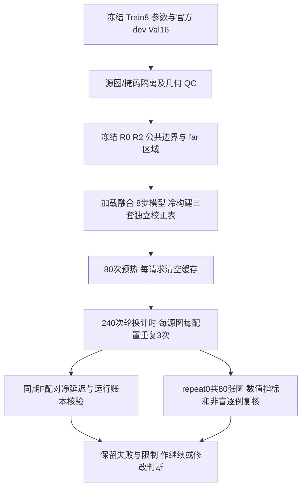
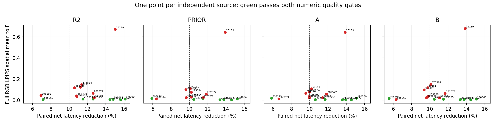
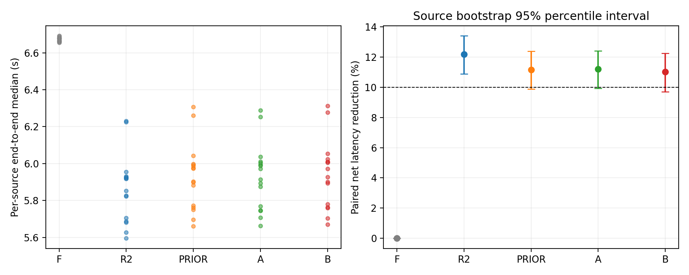
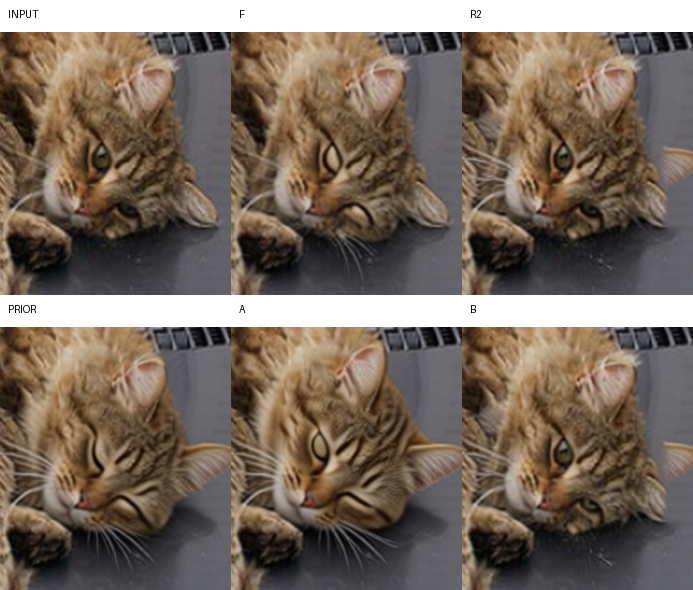
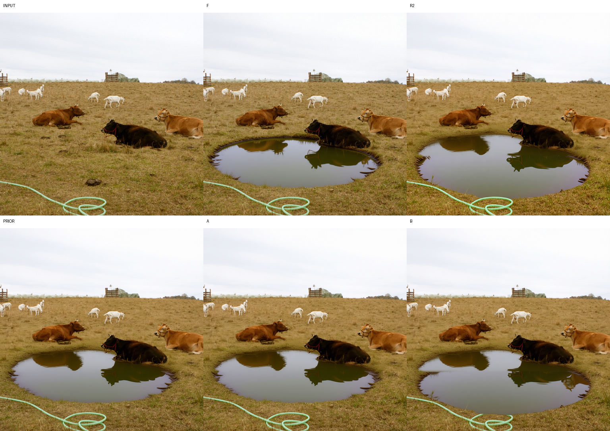
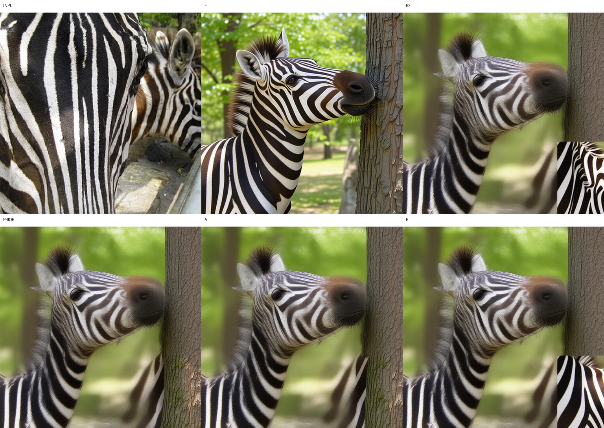
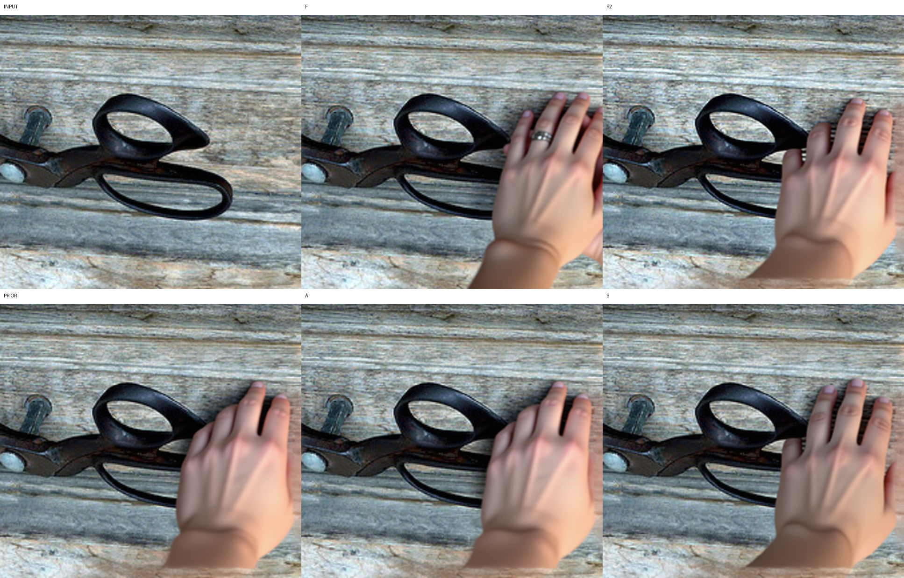

# 基于 Train8 统计校准的局部图像编辑加速：独立 Val16 闭环验证

实验日期：2026-10-23；执行环境：zeta 单卡 H800（用户确认，驱动名称 NVIDIA L20Y，计算能力 9.0，显存约 79.18 GiB）。开发仓库 `/workspace/diffusers-fix`，分支 `test/lightning8-preflight-20261022`，提交 `73faca368c0da77645ea58836aa8780d2d8c5353`。研究代码留在 `research/`，未提交或发布。

## 摘要

本轮以冻结的 Train8 校准结果为输入，在独立的 MagicBrush 官方 dev 首轮 16 个源图上比较 F、R2、PRIOR、A、B。研究问题是：小样本统计校准能否把缓存空间的近似改善转化为闭环编辑质量改善，并保留真实部署路径的净节时。实际完成320请求、2560次DiT，0推理失败、0额外教师调用。R2净节时12.18%，PRIOR/A/B分别11.17%/11.21%/11.01%；四候选均仅7/16例通过固定数值质量门槛，其中同时逐例节时≥10%的为6/16。猫例的数值通过仍伴随R2/B漏编辑。B相对R2在14/16例降低LPIPS，但未优于无样本先验或增加联合通过数。当前结论为**Revise：单卡执行可行，当前小样本Value校准不足以实现稳定高保真局部加速**。Test仍封存，未启动梯度训练或RL。

## 1 研究假设与对照意义

F 为原生全量 8 步 Lightning 编辑结果；R2 为首尾全量、中间六步仅更新标注外包框加两格 halo 的目标 token。条件图和文本始终更新。PRIOR、A、B 使用相同 R2 执行范围，唯一干预是陈旧 Value 的读取方式。这里的 B 是直接拟合的校准路线，与前序预算实验中的 B125/B250/B500 名称无关。

PRIOR→A 的比较检验真实 img_norm1 统计量能否改善解析通道校正；R2→B 检验逐通道原始 Value 回归的闭环收益；PRIOR→B 和 A→B 区分无样本解析先验与小样本拟合。五组使用相同源图、指令、初始 latent、scheduler、精度和步数。所有收益均相对本轮同期的全量 8 步 F，不混入原版 50 步到 Lightning 8 步的收益。

本轮没有主模型梯度更新。所谓“小样本”具体指上一阶段 8 张源图的统计校准，不能写成已经完成了 Qwen 主模型微调或强化学习训练。

## 2 算法与闭环差异

令目标 token 的真实刷新时间戳为 a(j)，当前步为 t。首尾步全量，中间步更新集合为 R2；被选中 token 的 K/V、隐藏传播与 velocity 使用当前计算，未选中 token 复用缓存。校正路线对临时读取的原始 Value 执行

\[
\widetilde{V}_{\ell,j}^{t}
=\alpha_{\ell,t,a(j)}\odot V_{\ell,j}^{a(j)}
+\beta_{\ell,t,a(j)}. \tag{1}
\]

新鲜 token 的对角系数为 α=1、β=0；未观测时间对亦退回恒等映射。预测读取值不回写原始缓存，a(j) 只在真实重计算时改变。K 和目标隐藏状态的陈旧性并未因此消失。

A 和 PRIOR 在冻结隐藏特征、对角协方差近似下利用时间调制和 Value 投影构造通道系数。记 u_t 为调制 scale+1，W 为 Value 投影矩阵，c_t 为调制 shift 经带偏置 Value 投影后的结果；锚点特征均值和方差分别为 μ_s、σ²_s。对输出通道 d，

\[
\alpha_{t,s,d}=
\frac{\sum_k W_{dk}^{2}u_{t,k}u_{s,k}\sigma_{s,k}^{2}+\lambda_s}
{\sum_k W_{dk}^{2}u_{s,k}^{2}\sigma_{s,k}^{2}+\lambda_s},
\quad
\beta_{t,s}=c_t+W(u_t\odot\mu_s)
-\alpha_{t,s}\odot[c_s+W(u_s\odot\mu_s)]. \tag{2}
\]

实现中的正则项按锚点输出方差的通道均值缩放，具体计算与 SHA 固定在 `value_channel_correction.py`；PRIOR 取 μ=0、σ²=1，A 只把锚点统计换成 Train8 矩。

B 直接使用上一阶段在未校正 R2 学生当前输入状态上采集的密集影子 Value。每张训练源图在每层固定抽取 128 个非活跃位置，聚合一阶/二阶矩；源图等权，而非按 token 数给大区域样本更高权重。对旧 Value x 与当前密集 Value y：

\[
\alpha=\frac{\operatorname{Cov}(x,y)+\lambda}{\operatorname{Var}(x)+\lambda},
\qquad \beta=\mathbb{E}[y]-\alpha\mathbb{E}[x],
\qquad \lambda=0.01\,\operatorname{mean}_d\operatorname{Var}(x_d)+10^{-12}. \tag{3}
\]

系数覆盖 60 层、6 个局部步相对于 anchor=0 的时间对；参数未基于 Val16 更新。Train8 留一代理 SSE 的约 10.98% 相对改善只是前置证据。密集影子在相同当前输入状态上取标签，独立全量 F 则沿自身轨迹生成；B 部署后还会改变后续学生状态。因此，代理改善不必然带来相对 F 的闭环图像改善。

## 3 数据、区域与计量

使用已冻结的 16 个官方 dev 首轮源图，无替换、无按输出质量剔除。与 Train8 及旧三图进行原始/RGB SHA 与 aHash/dHash 检查，并核对 Val 内部 120 对，全部通过，未出现待处理灰区。16 例 R2 目标占比为 3.49%–54.59%；该比例是活跃目标 token 的比例，既不是完整模型 FLOPs 比，也不是延迟预测。

只读取 pinned revision 的源图、掩码和元数据，不读取 target_img 列或 Test 媒体。透明掩码采用已验证的 alpha<255 保守解码，正区外包框投影到目标 16px 网格得到 R0，R0 外扩两格得到 R2。公共边界和 far=~R2 在生成前冻结，SHA256=`e2dec94c03999e6077e3e21f64f1731c619ebbed7bfd6c706ed10d422d90d660`。这里仍是标注辅助验证，尚未测量自动语义识别和动态扩边成本。

质量只评每组第一次正式测量输出，独立源图数为 16，输出数为 80；预热和重复不扩充质量样本量。LPIPS Alex spatial=True、normalize=True 先在完整 RGB 图上计算，再分区域平均。另报 PSNR、SSIM、MAE、公共 band2、远背景及边界梯度误差。源图按 Lanczos 缩放到评价画布，五组采用同一参照。

数值门槛逐例固定为 LPIPS(候选,F)≤0.02 且 extraBG≤1/255。extraBG 是候选相对源图的远背景 MAE 减去 F 对应 MAE；负值不能解释为更正确。F 是计算参考，不是指令正确性真值。

计时从内存源图和给定 ROI 到 PIL，包含索引准备、编码、8 次 DiT、校正读取/检查、scheduler、解码和缓存清理。模型装载、静态构表、初始 latent 生成、文件读写和评价不计入，冷启动单独报告；不扣除候选运行时额外成本。对源图 i、重复 r、配置 c：

\[
q_i^c=\exp\left[\tfrac13\sum_{r=0}^{2}\log(T_{i,r}^c/T_{i,r}^{F})\right],
\qquad S_c=1-\exp\left[\tfrac1{16}\sum_{i=1}^{16}\log q_i^c\right]. \tag{4}
\]

节时区间按源图重采样 10000 次、seed=2026102304，报告描述性 percentile95%；通过率另报 Wilson95%。区间不涵盖其他生成种子、硬件或新数据分布，也不构成非劣效性检验。

## 4 执行过程与审计

源资产提取、区域冻结、协议、脚本和校准 SHA 在生成前留档。五组共 320 次预定请求：80 次预热、240 次正式计时，预定真实 DiT 总数 2560；无额外密集教师/影子调用。四个执行器在包装前保存同一原生 forward，独立静态表常驻；F 直接走原生计算。每请求重置 scheduler、generator、显式初始 latent 和缓存，在输出后校验真实模型时间顺序和缓存清理。

准备过程保留两类环境问题：默认导入路径下 check_ai 找不到本仓库 commands.skills，显式设置 PYTHONPATH 后完成；skills registry 查询发生 SSL 超时，使用已读本地指南。首条启动命令因 logs 目录不存在而被 shell 拒绝，Python 尚未启动；创建目录后运行冻结脚本。这些事件均为零模型调用，单列 `data/setup_attempts.json`。实际推理异常若有，由 runs_primary.jsonl 独立计数，不把失败调用藏在成功预算中。

冷启动模型加载与融合约 17.39 秒。PRIOR、A、B 表分别约 95.64、95.64、90.00 MiB，合计 281.28 MiB；实测构建分别约 0.193、0.088、0.139 秒。该数值只描述本次已加载模型下的表准备，不含模型装载，也不是通用冷启动承诺。三套表常驻时静态 allocated 约 54.10 GiB。

## 5 完整实测结果

### 5.1 总体质量与净延迟

全部320请求在北京时间16:50:38完成。80次预热、240次正式计时、2560次真实DiT；推理失败、未完成调用、影子教师均为0。80个源图×配置组的四次PNG SHA完全一致。独立账本验证、离线统计复算、模型时间/初始latent/源图/ROI/缓存年龄/QKV/MLP/执行顺序核验均通过，warnings为空。独立统计复算与原结果相差≤1e-14。

| 配置 | 跨源图中位耗时(s) | 源图等权净节时% [95%] | 均值LPIPS/F | 中位LPIPS/F | 数值质量通过 | 数值质量且逐例节时≥10% | 峰值allocated(GiB) |
|---|---:|---|---:|---:|---|---|---:|
| F | 6.6755 | 0.00 [0.00, 0.00] | 0.000000 | 0.000000 | 自身参照，非语义验收 | — | 54.95 |
| R2 | 5.8850 | 12.18 [10.88, 13.41] | 0.082066 | 0.027037 | 7/16 | 6/16 | 57.93 |
| PRIOR | 5.9378 | 11.17 [9.87, 12.38] | 0.071204 | 0.020703 | 7/16 | 6/16 | 57.93 |
| A | 5.9428 | 11.21 [9.92, 12.41] | 0.068800 | 0.020269 | 7/16 | 6/16 | 57.93 |
| B | 5.9492 | 11.01 [9.70, 12.25] | 0.078287 | 0.019269 | 7/16 | 6/16 | 57.93 |

耗时列是16个源图三次测量中位数的中位数；节时列由式(4)的同期配对比独立计算，不能拿两列中位数相除重建。四候选数值通过率均43.75%，Wilson95%为[23.10%,66.82%]；6/16只是数值质量与速度交集，**不是最终语义成功率**。猫例R2/B在交集中却没有闭眼。三种校准的节时区间下界都低于10%，不能宣称跨图稳定至少节时10%。

五配置最大单例计时CV分别约0.46%/0.68%/0.78%/0.61%/0.64%，没有因异常计时后验删除重复。局部执行峰值allocated约57.93GiB，高于F的54.95GiB：当前实现省部分计算，但仍保存密集目标KV及velocity，不是显存压缩方案。三套表共同常驻的内存环境也不能当成各配置独立部署的精确峰值。

图5：每点一个独立源图。绿色仅表示两项数值质量门槛通过；横线LPIPS=0.02、竖线节时=10%。严重失败不剔除。

图6：本轮同期端到端延迟与源图重采样区间；不是新硬件或新种子的性能保证。

### 5.2 小样本是否带来独立增量

| 比较(候选−对照) | LPIPS变小/变大源图 | 均值LPIPS差 [source95%] | 数值新增通过/丢失通过 |
|---|---|---|---|
| PRIOR_vs_R2 | 12/4 | -0.010862 [-0.021134, -0.003026] | 1/1 |
| A_vs_PRIOR | 12/4 | -0.002403 [-0.007058, 0.000732] | 0/0 |
| B_vs_R2 | 14/2 | -0.003778 [-0.008320, -0.000143] | 1/1 |
| B_vs_PRIOR | 7/9 | 0.007084 [-0.000746, 0.018371] | 0/0 |
| B_vs_A | 4/12 | 0.009487 [0.001191, 0.020475] | 0/0 |

B相对R2的参考距离改善确实存在于多数源图，但改进幅度不足以提高门槛覆盖，平均净节时还少保留约1.17个百分点。PRIOR无需样本即有更大的平均参考距离改善；A相对PRIOR的均值改善区间跨0。B相对PRIOR的均值差为正且区间跨0，未建立可靠优势；相对A在12/16例LPIPS更大。另一方面B的中位LPIPS略低于A，不能把均值差改写成B在每例、每个统计量都更差。以上均为16源图上的探索性描述，未作确认性显著性或多重比较检验。

四候选通过数量相同，**通过的不是完全相同七例**：PRIOR/A/B把308192球拍从R2数值失败变为通过，同时把565269公交站从R2通过变为失败。后者F本身未清楚执行新增站点，进一步说明参考距离不能替代语义目标。没有把不同配置的最好结果后验拼成一个新算法。

### 5.3 B的逐例结果与失败保留

| 源图 | R2活跃目标% | B中位秒 | B净节时% | B LPIPS/F | B extraBG/F | B band2 MAE/F | 数值门槛 |
|---|---:|---:|---:|---:|---:|---:|---|
| 308192 | 54.59 | 6.3115 | 5.55 | 0.015942 | -0.001275 | 0.019546 | 通过 |
| 565269 | 53.61 | 6.2762 | 6.32 | 0.004612 | 0.005076 | 0.005735 | 失败 |
| 392687 | 8.30 | 5.7624 | 13.74 | 0.005926 | 0.000298 | 0.006916 | 通过 |
| 175584 | 29.69 | 6.0084 | 10.10 | 0.150352 | 0.008980 | 0.079930 | 失败 |
| 190360 | 3.49 | 5.6696 | 15.05 | 0.009611 | 0.000458 | 0.014513 | 通过 |
| 178572 | 4.13 | 5.7034 | 14.45 | 0.002882 | -0.000957 | 0.007353 | 通过 |
| 211860 | 11.23 | 5.7800 | 13.32 | 0.004354 | 0.000702 | 0.006627 | 通过 |
| 415314 | 29.74 | 5.9714 | 10.47 | 0.008194 | -0.001254 | 0.003544 | 通过 |
| 50151 | 32.37 | 6.0047 | 9.77 | 0.118155 | -0.016127 | 0.055931 | 失败 |
| 215135 | 22.34 | 5.8941 | 11.47 | 0.008362 | -0.002023 | 0.004344 | 通过 |
| 354126 | 35.60 | 6.0530 | 9.37 | 0.096781 | -0.014268 | 0.020087 | 失败 |
| 25139 | 8.42 | 5.7589 | 13.85 | 0.678895 | -0.024316 | 0.260982 | 失败 |
| 282572 | 23.73 | 5.9017 | 11.65 | 0.064348 | -0.002055 | 0.051704 | 失败 |
| 466845 | 33.59 | 6.0246 | 9.61 | 0.024290 | 0.013388 | 0.011559 | 失败 |
| 55458 | 22.56 | 5.9270 | 11.04 | 0.022597 | 0.000524 | 0.003887 | 失败 |
| 155790 | 32.37 | 6.0097 | 9.82 | 0.037297 | 0.000301 | 0.009926 | 失败 |

斑马25139的LPIPS约0.64–0.68，是保留的严重失败，不从均值和区间中删除。B池塘175584的LPIPS=0.150352、extraBG=0.008980；手50151的LPIPS=0.118155，extraBG却为−0.016127。后者再次说明“远背景比F更接近源图”不能抵消明显结构错误。木围栏虽在缩略图上主要语义可辨，B的LPIPS=0.024290、extraBG=0.013388仍超标；定性可辨与数值高保真必须分别报告。

全80行质量和240行计时见[CSV](data/quality_val16.csv)、[逐请求时间](data/timings_val16.csv)；所有五组逐例表和PSNR/SSIM/边界等指标见[数据摘要](03_Val16数据摘要.md)与[JSON](data/summary_val16.json)。

### 5.4 净延迟的组成

下表为每配置48个正式测量的分组件CUDA event时间中位数，单位秒；只用于解释瓶颈，不能把独立中位数相加充当端到端墙钟。

| 配置 | prompt编码 | VAE编码 | DiT | VAE解码 |
|---|---:|---:|---:|---:|
| F | 0.3567 | 1.0128 | 3.6718 | 1.5916 |
| R2 | 0.3563 | 1.0134 | 2.8703 | 1.5907 |
| PRIOR | 0.3566 | 1.0128 | 2.9364 | 1.5910 |
| A | 0.3568 | 1.0121 | 2.9345 | 1.5910 |
| B | 0.3560 | 1.0123 | 2.9363 | 1.5912 |

DiT由约3.67秒降至2.87–2.94秒，但VAE编码/解码等固定部分仍约3秒，因此目标token大幅减少不能等同于整机同幅加速。B的校正/检查开销已计入，未事后扣除。320请求计时区间之和约1943.38秒（32.39分钟）；它不包含所有PNG/源文件I/O和装载，不能充当整个实验墙钟或训练成本。

## 6 失败案例与视觉复核

已完成 16 例、80 个正式 repeat0 输出的非盲助手视觉复核，先于数值指标查看。前后各 8 例分别留有结构化记录，输出、全图/crop、账本快照和 receipts 的 SHA 均已核对。该检查不是独立真人盲评，不报告正式人工准确率。完整记录见[前8例](05_前8例助手视觉复核.md)、[后8例](06_后8例助手视觉复核.md)及[80条结构化证据](data/assistant_visual_review_all16.json)。

| 样本 | 基线F与候选可观察现象 | 本轮能支持的判断 |
|---|---|---|
| 175584 池塘 | F有人工感椭圆水面；B新增水面水平拼接、近水平下缘截断，并遮挡部分水管；其他候选未见同样明确断层 | B完成添池塘的主要语义，但局部结构/接缝失真，校准并非稳定保护 |
| 190360 猫闭眼 | F仅闭一眼；R2/B仍双眼睁开；PRIOR/A双眼闭上，但头部、耳廓和姿态漂移更大 | 接近F与完成指令可以矛盾；解析先验也可能在语义上优于B，保持性代价不能忽略 |
| 25139 斑马靠树 | F重新构图形成连续斑马与树干；R2/B右下明显矩形条纹块，PRIOR/A也有不连续条纹/树干部位 | 所有候选均不能稳定完成结构一致的局部执行；小标注框不代表任务只需小范围变化 |
| 50151 门上加手 | F有延伸前臂；四个候选均新增手，但腕部在画面内部近水平截断，像浮在门板上 | 主要编辑内容出现仍可有明显边界失败，单纯Value校正未恢复邻接结构 |
| 565269 新增公交站 | F/R2/B主要把远处公交车变白，没有清楚新增站点设施；PRIOR/A小灰结构被遮挡，记uncertain | F本身不构成正确语义真值，不因与F相近宣称编辑成功 |
| 354126 玩具换鸭 | 各组出现黄鸭，但粉色/紫色毛绒仍在；F还在狗背上加鸭，A可见鸭数更少 | 各组仅部分完成，不能过滤该例或把低参考误差当完整替换 |
| 55458 移除苹果 | 各组苹果移除，但F及候选填补叶片均有明显平滑矢量感，与原照片质感不一致 | 存在继承的基线质感问题；不把它误归因为本方法独有退化 |
| 215135 木地板、466845 木围栏 | 五组主要属性修改可辨，未见明确新增硬接缝；柜体、动物等主要对象保留 | 存在可用案例，但局部成功不能覆盖上列失败 |

猪栏样例 282572 的候选躯体较模糊，栏杆遮挡下是否新增融合错误记 uncertain；网球样例 155790 的缝线短段等细节也保留 uncertain。没有为了增加失败数而把合理姿态、颜色或局部位置差异一律记错。

图1：同一正式 repeat0 的原像素裁剪，顺序为上排 INPUT/F/R2，下排 PRIOR/A/B。该例说明仅比较与F的距离可能误判指令完成度。

图2：B的池塘接缝为新增退化；F已有不自然水面感，两类问题分别记录。

图3：小框编辑涉及全局姿态与场景关系时，固定halo与Value读取校正不足。图像现象不能单独证明错误来自K、V、velocity或区域边界中的哪一项。

图4：手已生成，但邻接前臂未连贯恢复；这是“主要编辑可见”与“边界质量通过”分离的例子。

## 7 结论、限制与后续计划

本轮判定为 **Revise**。工程可行性已确认：单卡H800能完成给定ROI下的全矩阵，约11%–12%的净节时真实存在；当前算法尚不能稳定满足质量、语义/边界和≥10%节时的联合目标。统计校准值得保留为对照与组件，但没有证据把当前A/B当成已成立的主要创新或直接进入大规模训练。

这一结论限于冻结Train8、单种子、八步模型、固定R2和逐通道Value校正。不能据此否定全部小样本局部加速；也不能把“再加样本/更大MLP/RL”当作已经验证的修复。K、隐藏状态、velocity、轨迹分布与空间支撑均可能参与误差，接缝位置本身不是唯一因果证据。

当前Val16已经公开看图，后续受其启发的方案不能再次把它称为全新盲测。Train32/Val16/Test64原划分保留，Test继续封存；下一版若需要新验证，应预登记新的官方dev留出源图，不能替换本轮失败。外部真实人工盲评、多种子、自动选区与SGLang端到端实现均尚未完成。

| 后续顺序 | 具体任务 | 去留依据与费用边界 |
|---|---|---|
| 第1–2天 | C1：Train8同当前状态NONE/B0/oracle V/oracle KV注入 | 先判定Value是否有可利用因果空间；名义256 DiT，不当部署加速 |
| 首次新训练侧生成前 | 预先冻结Train16后8图的结构闭合与等token普通扩张区域 | 不根据后续终图重画，超预算也保留不可行记录 |
| 第3–5天，条件执行 | C2：仅Train8一次B0闭环补采，固定eta，混合旧/新矩拟合B1 | 用Train16后8图作训练内部探针；名义368 DiT；没有改善则不无限补采 |
| 第5–7天，条件执行 | C3：无校正R2/普通扩张/完整接触结构闭合等token对照 | 最多256 DiT，原评价区不随计算域变大而缩小；手工先验不冒称自动创新 |
| 通过机制筛查后 | 冻结下一版控制器与独立验证，补多种子/真人复核 | 不回写本轮结果，不解封Test去调参 |
| 质量收益明确后 | 先融合Value读取、减少gather/临时张量，再移植SGLang | 分别测固定表、规划、分割、校正与后端的净成本，不能由token比例外推延迟 |

三项机制实验是条件式计划，尚未执行；名义全部展开880次DiT，预热/检查/失败另计，完全相同的F/R2只有核验合同和hash后才能明确复用。完整方案及可证伪条件见[后续因果实验建议](07_结论边界与后续因果实验建议.md)。

强化学习继续后置。先在训练侧建立“源图/边界/age状态→扩边或背景刷新动作→真实质量与净延迟”的小规模动作收益表，并证明结构策略或校准有可部署增量，再考虑小动作空间的监督选择器/上下文bandit。动作可包含边界扩展、背景预算与全量回退；预算约束仍是token上限，不是延迟保证。奖励至少需要指令完成、共同边界/保持误差和实测成本，不能只奖励接近F的LPIPS，否则猫例可能鼓励保留睁眼。奖励模型自身的可靠性和推理成本也须验证；本轮没有训练actor、采集RL rollout或执行PPO。

## 8 完成情况与复现证据

数据准备、16例生成、全计时矩阵、80输出助手复核、离线GPU指标、独立CPU账本审计及CSV统计复算全部完成。运行账本和校准文件保持冻结。`data/independent_validation.json`与`data/offline_statistics_validation.json`为PASS，审计通过只代表其声明的计账/来源/计算范围，不是质量验收。

主要入口为[冻结协议](01_独立验证协议.md)、[源资产审计](source_asset_audit.md)、[完整数据摘要](03_Val16数据摘要.md)、[独立账本说明](08_独立账本与确定性验收.md)、[原始请求](data/runs_primary.jsonl)、[校准/源码预注册](data/preregistration.json)。本轮校准SHA始终为`6df60e49ca8d618c5458063a80ce5bf3a5b02b0c28c7e618b04b76733964518f`，无Val拟合、无主模型梯度步、无RL、无Test生成。
